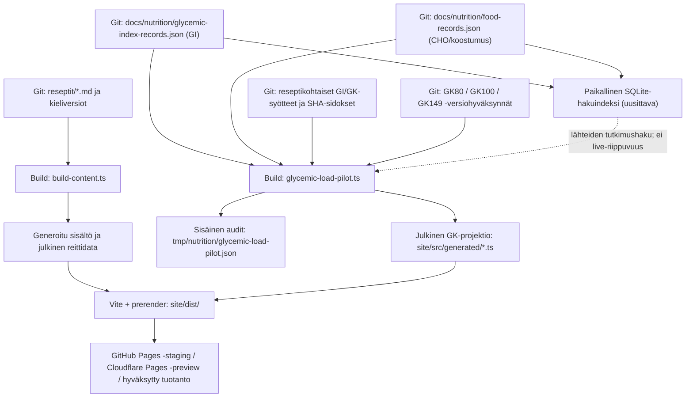

# GI/GK-arkkitehtuurin riippumaton tilanneauditointi — 13.11.2026

> **Tila: KATSELMOITAVA TUTKIMUS / EI TOTEUTUSPÄÄTÖSTÄ.** Tämä tiedosto on suunnittelun ja myöhemmän siivouksen päätösaineisto. Ei laskenta-, lähde-, tietokanta-, hyväksyntä-, julkaisu- tai Cloudflare-muutoksia. Aikataulu tarkoituksella avoin ("joskus tai jouluna").
> **Lähtömain:** `2293fd1851bad0574ae89430cb9ba1b184df6b8b`. **Rinnakkainen sisältö-PR:** #532; tähän PR:ään kuuluu vain uusia `docs/architecture/`-tiedostoja.

## 1. Tutkimuskysymys ja vastaus

**Onko GI/GK-järjestelmästä tullut monimutkainen himmeli, missä sen tieto oikeasti sijaitsee, ja mitä Cloudflareen siirtyessä tapahtuu?**

Vastaus: järjestelmässä on **eri elinkaarissa olevia tietoja ja useita historiallisen hyväksynnän adaptereita**. Lähderekisteri, paikallinen hakuvälimuisti, reseptikohtainen laskenta, versioidut hyväksynnät, staattisen sivuston julkinen sisältö ja tutkimusten arkistot on pystyttävä erottamaan. Olemassa oleva kerrosjako on perusperiaatteeltaan käyttökelpoinen, eikä tiedostojen määrä yksin todista tarpeetonta työtä.

Nykyisen julkaisuarkkitehtuurin perusteella **Cloudflare Pagesiin ei tarvitse eikä pidä viedä GI-SQLite-välimuistia**. Build lukee GI-/ravintoaine-JSOnin, tekee laskennan ja tuottaa julkiset GK-/reseptiesitykset ennen staattisen aineiston vientiä. **Cloudflare D1 -siirrolle ei ole Recipavo V1:n GK-näyttöön osoitettua käyttötarvetta.** Eri projekti, `docs/architecture/nutrition-core-vision.md`, kuvaa **tulevan yhteisen Nutrition Core -palvelun** mahdollista D1-ratkaisua. Sitä ei pidä sekoittaa tämän nykyisen GI/GK-rekisterin toteutuspäätökseen.

Tässä dokumentissa erotetaan:
- **TODENNETTU LÄHTEESTÄ:** tiedostopolku, skeema, nykyinen skriptin toiminta tai Gitissä oleva numeerinen inventaario.
- **AIEMMIN RAPORTOITU / TESTIEN SUOJAAMA:** aiempien auditointien 326/87-laskentajoukot, hyväksyntä- ja tuotantovarmennus. Niitä ei laskettu tässä uudestaan.
- **EI VIELÄ VARMENNETTU:** tuore `dist/`-artefaktin täydellinen tiedostoluettelo ja sisällön vuodottomuus, jokaisen historiallisen adapterin poistokelpoisuus, nykyisen koko julkisen kannan GK-prosentti, live-D1-bindings- ja Cloudflare-käyttömittarit.

## 2. Arkkitehtuuri: mikä on totuus ja mikä johdannainen?

**Huomio:** Kuvassa katkoviiva ei tarkoita, että `glycemic-load-pilot.ts` kutsuisi SQLitea jokaisella buildillä. Skriptin suorat lukulähteet ovat JSON-tiedostot. SQLite V1/V2 on **tutkimushakua ja evidenssin löytämistä** varten. Tämä ero on testattava, jos integraatiota myöhemmin muutetaan.

| Kerros | Todellinen omistajuus | Käyttö | Julkaistaanko suoraan? |
| --- | --- | --- | --- |
| GI-lähteet | `docs/nutrition/glycemic-index-records.json` | Lähde- ja GI-arvon inventaario | **Ei raakarekisteriä**; hyväksytyt, olennaiset lähdeviitteet saavat näkyä |
| Koostumustietueet | `docs/nutrition/food-records.json` | Syötävän osuuden, CHO:n ja makrojen lähteet | Ei koko rekisteriä |
| Täydet viitetietokannat | `fineli-release-20-reference.json`, `afcd-release-3-reference.json`, `cnf-2026-reference.json` | Build-/tutkimusviitteitä, lisenssit erikseen | Ei sellaisenaan |
| GI-haku | `site/scripts/gi_sqlite_index.py`, `gi_sqlite_evidence.py` | Välimuisti, haku, rankkaus, evidence leads | Ei SQLite-tiedostoa eikä hakuindeksiä |
| Laskentasyötteet | `glycemic-load-pilot-input.json`, `glycemic-load-recipe-bindings.json` ja katselmointipaketit | Reseptikohtainen GI/CHO-sidos | Ei raakasyötteitä |
| Hyväksynnät ja snapshotit | `gk80-*`, `gk100-*`, `gk149-*`, SHA-lukot | Suojaavat laskennan laajuutta ja historiaa | Ei hyväksyntätiedostoja raakana |
| Sisäinen GK-audit | `tmp/nutrition/glycemic-load-pilot.json` | Täysi tulos, blokkerit ja lähdenäyttö | **Ei** |
| Julkinen GK-projektio | `site/src/generated/glycemic-load-pilot.generated.ts`, `gk-only-variants.generated.ts`, `glycemic-load-filters.generated.ts` | Reseptikortit, suodattimet, GK-selitteet | **Kyllä, tarkasti rajattu projektio** |
| Julkiset reseptit | `site/public/data/`, `content.generated.ts`, `prerender.ts` | Reitti, kieli, ohje, näkyvät ravintoarvot | Kyllä, vain julkaistun lähteen mukaisesti |

**Elinkaari ja pakkaaminen:** `npm run build` suorittaa `content:sync` → tiukka `audit:nutrition` → `audit:glycemic-load` → `typecheck` → Vite → `prerender`. `build-content.ts` kirjoittaa generoituja reittipaketteja ja `glycemic-load-pilot.ts` kirjoittaa erikseen sisäisen `tmp/`-raportin sekä julkiset moduulit. `.gitignore` rajaa `.cache/`, `*.sqlite`, `*.db`, `tmp/`, `dist/` ulos Gitistä. **Gitignore ei yksin todista, ettei tieto päädy build-artefaktiin:** se on varmennettava alla olevan portin kautta.

## 3. Tarkka, lähdesidottu lähtöinventaario

Lukumäärät koskevat yllä mainittua main-SHA:ta. Rakenne ja Git-blobit löytyvät saman PR:n `gi-gk-evidence-2026-11-13.json`-tiedostosta.

| Mittari | Määrä | Merkitys ja raja |
| --- | ---: | --- |
| GI-lähderekisterin `sources` | **11** | Bibliografiset/lähdekuvaukset, ei 11 itsenäistä tutkittua ruokaa |
| GI-lähderekisterin `records` | **64** | Tietuerivejä, ei 64 riippumatonta ihmismittausta |
| `qualityTier=STRONG` | **6** | Lähteen laatuluokitus, ei automaattinen reseptikohtainen EXACT-soveltuvuus |
| `qualityTier=SUPPLEMENTARY` | **58** | Muut, usein matalan varmuuden arviot |
| `matchKind=ANALOG` | **34** | Ruoka-/valmistusanalogia; erillinen soveltuvuusarvio tarvitaan |
| `matchKind=CATEGORY_MEAN` | **17** | Ryhmäkeskiarvo ei ole nimetyn reseptin mitattu GI |
| `matchKind=EXACT` | **3** | Merkityn tiedon osuma, ei yksin riippumattoman GI-mittauksen tae |
| `matchKind` puuttuu | **10** | Vanhenevan skeeman/implisiittisen oletuksen katselmointivelka |
| `evidenceKind=HUMAN_GI` | **7** | Selkeä evidenceKind-merkintä, mutta soveltuvuus erikseen |
| `evidenceKind=PUBLISHED_IMPUTATION` | **12** | Julkaistu imputaatio; EI ihmisen GI-mittaus |
| `evidenceKind` puuttuu | **45** | Luokittelematonta historiatietoa, ei todistus mittauksen puuttumisesta |
| `calculationUse=REFERENCE_ONLY` | **4** | Ei automaattisesti laskentaan |
| `food-records.json` | **604** | Paikallinen koostumus-/tuoteotanta, ei kaikkien lähdekantojen koko |
| `glycemic-load-recipe-bindings.json` | **326** | Historiallisten reseptien syöte- ja lähdesidokset |
| `exactRecipeText` | **23** | Erilliset koko tekstin tarkkasidokset |
| `new-public-gk-pending-sources.json` | **34** | Uusien FI-julkaisujen GK-lähdelukot, eivät 34 hyväksyttyä GK-arvoa |

Rekisterissä on `foodKey + preparationKey` -pareja 60; ainakin `tomato::whole-raw` ja `potato::boiled-unspecified` esiintyvät kolmesti. **Sama avain ei välttämättä tarkoita duplikaattimittausta:** rivi voi olla erillinen GI-arvo, tuotesovitus tai tutkimuslähde. Tarvitaan havainto-ID ja viitattu alkuperäistutkimus ennen yhdistelyä.

Erityisen tärkeä erottelu: vahvimman `STRONG`-luokan kuudesta rivistä **kolme on merkitty analogiaksi, yksi ryhmäkeskiarvoksi ja kahdessa ei ole `matchKind`-kenttää**. STRONG ei siis ole sama kuin kuusi reseptikohtaista, täsmällisesti osoitettua GI-havaintoa.

Vanha `docs/nutrition/audit.json` on **25.10.2026 päivätty aikaleimattu auditointi**, ja sen inventaarion koko oli 325. Sitä ei saa käyttää nykyisen 326-rivisen jäädytetyn historian eikä nyt julkaistujen FI-reseptien lukumäärän lähteenä ilman ajantasaistamista.

## 4. GK-kattavuus ja laskennan semantiikka

Historiallisessa 326 alkuperäisreseptin GK-joukossa viimeksi varmennettu erottelu on **156 laskettua alkuperäisreseptiä ja 170 määrittämätöntä**. Historialliset erillisversiot / tutkimusannokset ovat **oma joukkonsa** (87 version tarkistesuoja useissa testeissä). Edelliset #516, #520–#531 katsoivat palauttaa ja säilyttää vanhoja tuloksia; **tämä dokumentti ei aja tuoretta GK-pilottia eikä vahvista uusia prosentteja**.

Tämän erottelun luotettava lähde on `docs/nutrition/gk-original-recipe-method.md` ja `site/scripts/glycemic-load-pilot.ts` `coverageViews`-rakenne:
- **ORIGINAL_RECIPE:** sama alkuperäinen resepti, hyväksytty GI-/CHO-soveltuvuus.
- **RECIPE_VARIANT:** oma täsmävalmistus, omat ravinto- ja hyväksyntärajat; ei alkuperäisen GK.
- **STUDY_COMPARISON:** ihmistutkimuksen annos tai vertailuskenaario; ei kotireseptin kattavuus.
- **INSUFFICIENT SOURCE DATA:** ei merkitä nollaksi eikä muuteta löydöstä laskennaksi.
- **MISSING PENDING:** uusien julkisten reseptien ilmoitettava GK-puute; tarkka lähde-SHA pidetään näkyvissä auditissa.

**Miksi lukujen sekoittaminen on vaarallista:** 236/326-aikaisempi yhdistelmäluku sisälsi alkuperäisiä ja täsmäversioita; 156/326 kuvaa alkuperäisen resepterän mittaria. Lisäksi julkisen FI-reseptikannan koko on muuttunut, joten historiallista prosenttia ei saa sellaisenaan esittää nykyisen koko sivuston kattavuutena.

**Laske puuttuva GK vain perustellusta koostumus- ja GI-näytöstä.** Uusissa päätöksissä reseptin idea ei saa muuttua GI-datan saatavuuden vuoksi; tuntematon, eräkohtainen öljyretentio tai väärä raaka/kypsäpaino on oikea esto, ei arvo 0. Laskurin toleranssi on toimituksellinen, ei kliininen virheraja.

## 5. Historialukot: suojaus vai korjausvelka?

Suojaukset ovat perusteltuja niin kauan kuin ne ehkäisevät hyväksymättömiä tulosten muutoksia. Tekstioikaisujen kasautuminen SHA-poikkeuksiksi on kuitenkin erillinen ylläpitokustannus.

**Havaitut kerrokset:**
- `site/scripts/glycemic-load-pilot.ts`: lukee peruskannan ja yhdistää GK80/100/149- ja muita sovitettuja erillisversioita; julkisen ja sisäisen näkymän raja.
- `site/scripts/approved-recipe-note-edits.ts`: tekstimuutosten tarkistettuun nykyversioon sidotut käänteissovitukset.
- `site/scripts/legacy-gk-corrections.ts`: aiempien laskentatapausten yhteensovitus.
- `site/tests/gk-legacy-reconciliation.test.ts`, `site/tests/gk149-integration.test.ts`, `site/tests/gk-history-scope.test.ts`: historialliset numeeriset ja lähdeversioiden regressioportit.
- `docs/nutrition/gk80-release-registry.json` sekä GK100/149 hyväksyntätiedostot: versionmukaiset päätökset.
- `docs/nutrition/glycemic-coverage-*`: suuri osa **päivättyjä tutkimus-/vertailutilannekuvia**, ei toinen elävä lähde.

**Todettu riski, ei todettu virhe:** useat viimeaikaiset reseptin tekstikorjaus-PR:t muuttivat sovitus- ja testikoodia. Jos hyväksyntäportti vaatii uuden käsin sidotun poikkeuksen jokaiselle harmittomalle ohjeen selvennykselle, hyväksynnän ja esityksen välillä on tarpeettoman tiukka riippuvuus. Vastakkainen riski on, että suojauksen helpottaminen huomaamatta sallii reseptin valmistusmenetelmän olennaisen muuttamisen vanhan GK:n alla.

**Tulevan muutoksen vaatimus:** historiallinen syöte pysyy muuttumattomana; toimituksellisesti hyväksytty nykyinen teksti saa oman tarkistettavan version ja soveltuvuusarvion. Ei uusia massapoikkeuksia, automaattista SHA-uudelleenkirjoitusta tai vanhan laskentatiedon hiljaista uudelleentulkintaa. Arkiston poistamiseen ei saa mennä ennen riippuvuus- ja testinäyttöä.

## 6. Cloudflareen menevien tietojen rajaus

**Nykyinen toteutus:** Vite rakentaa staattisen sivuston. `site/scripts/build-content.ts` tuottaa `content.generated.ts`, reittidataa ja `site/public/data`-tiedostoja. `site/scripts/glycemic-load-pilot.ts` tuottaa sisäisen `tmp/nutrition/glycemic-load-pilot.json`-tiedoston sekä julkiseen sovellukseen tuotavat `*.generated.ts` GK-yhteenvedot. `site/scripts/prerender.ts` kirjoittaa HTML-sivut ja hakukone-metadataa. `site/src/content/site-target.ts` erottaa GitHub Pagesin `/Reseptit/`-pohjan, Cloudflare-preview'n `/`-pohjan ja tulevan www-tuotannon.

**Turvallinen tavoite:** selain voi nähdä hyväksytyn arvon, välttämättömän lähdeviitteen, epävarmuusluokan ja puuttumisen perusteen. Selain ei tarvitse raakoja koostumuskantoja, kaikki 64 GI-tietuetta, paikallista SQLitea, historiallisia hyväksyntäpaketteja eikä sisäisiä auditointidokumentteja.

**VIELÄ TEHTÄVÄ TODENNUS (ei tämän docs-PR:n suorittama):**
1. Rakenna samasta sisällön SHA:sta GitHub Pages -staging- ja Cloudflare-root-preview-artefaktit erillisin ympäristöasetuksin.
2. Listaa `site/dist/`: tiedostopolut, koko, lähde-/lisenssitunnisteet; erottele HTML, JS, JSON, images ja meta.
3. Estä raakadatavuodot: `glycemic-index-records.json`, `food-records.json`, `glycemic-load-recipe-bindings.json`, `tmp/nutrition/*`, `*.sqlite`, `*.db`, audit- ja omistajapäätöspaketit eivät saa päätyä julkisiksi artefakteiksi.
4. Tarkista että JS-bundleen inlinetut lähde-/GI-rivit ovat vain julkaistua, käyttöehtojen mukaista reseptisivuilla näkyvää projektiota; tekstihaku yhden tiedoston nimen perusteella ei riitä.
5. Tarkista karanteenien **21 × 4 = 84** HTTP 404, hakuaineiston poissulku, sitemap, kanoniset reitit ja noindex preview'ssa.
6. Tarkista sisällön GK-tila sekä tarkka julkaisu-SHA; myös puuttuvan GK:n tulee olla puuttuva, ei numeerinen nolla.
7. Vertaa nykyiseen Pages/Cloudflare-preview -näyttöön; älä siirrä domainia tämän testin vuoksi.

**Vika, joka tätä auditointia ei ole tarkoitettu korjaamaan:** yksittäisen reseptin epävarma GI / puuttuva tuotekuva tai valmistuskokeen saanto. Nämä ovat itsenäisiä sisältö-HOLDeja.

## 7. Miksi D1 ei nyt ole ratkaisu?

| Näkökulma | Nykyinen Git + paikallinen SQLite + staattinen Pages | Mahdollinen D1 + Worker/Pages Function |
| --- | --- | --- |
| Käytettävä GK | Lasketaan buildissä, sivu näyttää hyväksytyn snapshotin | Tarvitsisi kysely-API:n tai rakennusvaiheen vientiputken |
| Lähteiden auditointi | Git-commit, blob/SHA ja reseptikohtainen hyväksyntä | Tarvitsee erillisen versionhallinta-/migratiosopimuksen |
| Offline/paikallinen toistettavuus | Koko hakuvälimuisti uudelleenrakennettava | Runtime-kysely ei ole paikallinen ilman erillistä peiliä |
| Haku ja nopeus | 64 GI-riviä; paikallinen erähaku nopea, ei näyttöpullonkaula | Kyselyt, käyttörajat, uusi vikapinta |
| Ylläpito | Yksi lähdetotuus, staattinen julkaisu | Salaisuudet, tietokannan schema, bindings, rollback, kuluseuranta |
| Julkaisun riskit | Tuttu portti, ei GI-runtime-yhteyttä | Uusi liikkuva osa juuri ennen V1:tä |
| Perusteltu myöhempi tarve | Riittää hyväksytyille valmiille resepteille | Mahdollinen reaaliaikainen haku/editointi, usean sovelluksen yhteinen hyväksytty katalogi |

Cloudflare D1 on **oikea SQLite-yhteensopiva hallittu tietokanta**, ei nykyisen paikallisen `.sqlite`-tiedoston maaginen kopio. Sitä käytetään Workers/Pages Functions -bindingin kautta; kustannukset riippuvat lukuriveistä, kirjoitusriveistä ja tallennuksesta. Viralliset nykyohjeet:
- https://developers.cloudflare.com/d1/
- https://developers.cloudflare.com/pages/functions/bindings/
- https://developers.cloudflare.com/d1/platform/pricing/
- https://developers.cloudflare.com/pages/framework-guides/deploy-anything/

**Tärkeä ei-ristiriita:** `docs/architecture/nutrition-core-vision.md` (2.11.) esittää D1:tä myöhempään usean sovelluksen Nutrition Coreen; `docs/nutrition/gi-knowledge-base-v1-plan.md` esittää Git-JSONin kanonisena GI-rekisterinä. Nämä ovat **eri tasoisia ja eri vaiheissa olevia suunnitelmia**, eivät toteutettu D1-migraatio. Tämä PR ei kumoa kumpaakaan eikä hyväksy ensimmäisen D1:tä.

## 8. Riskirekisteri ja varmennuskriteerit

| Riski | Vaaran laji | Nykyinen näyttö | Tuleva todennus ja estoehto |
| --- | --- | --- | --- |
| R1: julkinen raaka-aine-/lisenssivuoto | Korkea vaikutus | Staattinen projektio tiedostotasolla; ei `dist`-täysinventaaria | Artefaktin ja bundlejen luettelo, kielteinen vuototesti, käyttöoikeudet |
| R2: historialukkojen sivuvaikutukset | Korkea | Monta version/snapshot-sovitusta ja testitransitiota | 326 + 87 tulosten/syötteiden tarkisteet; ei automaattista korvausta |
| R3: väärä GI-vastaavuus | Korkea sisällölle | 34 analogiaa, 17 ryhmäkeskiarvoa, puutteellisia `evidenceKind`-kenttiä | Ruoka + valmistus + tutkimushavainto + reseptikonteksti |
| R4: lukujen sekoittuminen | Keskisuuri | 156/326 alkuperäinen vs hyväksytyt erillisversiot vs uudet pendingit | Julkinen erottelu, selite, kokonaiskannan vertailukelpoinen mittari |
| R5: vanha auditointi esitetään nykytilana | Keskisuuri | `audit.json` 25.10., 325-rivinen | `asOf`, lähde-SHA, arkistostatus ja omistaja |
| R6: cache/kanoninen ristiriita | Keskisuuri | SQLite käyttää JSON-SHA:ta ja uudelleenrakennusta | Vanha/puuttuva indeksitiedosto ei muuta lähdetulosta |
| R7: turha pilvidatabase | Keskisuuri operatiivinen | Reaaliaikainen GI-kysely ei ole V1:n vaatimus | D1-arvio vain erillisestä todistetusta käyttötarpeesta |
| R8: rinnakkaisen reseptityön konflikti | Keskisuuri | #532 muokkaa reseptejä/versiosidoksia | Docs-only, erillinen omistaja, rebase lukijan toimesta ennen mahdollista mergeä |

**Ei tehdä:** lähdearvon/imputoinnin muutosta; hyväksynnän massapäivitystä; GK-prosentin keinotekoista nostoa; D1-skeemaa; tietokannan siirtoa; Cloudflare-domainia, DNS:ää tai tuotantoa; sivuston toiminnallisen koodin muokkausta.

## 9. Auditoinnin rajat ja tarkistettavat väitteet

Tämä tutkimus on tehty **GitHubin lähdetiedostoista** ja aiemmista julkaisutodisteista. Se ei ole suorittanut `npm run build`-komentoa omassa ympäristössään, rakentanut SQLite-välimuistia tai ladannut Cloudflare-julkaisuartefaktia. Tämän vuoksi **julkisen tiedon rajaus on rakenteesta johdettu, ei itsenäisesti byte-for-byte todistettu**. Ajantasainen hankekohtainen GO/NO-GO-päätös jää Cloudflare-avausportille.

**Tarkastetut aikaisemmat lähteet:**
- `docs/nutrition/gi-sqlite-cache-v1.md` (V1 ja V2-haku, aiemmin mitattu eränopeus)
- `docs/nutrition/gi-knowledge-base-v1-plan.md` (tuleva lähde/havainto/soveltuvuusmalli)
- `docs/architecture/nutrition-core-vision.md` (erillinen Nutrition Core, ei toteutettu)
- `docs/nutrition/gk-original-recipe-method.md` (resepti ensisijainen, ei GK:n vuoksi muuteta)
- `site/scripts/glycemic-load-pilot.ts`, `site/scripts/build-content.ts`, `site/scripts/prerender.ts`
- `site/scripts/gi_sqlite_index.py`, `site/scripts/gi_sqlite_evidence.py`
- `site/src/content/site-target.ts`, `site/src/content/route-data.ts`
- `site/tests/gk149-integration.test.ts`, `site/tests/gk-history-scope.test.ts`
- `docs/nutrition/glycemic-index-records.json`, `food-records.json`, `glycemic-load-recipe-bindings.json`, `new-public-gk-pending-sources.json`

## 10. Ehdotus, ei toteutuskäsky

**Suositus:** säilytä staattinen Git+JSON+SQLite+build-rakenne Recipavo V1:ssä. Ensin pyydettävä tuleva työ on julkisen artefaktin tietorajojen todistus ja muutosten aiheuttaman historia-adapterivelan mittaus. Vasta sen perusteella mahdollinen suppea refaktorointi. D1:een ei siirry mitään automaattisesti.

**Päätösportit ja täsmälliset myöhemmät työpaketit:** [gi-gk-future-implementation-gates-2026-11-13.md](gi-gk-future-implementation-gates-2026-11-13.md).

**Vahvistettujen lähtötietojen JSON:** [gi-gk-evidence-2026-11-13.json](gi-gk-evidence-2026-11-13.json).
