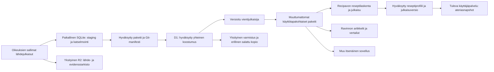

# Nutrition Core – yhteinen ravintoainetietovaranto

**Arkkitehtuuriehdotus v1, 2.11.2026. Ei toteutus- tai siirtolupaa.**

Suositus: rakennetaan sovelluksista riippumaton, lähdeversioihin sidottu ravintokoostumuksen tietovaranto ja julkaistaan siitä käyttötapakohtaiset, muuttumattomat tietopaketit. Paikallinen SQLite valmistelee ja validoi aineiston; D1 on myöhemmin hyväksyttyjen yhteisten lähdetietojen keskitetty varasto. R2 säilyttää oikeuksien sallimat alkuperäisaineistot, suuret evidenssit, viennit ja varmistukset. Recipavo ja Ravinto valitsevat oman hyväksytyn pakettiversionsa. Kumpikaan sovellus ei kirjoita yhteisiä lähdearvoja eikä tarvitse toisen sovelluksen Git-repoa tai käynnissä olevaa palvelua toimiakseen.

Tietomalli on ravintotekijöiden suhteen avoin: uuden komponentin lisääminen tarkoittaa määrittely- ja havaintorivejä, ei uutta SQL-saraketta. Eri vitamiinimuodot, mittausmenetelmät, painoperustat ja puuttuvuudet säilyvät. Tuntemattoman komponentin voi säilyttää alkuperäisessä muodossa, vaikka sen vertailukelpoinen normalisointi ei olisi vielä hyväksytty.

Tämän dokumentin hyväksyminen hyväksyy suunnan ja nimetyt rajaukset. Jokainen toteutusvaihe hyväksytään erikseen täsmälliselle versiolle. Tässä PR:ssä ei ole SQL-migraatiota, importer-koodia, tietokantaa, resurssimääritystä, uutta API:a tai henkilökohtaisia tietoja käsittelevää palvelua.

## 1. Päätösten tila ja tutkimuspohja

| Luokka | Mitä voidaan käyttää lähtökohtana |
|---|---|
| Käyttäjän asettamat vaatimukset | Yhteinen varanto usealle itsenäiselle projektille; kaikki ravintotekijät; SQLite/D1/R2/Git-roolit; versioidut viennit; ei henkilötietoja; nykyiset makro- ja GK-menetelmät säilyvät; Workers Paid on olemassa; tavoite enintään 5 USD/kk lisäkuluja koko Recipavolle. |
| Tarkistetut nykyiset tosiasiat | Reseptit main `adda64fda9bf63e69e190b6d888698587a250a2a`; erillinen tutkimusworktree. SOURCE-01 [Draft-PR #174](https://github.com/ozirix-dev/Reseptit/pull/174) HEAD `19939d95d8c93d6e93d4619d9f2510d043d246dc` on avoin Draft, ei hyväksyntä. Cloudflare [Draft-PR #172](https://github.com/ozirix-dev/Reseptit/pull/172) HEAD `1a3ba27d8b7f738d22e8a6b899bb3b0081560507` on erillinen siirtosuunnitelma. |
| Tarkistetut sovellusrajat | Reseptien neljän arvon laskenta on toimituksellinen Git-pohjainen työkalu; GK:lla on omat GI-tietueet, valmistus- ja vastaavuusrajat. Ravinto on Jekyll-artikkelisivusto FI/EN/TH-kielillä, nykyisin Markdown-taulukot. |
| Tässä ehdotetut tekniset valinnat | Alla kuvattu havaintomalli, yhteinen käsitteistö, erilliset sovellusprofiilit, yksi julkaisuvastuullinen, pakettisopimukset ja vaiheportit. Nimet ja fyysinen skeema eivät ole lukittuja. |
| Avoimet riippuvuudet | SOURCE-01:n ja kenttäkartan omistajahyväksyntä; lähdekohtaiset oikeudet ja polyolirajaukset; sovellusten vaatimat komponentit; tilin todellinen kiintiökulutus; resurssien omistajuus suhteessa PR #172:een; julkaisijan ja palautuksen vastuuhenkilöt. |
| Myöhemmät mahdollisuudet | Oma Core-repo, julkinen rajattu haku-API, laajempi aineisto, shardit, yksityinen ruokapäiväkirjapalvelu erillisenä projektina. Yksikään näistä ei sisälly tämän PR:n toteutukseen. |

SOURCE-01:n [loppuraportti](https://github.com/ozirix-dev/Reseptit/blob/19939d95d8c93d6e93d4619d9f2510d043d246dc/docs/research/source-01/README.md) ja [kenttäkartoitus](https://github.com/ozirix-dev/Reseptit/blob/19939d95d8c93d6e93d4619d9f2510d043d246dc/docs/research/source-01/field-mapping.md) ovat pohja, jota laajennetaan kaikkien ravintotekijöiden varantoon. Niiden 261/65/55-kattavuusluvut koskevat vanhempaa mainia `c5393a1`, eivät tämän dokumentin uudeksi auditoimaa nykytilaa. Mainiin on sen jälkeen yhdistetty PR #173:n muutoksia. Tässä ei ajeta uutta ravintoarvoinventaariota eikä muuteta SOURCE-01:n tuloksia.

Ravinto tarkistettiin lukevasti HEADissa `b4f618416d64198b40b4443169d1a3f77a0acf96`: [README](https://github.com/ozirix-dev/Ravinto/blob/b4f618416d64198b40b4443169d1a3f77a0acf96/README.md), [_config.yml](https://github.com/ozirix-dev/Ravinto/blob/b4f618416d64198b40b4443169d1a3f77a0acf96/_config.yml), [artikkeliohje](https://github.com/ozirix-dev/Ravinto/blob/b4f618416d64198b40b4443169d1a3f77a0acf96/docs/creating-articles.md) ja [amaranttiartikkelin taulukot](https://github.com/ozirix-dev/Ravinto/blob/b4f618416d64198b40b4443169d1a3f77a0acf96/kasvit/amarantti.md). Amaranttiartikkeli vertaa kuivia/keitettyjä siemeniä ja lehtiä sekä makroja, mineraaleja, folaattia ja A-aktiivisuutta. Se sopii myöhemmäksi vientipilotiksi, mutta nykyisiä pyöristettyjä taulukkolukuja tai USDA-yleislinkkiä ei hyväksytä automaattisesti täsmälliseksi Core-tietueeksi. Native-ID:t, versiot ja määritelmät pitää selvittää.

## 2. Vastuut ja rajat

### 2.1 Tietovaranto ja sovellukset

| Tieto tai toiminto | Omistaja / ensisijainen totuus | Sovelluksen oikeus |
|---|---|---|
| Alkuperäinen kansallinen elintarvikehavainto | Lähteen julkaisu; sallittu muuttumaton arkistokopio ja manifesti | Lukea oikeuksiensa sallimaa julkaistua versiota, ei korjata lähdearvoa paikallisesti yhteiseksi totuudeksi |
| Lähdemääritelmät, hyväksytyt normalisoinnit ja oikeuspäätökset | Nutrition Core -ylläpito ja hyväksyntämanifesti | Ehdottaa muutosta Corelle; hyväksytty revisio yhteisestä prosessista |
| Core-skeema, adapterit ja geneeriset laskentasäännöt | Core-koodin versioitu Git-kokonaisuus | Käyttää nimettyä versiota; ei ylläpitää saman yhteisen tietueen toista muokattavaa masteria |
| Reseptin sisältö, raaka-ainemäärät, valmistus ja käyttövastaavuudet | Reseptit/Recipavo Git; myöhempi master-vaihto vain erillisellä päätöksellä | Valita täsmällinen Core-tietuerevisio omaan reseptiin |
| Reseptin laskettu profiili ja sen julkaisu | Recipavon hyväksytty laskentapaketti ja julkaisumanifesti | Julkaista muuttumaton tulos, ei kirjoittaa tulosta takaisin lähteen raaka-arvoksi |
| Ravinnon artikkeli, vertailuasetelma ja lähdevalinnat | Ravinto Git | Rakentaa taulukko hyväksytystä vientipaketista, säilyttää editoriaalinen vastuu |
| GI-mittaukset, GK-sovellus ja tulkinta | Nykyinen erillinen GK-menetelmä / nimetty versio | Viitata koostumusrevisioon; koostumustietokanta ei korvaa GI-näyttöä |
| Käyttäjätili, ateria, aika, annos, terveystieto | Mahdollinen myöhempi käyttäjäpalvelu, täysin Coren ulkopuolella | Tallentaa sallittu profiilisnapshot omaan järjestelmään; ei kirjoittaa sitä Coreen |

Eri domaineilla voi olla eri master: yhteinen lähdekoostumus ja Recipavon reseptit eivät ole sama aineisto. Saman lähdehavainnon rinnakkaiset muokattavat masterit kielletään. Kuluttajien varmennetut, muuttumattomat pakettikopiot sallitaan toimintavarmuuden vuoksi; nämä eivät ole itsenäisesti päivitettäviä lähderekistereitä.

### 2.2 Looginen kokonaisuus



Kaavio on myöhempi tavoitetila. Nykyinen Git-laskenta ei siirry D1-masteriksi tämän päätöksen perusteella. Julkinen sivu käyttää ensisijaisesti oman julkaisunsa staattisia tiedostoja. R2:n yksityisiä aineistoja ei sisällytetä julkiseen pakettiin. Vientijulkaisija voi aluksi olla valvottu työkalu; pysyvää julkista Core-API:a ei tarvita.

### 2.3 Nimi ja repository

`nutrition-core` on tarkoituksenmukainen **looginen työnimi**: se ei sido varantoa yhteen sivustoon, kieleen tai neljään makroon. Nimestä ei päätellä Cloudflare-tiliä, resurssi-ID:tä, ympäristöä tai lupaa luoda kantaa. Stage/production-nimet, mahdollinen katalogi ja shardit valitaan vasta resurssipäätöksessä.

| Sijoitus | Ylläpito ja oikeudet | Riippuvuudet / arvio |
|---|---|---|
| Reseptit-repossa oma eriytetty kokonaisuus | Pienempi alkujärjestely, nykyinen guard/review käytössä. Kaikilla repo-oikeuksilla voi kuitenkin olla liian laaja näkyvyys; lähdelisenssit ja koodin lisenssi erotettava. | Sopii suunnitelmalle ja rajatulle paikalliselle pilotille. Kuluttaja ei checkouttaa Reseptit-repoa: se lukitsee julkaistun artefaktin ja sopimusversion. Core-muutos ei julkaise reseptisivustoa. |
| Oma myöhempi Core-repo | Oma julkaisu- ja käyttöoikeushallinta, riippumaton historia, versiot, ylläpitäjät ja datalisenssien kirjanpito. Uusi repo ja julkaisuprosessi lisäävät ylläpitoa. | Suositeltu pitkän aikavälin ratkaisu kahdelle itsenäiselle kuluttajalle. Koodin yhteiset osat julkaistaan versiona, ei git-submodule/live-path-riippuvuutena Reseptit-repoon. |

Ehdotus: suunnitelma säilyy nyt Reseptit-repossa. NC02:ssa omistaja päättää pilotin koodisijainnin, ja ennen Ravinnon tuotantokulutusta arvioidaan oma repo uudelleen. Oma repo ei ole NC03:n paikallisen kokeen edellytys. Jo ensimmäinen vientisopimus toimii ilman Reseptit-checkoutia ja ilman sen oletushaaran tämänhetkistä tilaa. Myöhempi eriytys säilyttää dataset-/component-/release-ID:t, historiaviitteet ja pakettihashit; uusi julkaisupaikka ei luo uusia ravintoarvoja.

Tässä ei luoda repoa, siirretä historiaa, muuteta CODEOWNERSia, lisenssiä tai CI:tä. Core-koodin lisenssi ei myönnä oikeuksia kolmannen osapuolen dataan. Rajoitettu raakadata pysyy poissa julkisesta Gitistä riippumatta valitusta reposta.

## 3. Tietomalli kaikille ravintotekijöille

### 3.1 Viisi erillistä tietotasoa

1. **Alkuperäinen lähdetietue:** lähde+release/snapshot+native food ID, tila ja muuttumattomat komponenttihavainnot.
2. **Normalisoitu komponenttihavainto:** eksplisiittinen semantiikka-, yksikkö- tai painoperustamuunnos, joka viittaa alkuhavaintoihin ja sääntöversioon.
3. **Elintarvikevastaavuus:** tarkistettu suhde kahden tuotteen/tilan tai käsitteen välillä; ei yhteinen ravintoprofiili eikä automaattinen yhdistys.
4. **Reseptin hyväksytty lähdevalinta:** sovellus/resepti/input-hash/rivi+täsmällinen lähderevisio ja laskentaan valitut havainnot, massa-/tilanäyttö.
5. **Laskettu reseptitulos:** menetelmäversio, input-hash, komponenttikohtaiset tulokset/kattavuus ja erillinen julkaisupäätös.

Tasot 1–3 kuuluvat yhteiseen lähdevarantoon. Tasot 4–5 ovat sovelluksen omistamia laskenta-artefakteja yhteisellä sopimuksella. D1 voi myöhemmin indeksoida niiden manifestiviitteitä erillisessä sovellusnimiavaruudessa; se ei tee Recipavon reseptipäätöksestä yleistä elintarviketotuutta tai Ravinnon oletusvalintaa.

### 3.2 Relaatiot ja invarianssit – looginen skeemaehdotus

Ei valmista DDL:ää. SQLite/D1-pilotissa osoitetaan tavallisilla tauluilla, avaimilla, vierasavaimilla ja indekseillä seuraava sopimus:

| Entiteetti | Keskeiset kentät / vaatimus |
|---|---|
| `source`, `source_release` | Lähdenimiavaruus; vendor version; erillinen hyväksytty snapshot/release key; julkaisu- ja hakuaika; manifesti; oikeussnapshot. UNIQUE `(source_id, release_key)`. |
| `source_asset`, `raw_occurrence` | Alkuperäinen URL, MIME, bytes, SHA-256, sallittu R2-viite, sivu/sheet/rivi; native-ID ja lähteen raw-arvot. Sama native-ID saa esiintyä ristiriitaisena stagingissa; molemmat säilyvät. |
| `source_record_revision` | UNIQUE `(source_id, release_key, native_food_id)` hyväksytyssä joukossa; revisio-ID, raw-viitteet, nimi, laji, osa, tuote, maa, valmistustila, syötävä osa ja basis. Native-ID on teksti, etunollat säilyvät. |
| `source_component_definition` | Source/release/native-component-ID tai lähteen alkuperäinen otsikko+lokaattori; määritelmä, analysoitava yhdiste, yksikkö, yksikködimensio, painoperusta, määritysmenetelmä, mitä summakomponentti sisältää. |
| `component_definition`, `component_label` | Coren pysyvä semanttinen ID + määritelmärevisio; yhdiste/isomeeri tai summan resepti; kansainväliset crosswalkit; FI/EN/SV/TH ja muut BCP 47-kieliset nimet. Uusi ravintotekijä on uusi rivi. |
| `component_mapping` | Lähdekomponenttirevisio → Core-komponenttirevisio; exact / convertible-with-rule / related-not-equivalent / unmapped; hyväksyntä ja rajoitteet. Yksikään nimi ei yksin ole muunnossääntö. |
| `unit_definition`, `basis_definition` | g/mg/µg/kJ/kcal/%/IU jne. dimensio; per 100 g edible/as-sold/prepared/dry matter/per 100 ml/per serving/per 100 g fat/per total fatty acids. Määrä, nimittäjä ja tila erillisinä. |
| `nutrient_observation` | Tietuerevisio, lähdekomponenttirevisio, observation-ID, raw-arvoteksti, desimaali tai rajat, value state, precision, n, min/max/SD/SEM jos ilmoitettu, menetelmä/source-reference. Sama komponentti voi sisältää vaihtoehtoisia menetelmiä tai mittauksia omilla ID:illään. |
| `normalization_derivation` | Input-observation-ID:t; sääntö/algoritmi ja versio; parametrit, yhtälö ja edellytykset; output-component/basis/unit; tulos; arvioija. Raaka-arvoa ei päivitetä tuloksen paikalle. |
| `food_label`, `food_concept`, `food_match` | Käännös/alias/kirjoitusasu, lähde ja tarkistustila; vapaaehtoinen käsiteryhmä; suunta, vastaavuuslaji ja perusteet. Kaksi sipulitietuetta eivät sula yhteen. |
| `rights_policy`, `rights_scope`, `review_decision` | Ehtoteksti/linkki/hash, käyttömuoto, kaupallisuus, attribuutio, muokkaus-/jakelurajat, kesto, päätös ja tarkistaja. Viite voi rajata releasea, tietuetta, havaintoa tai johdannaista. |
| `import_batch`, `approval_manifest` | Importer/parser/canonicalization/schema-versiot, aineistohashit, rivimäärät, poissulut ja päätökset. Identtinen hyväksytty paketti on no-op. |
| `dataset_release`, `export_manifest`, `revocation` | Sisältöversio, hyväksyttyjen revisioiden joukko, oikeussuodatin, tiedostohashit, superset-/osa-aineistosuhde, julkaisija sekä uutta käyttöä estävä peruutuspäätös. |
| `application_profile_reference` (myöhemmin tarpeen mukaan) | Sovellusnimiavaruus, muuttumattoman ruoka-/reseptiprofiilin ID, sopimus/menetelmä/input-versiot ja pakettiviite. Ei käyttäjätunnuksia, ateriamerkintöjä tai henkilökohtaista kulutusta. |

Yhteensopivuutta auttaa pienet normalisoidut rivit; raakaa XLSX/PDF/isoa JSON-blobia ei aseteta D1-riviksi. ISO 8601 UTC-ajankohdat tekstinä, booleanit 0/1, eksplisiittiset null-arvot. Decimal-arvo säilytetään kanonisena desimaalitekstinä ja raw-merkkijonona; täsmälaskennan desimaali-/rationaalisääntö ja pyöristys versioidaan. SQL REAL voi palvella johdettua haku-/lajitteluindeksiä, mutta ei korvaa alkuperäistä tarkkuutta tai laskentatotuutta. Lähteen ilmoittama n/min/max ei muutu samaksi populaatioksi tai luottamusväliksi pelkällä kenttänimellä.

Havaintomalli on harva: lähteen komponenttiluettelo ja tuonnin kattavuusmetadata kertovat, mitä voidaan raportoida. Jokaista puuttuvaa komponenttia ei materialisoida miljooniksi null-riveiksi. Puuttuva observation-rivi ei silti tarkoita nollaa; parserin pois jäänyt kenttä on erotettava lähteen puuttuvasta mittauksesta ja kokonaan raportoimattomasta komponentista komponenttiluettelon, raw-näytön ja tuontimäärävertailun avulla.

### 3.3 Kansainvälinen semantiikka

Käytetään omia pysyviä Core-ID:itä ja versionoitua crosswalkia esimerkiksi FAO/INFOODS-tagnimiin. Standarditunniste ei korvaa lähde-ID:tä, eikä sama yksikkö todista samaa analyysia. Jos sopivaa vertailukelpoista määritelmää ei ole vielä hyväksytty, havainto säilyy source-native-muodossa `UNMAPPED`-tilassa ja vain alkuperäisenä esitettävässä lähdekontekstissa. Sitä ei hukata eikä pakoteta yleiseen vitamiini- tai hiilihydraattikenttään. Uusi kemiallinen muoto tarvitsee metadatan ja hyväksynnän, ei SQL-saraketta. [FAO/INFOODS:n standardit ja muunnosohje](https://www.fao.org/infoods/infoods/standards-guidelines/en/).

| Komponenttiryhmä | Erillään säilytettävä merkitys / muunnosraja |
|---|---|
| Energia | Lähteen kcal ja kJ, käytetty energia-/Atwater- tai muu menetelmä. Yksikkömuunnos ei tee eri energiakaavoista samaa havaintoa; kahdesta lähteen luvusta ei valita toista pyöristysten peittämiseksi. |
| Proteiini / rasva | N×Jones, N×6.25 ja aminohapposumma eri määritelmiä; rasvan kokonaismäärä ja TAG-ekvivalentti erilliset. |
| CHO / sokerit / kuitu / polyolit | Available vs difference vs mono-equivalent; kuitumenetelmät; summien sisältämät jäsenet. Lähdekohtaiset SOURCE-01-rajaukset säilyvät. |
| A-vitamiini | Retinoli, yksittäiset karotenoidit, RE, RAE ja IU eri kentiksi. RAE/RE/IU-muunnos vaatii yhdisteen ja ravinto-/lisäravinne-kontekstin; koko A-lukua ei skaalata yhdellä yleiskertoimella. [NIH ODS](https://ods.od.nih.gov/factsheets/VitaminA-HealthProfessional/). |
| Folaatti / B12 | Luonnollinen folaatti, foolihappo ja DFE eri komponentteja; DFE-sääntö riippuu muodosta ja käytön kontekstista. B12:n muoto ja mittausmenetelmä säilytetään, biologista käyttökelpoisuutta ei päätellä kokonaisluvusta. [NIH:n folaattiohje](https://ods.od.nih.gov/factsheets/Folate-HealthProfessional/). |
| D-vitamiini | D2, D3, ilmoitettu summa ja muut metaboliitit erilleen. Varmennetun D-vitamiiniaktiivisuuden µg/IU-muunnos on eri asia kuin eri yhdisteiden tai menetelmien yhdistäminen. [NIH ODS](https://ods.od.nih.gov/factsheets/VitaminD-HealthProfessional/). |
| E- ja K-vitamiinit | Alfa-/muut tokoferolit, tokotrienolit, alfa-TE ja mahdolliset IU:t; K1 ja nimetyt menakinonit kuten MK4/MK7. Ei yleistä E-/K-summaa ilman jäsenistöä, painotusta ja hyväksyttyä sääntöä. |
| C-vitamiini ja B-ryhmä | Askorbiinihappo ja kokonais-C:n menetelmä; niasiini vs niasiiniekvivalentit ja niiden prekursorit; muut nimetyt vitamiinit/metaboliitit erillisinä. Kokonaiskomponenttia ei lisätä uudestaan sen osiin. |
| Mineraalit / hivenaineet | Ca/Mg/P/Na/K/Fe/Zn/Se/Cu/Mn/I jne. alkuaineen massa vs yhdisteen massa; suola ja natrium eivät ole yksi komponentti. Arvioitu muunnos erillisellä säännöllä. |
| Rasvahapot | Ketjupituus, kaksoissidokset ja n-3/n-6, cis/trans ja isomeeri. ALA/EPA/DHA eivät ole sama asia kuin omega-3-summa. g/100 g ruokaa, % kokonaisrasvahapoista ja g/100 g rasvaa tarvitsevat eri nimittäjän sekä tarvittaessa lähteen rasvahappokerrointa; pelkkä rasvaluku ei aina riitä. |
| Aminohapot ja muut aineet | Yksittäiset aminohapot, sterolit, orgaaniset hapot, alkoholi, bioaktiiviset yhdisteet ja myöhemmät source-native-komponentit mahtuvat samaan havaintomalliin. Ravintotekijän säilyttäminen ei tee siitä todistettua terveysvaikutusta. |

Pelkkä mg→µg on yksikköskaalaus vain samalle yhdisteelle ja basis-määritelmälle. Biologinen ekvivalentti on erillinen johdannainen, jolla on sääntöversio, konteksti ja lähde. Tarkat kertoimet otetaan myöhemmän pilotin nimettyyn sääntörekisteriin, eivät tästä taulukosta tuotantokoodiksi. Muunnosten lähdepohja: [FAO/INFOODS, Units, Denominators and Expressions v1.0](https://www.fao.org/4/i3089e/i3089e.pdf).

## 4. Puuttuvuus, tarkkuus ja laatu

### 4.1 Arvon tila ja menetelmä ovat eri ulottuvuuksia

| Arvotila | Tallennus ja laskennan oletus |
|---|---|
| `REPORTED_NUMERIC` | Raw-teksti, lähteen tarkkuus ja numeerinen desimaaliesitys; tuottamismenetelmä voi olla mitattu, laskettu tai lainattu. |
| `REPORTED_ZERO` | Lähteen julkaisema 0. Säilytetään pyöristys-/havaitsemisraja ja menetelmä. Ei automaattinen väite absoluuttisesta biologisesta nollasta. |
| `TRACE` | Lähteen trace-merkki; mahdollinen määritysraja. Ei täsmällinen 0. |
| `CENSORED` | Esim. `<0.1`: operaattori, raja ja yksikkö. Ei rajan tai nollan pistemääräksi. |
| `MISSING_MEASUREMENT` | Lähdekomponentti on olemassa mutta ruoan arvo puuttuu. |
| `COMPONENT_NOT_REPORTED` | Komponentti ei kuulu kyseisen lähdetaulukon raportoimiin tekijöihin. |
| `UNKNOWN` / `CONFLICT` | Tulkitsematon merkki, ristiriitaiset tietueet tai ratkaisematon määritelmä; pysyy pois laskettavasta pistetuloksesta. |

`derivation_method` erikseen: measured / calculated / recipe-derived / borrowed / logical-zero / estimated / unknown. Lähteen parenthesized-estimate, N-merkki, nolla ja blank käsitellään lähteen ohjeen mukaan. Aineisto voi olla oikein säilytetty ja hyväksytty source-native-havaintona mutta edelleen kelpaamaton tiettyyn normalisointiin tai reseptilaskentaan.

Laatua ei kuvata yhdellä kansallisen kannan pisteluvulla. Vähintään lähdehavainnon menetelmä, otanta/ajankohta, tuote-/tilavastaavuus, normalisoinnin varmuus, puuttuvuuden tila ja hyväksynnän laajuus erotetaan. Lyhyt julkinen laatuluokka muodostetaan näiden dokumentoidulla, versioidulla säännöllä. `AUTOMATED ONLY` ei ole ihmisen hyväksyntä; viranomaisen julkaisu ei takaa jokaisen arvon mittausmenetelmää.

### 4.2 SOURCE-01:stä säilytettävät rajaukset

- NEVO:n available-CHO sisältää polyolit mutta ei kuitua; SOURCE-01:n17 näytteestä 13 polyolinollaa oli logical-zero ja4 tarvitsi johdon lisäselvityksen. Niitä ei hyväksytä automaattisesti nykyisen yleismallin varmennetuiksi polyoleiksi.
- MEXT:n massapohjainen, monosakkaridiekvivalentti-, erotus- ja laaja CHO ovat eri komponentteja. Yksittäinen puuttuva P tai trace-kuitu voi estää juuri tarvittavan reseptilaskennan.
- CoFID 2021:n lähdekoodi 13-669 esiintyi kahdelle ruoalle. Molemmat raw-rivit säilytetään karanteenissa; ei last-write-wins- tai nimestä keksittyä korjausta. CHO/1.05 ei ole yleispätevä muunnos.
- Fridan 318-labelling-CHO voi sisältää erotusmenetelmän fallbackin; 244-polyolisumma oli kolmen vertailutietueen osalta blank. Summan osakomponenteista ei täytetä puuttuvaa koko summaa ilman kattavuusnäyttöä.
- CIQUALin 34000-polyolit eivät sisällä erytritolia. Energiakaavan oletettua nollaa ei muuteta julkaistuksi polyolihavainnoksi.
- Thai FCD:n kaupallinen lupa ja v3-sivuston/v2-PDF:n versioristiriita jäivät avoimiksi. IFCT/Korea sekä muut puutteellisesti varmistetut käyttömuodot pysyvät rajattuina pois hyväksytystä tuonnista, kunnes päätös on tehty.

Nämä ovat [PR #174:n](https://github.com/ozirix-dev/Reseptit/pull/174) tutkimushavaintoja, eivät tämän dokumentin uusia lupia tai valmiita adaptereita. Nykyisen mallin Fineli-koodeihin sidotut `componentIds`-kentät eivät ole kansainvälinen koodiavaruus: Frida 244:n tai CIQUAL 34000:n tallentaminen niihin olisi väärin. Core säilyttää molemmat nimiavaruudet ja myöhempi yhteensopivuusadapteri tuottaa nykyisen mallin hyväksymän syötteen erillisellä provenienssilla.

## 5. Lähteet, tuonti, revisiot ja oikeudet

### 5.1 Toistettava lähdeprosessi

Ehdotettu kulku: oikeus- ja versiotarkistus → sallittu capture → paikallinen staging → parser-/rakenne- ja semantiikkatarkistus → tietue/havainto/normalisointi erikseen katselmoitaviksi → hyväksytty paketti → eristetty stage-tuonti → verified-release → käyttötapaan suodatettu vienti. Toteutus tapahtuu vasta nimetyissä myöhemmissä vaiheissa.

- Tietueavain on `(source, approved-release-or-snapshot, native_food_id)`, ei pelkkä ruokanimen slug. Korjaussnapshot on nimenomainen revisio, ei jokaisen hakukellonajan tuottama uusi release.
- Bytes-hash tunnistaa ladatun tiedoston. Versionoitu semanttinen hash sisältää identiteetin, tilan/basisin, komponentit, alkuperäiset arvotekstit, yksiköt, menetelmät ja lähdeviitteet kanonisessa järjestyksessä. Käyttöliittymän tulostusajan muutos voi tuottaa uuden capture-havainnon samaan semanttiseen revisioon.
- Sama hyväksytty pakettihash uudelleen on no-op. Sama avain mutta eri semanttinen sisältö pysähtyy; parserin muutos ei saa päivittää hyväksyttyjä arvoja hiljaisesti. `import_batch` kirjaa myös hyväksytyt poissulut ja odotetut rivimäärät.
- Tarkka blob-duplikaatti voidaan tallentaa kerran **saman oikeus- ja pääsyalueen sisällä** SHA:n perusteella. Sen esiintymät, lisenssit ja lähdeviitteet säilyvät. Eri oikeusalueiden yhteinen fyysinen blob ei saa antaa laajempaa pääsyä tai sekoittaa säilytysehtoja.
- Lähteen korjauksessa syntyy uusi revisio ja `supersedes`-suhde, vanha säilyy oikeuksien mukaan. Core-tulkintavirhe korjataan uudella mapping-/derivation-/dataset-versiolla. Lähteen raw-tietuetta ei oikaista Core-arvoksi.
- Hyväksyttyyn aineistoon kohdistuva löydös merkitään vaikutuslistaan: mitä vientipaketteja, sovellusten profiileja ja laskentamenetelmiä se koskee. Kuluttaja saa peruutus-/korjausmanifestin; se ei ala hakea latest-arvoja vanhan tuloksen tilalle.
- Eri maiden samannimiset ruoat ja yhden maan erilaiset tuote-/kypsennysversiot eivät ole duplikaatteja. Fuzzy-, alias- tai vektorihaku löytää ehdokkaita, ei hyväksy niitä.

Kymmeniä tietokantoja tuetaan yhteisellä adapterisopimuksella: adapteri kuvaa source-native-kentät, puuttuvuusmerkit, menetelmät, versiokäytännön, oikeudet ja tunnetut poikkeukset. Adapteri saa tuoda kaikki laillisesti käytettävissä olevat komponentit, myös vielä mapittamattomat. Hyväksyntä ja vienti voivat silti rajautua komponentteihin/tietueisiin. Koko kannan laajuista laskentakelpoisuutta ei päätellä muutamasta näytteestä. Laajaa latausta ei tehdä ennen osoitettua käyttötarvetta, lupaa ja kapasiteettibudjettia.

### 5.2 Oikeudet tietueiden mukana

| Käyttömuoto | Mitä on nimenomaisesti selvitettävä ennen hyväksyntää |
|---|---|
| Paikallinen säilytys/tutkimus | Saako raakakopion ladata ja säilyttää; rekisteröityminen, säilytysaika ja ehdot; käyttäjä- tai organisaatiokohtainen lupa. |
| Sisäinen laskenta | Saako dataa käyttää tässä organisaatiossa, kaupallisessa sovelluksessa ja ulkoisessa laskentapalvelussa; onko D1/R2-kopio sallittu. |
| Johdannaisten julkaiseminen | Saako reseptituloksia/normalisoituja havaintoja julkaista, millä attribuutiolla, muutosten ilmoituksella ja rajoilla. Yhteenlasku ei automaattisesti poista ehtoja. |
| Raakadatan tai vastaavan paketin kaupallinen uudelleenjakelu | Saako tietuekohtaisia arvoja, suuren osajoukon tai koko kannan jakaa, millä lisenssillä ja kustannuksella. Ei johdeta latauksen maksuttomuudesta. |
| Käyttäjäpalvelun profiilisnapshot | Saako johdannaisprofiilin säilyttää käyttäjän yksityisessä historiassa ja siirtää tämän palvelun välillä; lupa on erillinen yleisestä verkkosivun näyttämisestä. |

Jokaisella vientiin käytettävällä havainnolla on ratkaistava oikeusketju: source release → mahdollinen tietue-/havaintokohtainen poikkeus → valittu muunnos → laskettu tulos → vienti/käyttötapa. Puuttuva tai päättynyt lupa tarkoittaa deny/HOLD kyseiseen käyttöön. Paikallinen lupa ei anna julkista jakelua, eikä pelkkä yksityinen bucket anna sisäistä käyttöoikeutta. Sekalähdepaketista ei tehdä kokoelmaa yhdellä harhaanjohtavalla CC-lisenssillä; osien ehdot ja lähdemerkinnät säilyvät. Paketin mukana on machine-readable policy-id:t sekä kuluttajalle näyttökelpoiset lähde-/versio-/lisenssitekstit.

Oikeuksia rajaava suodatus tehdään **ennen** julkisen paketin rakentamista; käyttöliittymän piilotus tai robots.txt ei suojaa raw-arvoja, lähdeviitteitä tai rajoitettuja blob-URL:eja. Sisäistä ja julkista vientiä ei julkaista samaan julkiseen hakemistoon. Myöhempi kielto/takedown käynnistää uuden jakelun eston ja vaikutusarvion; muuttumattomuus ei lupaa laittoman kopion säilyttämistä ikuisesti. Sallittua historiatietoa ei lasketa hiljaa uudelleen. Mahdollinen poistovelvoite ja sen vaikutus käyttäjäpalvelun historiaan ratkaistaan dokumentoidusti erillisessä prosessissa.

SOURCE-01:n käyttöehdot on tarkastettava lopulliselle aineistoversiolle ja käyttötavalle. Erityisesti NEVO:n ehdollinen käyttö, Thai-luvan tarve ja tietokantakohtainen kaupallinen edelleenjakelu säilyvät portteina. Tämä arkkitehtuurisuunnitelma ei anna lähteille yleistä juridista hyväksyntää.

### 5.3 Monikielinen haku ja vastaavuus

Haku alkaa Unicode-tekstinä sekä lähteen alkuperäisillä nimillä että tarkistetuilla käännöksillä/aliaksilla. `food_label` säilyttää kielen, kirjoitusasun, alkuperän, käännösversion ja tilan. Esimerkiksi `inkivääri`, `ginger`, `ingefära` ja `ขิง` voivat ohjata samaan käsiteryhmään, jonka sisällä tuore juuri, jauhe ja makeutettu tahna ovat edelleen erillisiä lähdetietueita. Esimerkki on hakusopimus, ei hyväksytty ravintovastaavuus.

Ensimmäinen toteutus: tarkka alias/native-ID-haku ja rajattu prefix-haku offline-muodostettuun vientihakemistoon tai ylläpidon SQLiteen. NFC-normalisointi ja kielen mukainen kirjainkoon käsittely; alkuperäinen teksti aina talteen. Ruotsin å/ä/ö tai thain merkit eivät katoa ensisijaisesta avaimesta. Kielikohtainen tokenisointi versioidaan; thain sananrajat eivät ratkea luotettavasti englannin stemmingillä. Automaattikäännös on ehdotus, ei ruokavastaavuuden hyväksyjä.

D1 tukee FTS 5:tä, mutta se ei yksin takaa kaikkien kielten sopivaa tokenisointia. Mahdollinen myöhempi FTS toteutetaan rajattuna, uudelleen rakennettavana indeksinä; räätälöitävää SQLite-laajennusta ei oleteta D1:een ladattavaksi. Perushaku toimii ilman sitä. Tuloksissa näytetään lähde, versio, maa, tuote/tila, basis ja komponenttikattavuus. Järjestys: native-ID/tarkka tarkistettu nimi → tarkistettu alias → muu ehdokas. Hakusijoitus ei ole hyväksyntä, eikä hiljaista kansallisten arvojen keskiarvoa synny. [D1:n SQL-tuki](https://developers.cloudflare.com/d1/sql-api/sql-statements/), [SQLite FTS 5:n tokenizerit](https://www.sqlite.org/fts5.html#tokenizers).

## 6. Laskenta ja ravintotekijäkohtainen kattavuus

### 6.1 Nykyinen makro- ja GK-sopimus

Nykyistä [nutrition-model.ts-mallia](https://github.com/ozirix-dev/Reseptit/blob/adda64fda9bf63e69e190b6d888698587a250a2a/site/scripts/nutrition-model.ts), neljän julkisen arvon yhteistä hyväksymis-/pidätyspolitiikkaa tai reseptikohtaisia poikkeuksia ei muuteta. Coreen tallennettu uusi B12-havainto ei muuta nykyistä makrolaskentaa. Tuleva komponenttikohtainen moottori julkaistaan uutena menetelmäversiona; sen tuloksia ei merkitä vanhan menetelmän tuloksiksi.

GK säilyy [glycemic-load-model.ts:n](https://github.com/ozirix-dev/Reseptit/blob/adda64fda9bf63e69e190b6d888698587a250a2a/site/scripts/glycemic-load-model.ts) erillisenä menetelmänä: GI-tutkimus, reference scale, valmistustila, tuotteen vastaavuus, koostumuksen saatava CHO ja rajattu poissulkunäyttö sidotaan erikseen. Core voi toimittaa täsmällisen koostumusprofiilin; se ei tuota GI-arvoa CHO-, kuitu- tai vitamiinikoostumuksesta. GI0:aa tai olemassa olevien GK-poikkeusten laajennusta ei päätellä uusista lähteistä. Nykyinen display-pyöristys ja matalan luottamuksen mallien tulkinta säilyvät.

### 6.2 Tuleva ravintotekijäkohtainen laskenta

Kullekin komponentille ja reseptiversiolle tallennetaan valitut havainnot, massaperustat, käytetyt muunnokset ja mahdolliset pois rajatut ainesosat. Kun lähtöarvo on `c_i,n` per 100 g syötävää raaka-ainetta ja tähän basis-tilaan sopiva syötävä massa `m_i`, ravintotekijän säilyvä määrä voidaan soveltuvan hyväksytyn menetelmän mukaan laskea `m_i × c_i,n /100 × r_i,n`. `r_i,n` on **ravintotekijäkohtainen** retention-kerroin ja lähdenäyttö, ei nykyisen yhden makrokertoimen automaattinen laajennus kaikille vitamiineille. Erän määrä jaetaan vasta oikealla annosmäärällä, pyöristys lopuksi.

Valmistusmallissa erotetaan:

- Syötävä osa ja kuori-/luu-/valutushävikki; tuotekohtainen kpl/dl/ml→g-näyttö. Nesteen 100 ml ei ole oletuksena 100 g.
- Saanto/yield (valmiin massan suhde lähtömassaan) ja ravintotekijän säilyminen. Veden imeytyessä massasaanto voi olla yli 1 ilman ravintoaineen lisääntymistä; pitoisuuden laimeneminen ei ole ravintoainehävikki.
- Keittämisen/paistamisen ravintotekijäkohtaiset hävikit, keitinveden tai paistorasvan poistaminen, säilyvät liemet ja tarjoilutapa. Retention-aineistolla oltava tuote-/menetelmä-/aika-/tilavastaavuus ja käyttöoikeus. Ei universaalia C-vitamiini- tai mineraalikerrointa.
- Kypsän lähdetietueen käyttö oikealla kypsäpainolla **tai** raakaprofiilin ja hyväksyttyjen valmistusmuunnosten käyttö. Sama vesi-/kypsennyshävikki ei saa tulla kahdesti mukaan.
- Ruokaan imeytynyt lisätty öljymassa omana ainesosanaan; kattilaan kaadettu kokonaismäärä ei ole syöty massa. Öljyn ravintoprofiili koskee myös sen omia komponentteja. Valmiiksi paistetun lähdetietueen sisältämää rasvaa ei lisätä uudestaan.
- Ilmoitettu retentio voi sisältää tutkimusvaihtelua; poikkeavaa yli 100% tekijää ei hiljaa leikata eikä hyväksytä. Menetelmä ratkaisee hyväksyttävyyden. Yieldille ja ravintotekijäretentiolle ei käytetä samaa yleistä 0–1-rajoitetta.

Laskentamenetelmän, retention-säännön ja ainesosamassan näyttö kuuluu samaan tuloksen provenienssiketjuun. Jos osa näytöstä puuttuu, juuri kyseisen komponentin laskentatila muuttuu. Suola ja vesi voidaan nykyisin rajata pois makroskenaariossa perustellusti, mutta suolan natrium ja veden mineraalit eivät ole mikrolaskennan yleisiä nollia. Nykyisiä makrojen poisjättörajoja ei kopioida jodille, B12:lle tai muille mikroille. [FAO/INFOODS:n food-matching-ohje](https://www.fao.org/fileadmin/templates/food_composition/documents/Nutrition_assessment/INFOODSGuidelinesforFoodMatching_version_1_2.pdf) erottaa tuotteen ja valmistustilan vastaavuuden.

### 6.3 Tuloksen kattavuus ja laatu

Jokaisella komponentilla on vähintään:

- `status`: COMPLETE / COMPLETE_WITH_BOUNDED_OMISSION / PARTIAL / NOT_CALCULABLE / WITHHELD / CONFLICT.
- Valmiiksi laskettavan kokonaisuuden `value` tai null; alkuhavainnot, basis ja yksikkö; tarvittaessa erillinen `known_contribution` ja rajat.
- Tunnettujen/pakollisten ainesosarivien määrä ja tunnettu massa/kokonaismassa, jos massat ovat tiedossa; puuttuvat rivit ja syyt. Massakattavuus ei ole ravintomäärän kattavuus: pieni suolamäärä voi ratkaista natriumin.
- Omission-policy ja dokumentoitu komponenttikohtainen yläraja, jos sellainen menetelmä on hyväksytty. Ei keksittyä yleistä mikrojen toleranssia.
- Lähde-/tuote-/menetelmä-/normalisointilaadut erillisinä, nimetty julkaisun laatusääntö, tarkistaja ja input/menetelmä/hash-sidos.

Jos proteiinin kaikki rivit ovat kelvollisia mutta B12 tai jodi puuttuu, tuleva laajennettu profiili voi esittää proteiinin COMPLETE ja B12:n NOT_CALCULABLE/PARTIAL. Nykyinen neljän makron julkaisuadapteri tarkistaa silti nykyisen koko ryhmän portin; mikrot eivät muuta sitä.

Havainnollistava esimerkki: tunnettu B12-osuus on0.8µg mutta yksi laskentaan kuuluva ainesosa on tuntematon. Tulos `value=null`, `known_contribution=0.8µg`, PARTIAL ja puuttuva rivi – ei aterian B12=0.8µg. Puuttuva pitoisuus estää yleensä koko summan nolla- tai täsmällisyysväitteen. Tunnettua summaa voi kutsua alarajaksi vain, kun menetelmä, ei-negatiivisuus, valmistus ja poissulut sen oikeuttavat. Massakattavuus ja arvioitu vaihteluväli eivät ole tilastollinen luottamusväli.

Epävarmuus esitetään lähteeseen perustuvina rajoina tai laadullisina perusteluina. Riippumattomuutta, yhteistä otantapopulaatiota tai 95% väliä ei oleteta eri maiden taulukkoarvoista. Lähteiden SD/SEM, havaittu vaihteluväli ja menetelmäpoikkeama eivät ole keskenään vaihdettavia. Eri elintarvikkeiden keskiarvo ei ole tarkemmaksi muuttunut ruoka.

## 7. Kuluttajien sopimukset ja muuttumattomat profiilit

### 7.1 Paketti ja julkaisu

Ensimmäinen rajapinta on tiedostosopimus, ei uusi verkko-API. Yhteinen hyväksytty dataset-release voidaan julkaista useana käyttötapakohtaisena osajoukkona: Recipavon tarvitsemat reseptiainekset, Ravinnon vertailuaineisto ja myöhemmän kuluttajan sallittu valikoima. Lähdedataa ei kopioida uudeksi muokattavaksi masteriksi. Täydet käyttöehdot ja tarvittavat attribuutiot kulkevat mukana myös pienessä paketissa.

Vientimanifesti sisältää ainakin:

- Sopimuksen major/minor-version, schema-version, dataset-release-ID:n, package-ID:n ja julkaisijan.
- Sisältöosoitteiset JSON/JSONL/CSV-osat, UTF 8-koodauksen, locale-riippumattomat desimaalit, MIME/bytes/SHA-256:n ja rivimäärät. CSV ei ole ainoa täydellinen esitys, koska komponentti-/provenienssiketju tarvitsee enemmän rakennetta.
- Täsmälliset komponenttimääritelmä-, source-release-, mapping-, parser- ja normalisointiversiot sekä aineiston käyttömuoto/oikeusmanifesti.
- Hyväksyntämanifestin digestin, lähdekoodin repo+commit-viitteen ja validointinäytön. Hash ei itsessään todista luotettua julkaisijaa: kuluttaja luottaa nimenomaiseen julkaisu-/hyväksyntäkanavaan, ei tuntemattomasta URL:sta saatuun checksumiin.
- Yhteensopivuus-/deprecation-tiedot, mahdolliset korvaavat/peruutetut julkaisut ja puuttuvuuden semantiikan. Laskentamenetelmän versio erikseen tiedostoskeemasta.

Semanttisesti muuttumaton komponentti-ID pysyy samana; merkityksen muuttava uusi määritys saa uuden määritelmärevision eikä vanhan ID:n hiljaista uudelleenkäyttöä. Sopimuksen rikkova yksikkö-, basis- tai kenttämerkityksen muutos on major-muutos. Kuluttaja hyväksyy vain tuntemansa sopimusversion ja määritelmän; tuntematon lisäkomponentti voidaan jättää näyttämättä mutta sitä ei tulkita lähimmäksi tunnetuksi ravinteeksi. Vanhalla varmennetulla paketilla voi jatkaa, jos uusi on yhteensopimaton tai haku epäonnistuu.

Julkaisujärjestys: candidate-paketti → kaikki osat ja oikeudet tarkistettu → verified-release → kuluttajan PR:ssä lukittu package+hash → kuluttajan hyväksytty julkaisu. Kesken olevan paketin manifestia ei mainosteta käyttökelpoiseksi. R2:n, D1:n, Gitin ja sivuston välillä ei oleteta yhteistä transaktiota. `latest` voi olla löytämisen apu, mutta build ja laskenta lukitsevat immuuttisen ID:n; selaimen sivulataus ei päivity siihen automaattisesti.

### 7.2 Neljä profiilia, neljä eri identiteettiä

| Profiili | Identiteetti ja sisältö | Muutoskäytäntö |
|---|---|---|
| Raaka-aineen koostumusprofiili | Source record revision + valitut komponenttihavainnot/mappingit/basis/oikeudet | Korjattu lähde tai mapping tuottaa uuden profiiliversion; vanha ei muutu. |
| Laskettu reseptiprofiili | Sovellus/resepti-ID + nutrition-input-hash + kaikki source-profile-ID:t + massa/retentio/method-versiot + tulokset/kattavuus | Uusi ainesosa, annosmäärä, valmistus tai menetelmä tuottaa uuden laskennan ja profiilin. |
| Julkaistu reseptiversio | Markdown-/sisältöversio, julkaisun kieli/reitti, lukittu reseptiprofiili ja julkaisumanifesti | Tekstikorjaus voi vaihtaa julkaisua vaihtamatta ravintoprofiilia; ravintosyötteen muutos vaihtaa molempien sidoksen. |
| Käyttäjän ateriasnapshot | Ulkoisessa käyttäjäpalvelussa profiilin kopio+digest, käytetty annosskaala ja jo silloin saadut komponentit/tilat/yksiköt/menetelmä/lähdeviitteet | Ei seuraa reseptin latest-versiota. Uusi tieto voidaan esittää erillisenä korjaustietona, ei historian ylikirjoituksena. |

Nykyinen `recipeNutritionInputHash` tiivistää annokset ja järjestetyt amount/unit/item/note-rivit. Tuleva mikromenetelmä tarvitsee lisäksi rakenteisen valmistusprotokollan ja hävikkitekijöiden identiteetin. Nykyisen hashin merkitystä ei muuteta samannimisenä: geneerinen calculation-input-digest on uusi, versioitu sopimus, joka sisältää nämä tai niiden muuttumattomat viitteet. Pelkkä title/slug tai Markdownin viimeisin URL ei riitä ravintoprofiilin tunnisteeksi.

Tulevan reseptiprofiilin havainnollistava osa, **keksittyä sopimusdataa, ei ravintoarvotutkimuksen tulos tai valmis JSON Schema**:

```json
{
  "contract_version": "1.0",
  "profile_kind": "recipe",
  "application": "recipavo",
  "profile_id": "illustration-only",
  "profile_digest": "<SHA-256 of canonical immutable profile>",
  "recipe_input_digest": "<versioned calculation input digest>",
  "method_version": "future-per-component-v1",
  "dataset_release_id": "<approved-core-release>",
  "basis": { "kind": "per_serving", "servings_in_batch": "4" },
  "components": [
    {
      "component_definition_id": "<approved-protein-definition-revision>",
      "unit": "g", "value": "12.50", "status": "COMPLETE",
      "coverage": { "eligible_rows": 3, "resolved_rows": 3 },
      "evidence_refs": ["<immutable-calculation-evidence>"]
    },
    {
      "component_definition_id": "<approved-B12-definition-revision>",
      "unit": "ug", "value": null, "known_contribution": "0.8",
      "status": "PARTIAL",
      "coverage": { "eligible_rows": 3, "resolved_rows": 2 },
      "missing_reason_refs": ["<unresolved-ingredient-row>"],
      "evidence_refs": ["<immutable-calculation-evidence>"]
    }
  ],
  "rights_policy_refs": ["<snapshot-storage-and-display-policy>"],
  "source_profile_refs": ["<immutable-source-profile>"],
  "approval_manifest_ref": "<reviewed-manifest>"
}
```

Kanoninen profiilihash ei sisällä käyttäjän tunnusta tai ateria-aikaa. Julkaisun capture-aikaleimat ja allekirjoitus-/jakelutiedot ovat erillisessä manifestissa, jotta saman sisällön uudelleenjakelu ei muuta profiilin identiteettiä. Käyttäjäpalvelu säilyttää varsinaisen profiilikopion tai viitekopion+kaikki tilat, skaalatun määrän, silloin käytetyn pyöristyssäännön ja digestin oikeuksiensa sallimassa laajuudessa. Pelkkä linkki uudelleenlaskettavaan URL:iin ei riitä historiaksi.

Käyttäjätunnukset, syömisajat, oireet, paino, diagnoosit tai päiväkirjamerkintöjen ID:t eivät kuulu Core-pakettiin, sen D1:een, lokiin tai hyväksyntämanifestiin. Tämä määrittelee vain ravintoprofiilin tietosopimuksen. Käyttäjäpalvelun tietosuoja, tunnistautuminen, suostumukset ja henkilökohtaiset saantisuositukset ovat erillinen myöhempi tehtävä.

### 7.3 Sovelluskohtainen käyttö

**Recipavo:** ensimmäinen vienti käyttää nykyisen makro-/GK-menetelmän hyväksyttyä rajattua profiilijoukkoa. Julkaisuadapteri säilyttää current-policy-id:n, neljän arvon portin, lähdeversiot, pidätykset ja rajatut poikkeukset. Mikrot lisätään erillisinä komponentteina vasta NC09:n hyväksytystä menetelmästä. Olennaisten ravinteiden nostot ovat versionoitu esityspolitiikka; puuttuvaa ei nosteta nollaksi tai suositukseksi.

**Ravinto:** Jekyll-build saa pienen versionoidun vientipaketin, joka voidaan hyväksytysti muuntaa artikkelin taulukoksi tai Jekyllin paikalliseksi data-aineistoksi. Valinta tehdään Ravinnon omassa myöhemmässä PR:ssä. Nykyinen artikkeli/layout/kieliversio ei muutu tässä. Vertailu näyttää kunkin maan/lähteen/tilan ja komponenttimääritelmän; vertailukelvoton RE/RAE, kuiva/kypsä tai määrittelemätön CHO ei asetu samaan numerovertailuun ilman näkyvää perustelua. Artikkelien terveysväitteiden näyttö ja toimituksellinen tarkistus ovat eri asia kuin koostumuspaketin hyväksyntä.

Kumpikaan kuluttaja ei tarvitse Core-D1-kirjoitusoikeutta. Core-julkaisun häiriö ei saa kaataa jo julkaistua sivustoa: viimeisin lukittu hyväksytty paketti ja staattiset assetit säilyvät. Kuluttajan päivitys on sen oma hyväksyttävä muutos, ei Core-lähteen päivityksen sivuvaikutus.

## 8. SQLite/D1/R2, indeksit ja kapasiteetti

### 8.1 Roolit ja julkaiseminen

SQLite sisältää kehityksen/stagingin, myös hylätyt ja keskeneräiset ehdokkaat. D1:een julkaistaan vain hyväksytty, oikeuksiltaan sallittu yhteinen aineisto ja sen auditointimetatiedot. Hyväksyntä voi tarkoittaa source-native-havainnon oikeaa säilytystä, ei vielä lupaa käyttää sitä jokaisen kuluttajan laskennassa. D1 ei ole epäselvien raakakantojen keräilyallas. R2:ssa suuret raw-assetit, sivukohtaiset evidenssit ja historiapaketit; D1:ssä niiden viitteet ja tarkistustiedot.

Aluksi yksi **looginen** Nutrition Core, pieni aktiivinen hyväksytty aineistojoukko ja erillinen stage. Ei yhtä tietokantaa per ravintotekijä eikä oletusta yhden fyysisen D1-kannan rajattomasta historiasta. Julkisella Static Assets -Workerilla ei tarvita D1-bindingiä; julkaisu/pakettivienti tekee rajatut kyselyt etukäteen. Suurempi hyväksytty tiedosto palvellaan tarvittaessa erillisenä R2-objektina oikean julkisuusrajan takaa. Pienet sivuston osajoukot voidaan sisällyttää sen omiin staattisiin assetteihin.

D1:n tämänhetkiset suunnittelurajat:10 GB/kanta Paidissa,2 MB/rivi tai merkkijono/blob,100 bound-parametria,30 s/kysely. Yksittäinen kanta käsittelee kyselyt sarjassa. Muuttujat ja ajoitetut batchit mitoitetaan näihin; ei oleteta pitkää avointa SQLite-transaktiota HTTP-kutsujen yli. Paikallisen SQLite-kokeen onnistuminen ei osoita D1:n suorituskykyä. Etäpilotissa todistetaan samat avaimet, desimaalit, puuttuvuudet ja palautus. [Cloudflaren D1-rajoitukset](https://developers.cloudflare.com/d1/platform/limits/).

D1 tukee suurta osaa SQLite-SQL:stä, FTS 5:tä ja JSON-funktioita; yhteensopivuus ei tarkoita kaikkia pragma-, extension- tai kirjoitusprotokollia. Fyysinen migraatio pidetään pieninä versionoituina askelina. Importer käyttää sidottuja parametreja ja tilapäistä erätilaa; release aktivoidaan vasta kun koko paketti ja FK-/määrä-/hash-näyttö on varmennettu. Pilkotun tuonnin keskeytys ei julkaise puolikasta releasea. [D1 SQL](https://developers.cloudflare.com/d1/sql-api/sql-statements/).

### 8.2 Kyselyt ja indeksit

| Käyttö | Ensisijainen avain/indeksi ja kyselyraja |
|---|---|
| Täsmällinen lähdetietue | UNIQUE `(source_id, release_key, native_food_id)`, erillinen revision-ID-haku; ei nimellä full scan. |
| Ruokaprofiilin komponentit | `(record_revision_id, source_component_definition_id, observation_id)`; valittu component mapping erikseen, ei SELECT-kaikki historiasta. |
| Valitun komponentin vertailu | Hyväksytyn export-viewn indeksi `(dataset_release_id, component_definition_revision, basis_id, record_revision_id)` tarpeen mukaan; vain sama semantiikka/yksikkö tai eksplisiittinen muunnos. |
| Monikielinen nimi | `(language_tag, normalized_label, record_revision_id)` ja native-ID. FTS optional; ylläpidetty julkaisusta, ei lukijan write-on-read. |
| Oikeuksien ratkaisu / julkaisu | Release/record/observation-rights-viitteet ja approval-state; vienti sallittujen ID:iden joukosta, ei käyttöliittymän filtteri. |
| Revisiovaikutus | `(input_observation_id, derivation_id)`, `(source_profile_id, application_profile_ref)` vaikutuslistan tuottamiseen. |
| Vientijoukko | Release-ID+vakaa sort key, keyset-pagination. Ei kasvavia OFFSET-fullscaneja eikä rajattomia tuloksia yhdellä kutsulla. |

Indeksit lisätään todellisten kyselyjen perusteella. NC03/NC06 mittaavat `EXPLAIN QUERY PLAN`in sekä D1:n `rows_read/rows_written`-metadatan, eivät rakenna kaikkia mahdollisia indeksejä etukäteen. Indeksien kirjoitukset ja tavut kuuluvat kustannukseen. Rajattu projektiomalli estää N+1-haun koko reseptikokoelmalle. LIKE/FTS-kyselyille asetetaan myöhemmin pituus-, sanasto- ja tulosrajat; D1:n LIKE/GLOB-kuvion 50 tavun raja huomioidaan erityisesti UTF 8-kielissä. Haku ei toimi SQL-merkkijonointerpolaationa. [Rivilaskutus](https://developers.cloudflare.com/d1/platform/pricing/).

### 8.3 Kymmenten lähteiden kapasiteetti

Kapasiteetti arvioidaan havaintoriveistä, ei vain ruokalukumäärästä. Esimerkkilaskelmat ovat suunnitteluoletuksia, eivät mitattuja tiedostokokoja:

- 2 lähdettä ×4 ruokaa ×200 komponenttia =1 600 havaintoa; määritelmät/rights/provenienssi lisäävät rivejä. Tällainen kaikki-komponentit-pilotti on pieni, mutta osoittaa semantiikan.
- 25 000 ruokaa ×150 komponenttia =3,75 miljoonaa havaintoa. Oletuksella 200 tavua/havainto ja indeksit/metadata mukaan kaksinkertaistava tekijä noin 1,5 GB aktiivista dataa; todellinen koko mitataan.
- 100 000 ×200 =20 miljoonaa havaintoa, samalla oletuksella noin 8 GB ennen stagea ja vanhoja revisioita. Täydet historialliset snapshotit sekä suuremmat provenienssit voivat ylittää 10 GB nopeasti.

Ehdotettu seuranta:6 GB aktiivista kantaa käynnistää kapasiteettipäätöksen;8 GB:n ennusteessa laajennustuonti pysähtyy, jotta migraatiolle/indekseille jää tilaa. Vanhoja lähdearvoja ei pudoteta hiljaa. Oikeuksien sallima täydellinen historiapaketti säilyy yksityisessä R2:ssa ja katalogissa on tietue-/release-hashit sekä palautus/lookup-polku. Aktiivisessa D1:ssä säilyvät kuluttajien tarvitsemat hyväksytyt täydet komponenttijoukot, eivät pelkästään makrot.

Historiallisen releasen mahdollinen siirto pois aktiivisesta D1-joukosta on näkyvä, hyväksyttävä arkistointi-/saatavuuspäätös; R2-pakettia ei esitetä välittömästi D1:stä kyseltävänä datana. Jos vaatimus on pitää kaikki hyväksytyt historiaversiot online-D1:ssä, valitaan shardeihin jako ja sille budjetti ennen rajan ylittymistä.

Jos kaikki aktiiviset hyväksytyt lähteet eivät mahdu yhteen kantaan, vaihtoehto on loogisen Coren alla lähde-/release-ryhmittelyllä jaetut D1-kannat ja pieni katalogi. Globaalit ID:t ja pakettisopimus pysyvät. Ristikkäisiä shard-FK:ita tai yhtä cross-database-transaktiota ei oleteta: offline-julkaisija validoi ja yhdistää nimetyt paketit. Tämä on NC10:n erillinen kapasiteetti-/budjettipäätös, ei ensimmäisen pilotin infrastruktuuri. Jos kustannus tai kyselytyö ei sovi D1:een, vertaillaan erikseen muuta tallennusratkaisua ennen laajennusta; kuluttajan pakettisopimus ei riipu siitä.

## 9. Suhde Cloudflare-siirtosuunnitelmaan

[PR #172:n](https://github.com/ozirix-dev/Reseptit/pull/172) kuusi siirtovaihetta ja tämän dokumentin kymmenen Nutrition Core -vaihetta ovat **eri porttiketjut**. Tässä käytetään tunnisteita NC01–NC10. Yhden suunnitelman hyväksyntä ei automaattisesti hyväksy toisen vaihetta.

PR #172:ssa on ehdotetut `reseptit-prod`/stage-D1-nimet ja Git→D1-masterin vaihdon erillinen myöhempi päätös. Tämä visio ei nimeä niitä uudelleen, luo rinnakkaista masteria tai pidennä nykyisen sivuston siirtoa kaikkien mikroravinteiden valmistumiseen asti.

Ennen NC06:ta ja ennen minkään tuotannon omistajuusvaihdon hyväksymistä tarvitaan erillinen yhteensovituspäätös:

| Vaihtoehto | Milloin sopii / ehto |
|---|---|
| Nykyinen siirtosuunnitelma ensin rajattuna, Core myöhemmin | Recipavo saa ensin nykyisen hyväksytyn snapshotin. Tuleva yhteisen lähdekoostumuksen eriytys tehdään omana migraationaan, samoilla immutable-ID:illä ja vertailulla. Core ei silloin muutu tuotantolähdemasteriksi kesken pilotin. |
| Yhteinen Core-lähdevaranto ennen ensimmäistä D1-tuotantosiirtoa | Jos NC01–NC06 ovat erikseen hyväksyttyjä ja rajattu pilotti riittää. PR #172:n resurssi-/omistajuuskohtaan tehdään myöhemmin oma hyväksytty muutos: yhteinen koostumus erilleen Recipavon sovellusprofiileista. Ei kahta hyväksyttävää write-masteria samoille havainnoille. |

Arkkitehtuurisuositus on erottaa yhteinen koostumus sovellusprofiileista, mutta ajoitusta ei lukita tällä PR:llä. Vaihtoehto valitaan main/SOURCE/GK-versioihin sidotulla omistajan päätöksellä. Kuvien R2, media-domain, vanhat URL:t, CDN ja tuotantokytkentä pysyvät PR #172:n vastuulla. Nutrition Core ei tarvitse julkista domainmuutosta, maksullista kuvamuunnospalvelua tai tuotantoliikennettä pilotin onnistumiseen.

## 10. Käyttöoikeudet, varmistus ja palautus

### 10.1 Operatiiviset roolit

Lähdekuratoija valmistelee oikeuksiltaan sallitut ehdokkaat; semantiikan tarkistaja hyväksyy havainnot/mappingit; julkaisuvastuullinen muodostaa nimetyn paketin; kuluttaja hyväksyy sen omassa projektissaan. Pienessä ylläpidossa sama ihminen voi hoitaa useamman roolin, mutta päätösten laajuus, versiot ja ajankohdat näkyvät. Ei automaattista self-approve-ketjua pelkän parserin onnistumisesta.

Stage ja tuotanto erotetaan resurssi-ID:illä ja bindingeillä. Lähdearkiston, julkisen paketin ja varmistuksen tunnukset rajataan tehtävään; julkisella Workerilla ei ole D1-kirjoitus-/arkistotunnusta eikä raw-bucket-bindingiä. Kuluttajalle jaetaan paketti, ei yhteistä ylläpitoavainta. Prefix ei yksin ole käyttöoikeusraja: eri oikeuksia tarvitsevat aineistot erotetaan bucket-/tunnusrajalla, jos alustan tarkka oikeusmalli sitä edellyttää. Stage ei saa tuotannon salaisuuksia oletuksena.

Lokeihin vain tarpeellinen erä-/release-/virhemetadata, ei rajoitettuja raw-arvoja, salaisuuksia tai käyttäjätietoja. Rajattu auditointihistoria ja tarkistajien toimija-ID:t ovat ylläpitometatietoa, eivät käyttäjien ravitsemushistoriaa. Julkaisussa tarkistetaan lisenssifiltterin lisäksi ettei tiedostoissa ole yksityisiä R2-URL:eja, signed-linkkejä tai tunnuksia.

### 10.2 Varmistusmalli

Hyödynnetään PR #172:n varmistusperiaatetta: yksi yksinkertainen ylläpidetty vientiprosessi, ei uutta rinnakkaista varmistuskehikkoa. Myöhemmässä resurssipäätöksessä sen piiriin nimetään Core-kannat ja katalogi erillisinä riippuvuuksina. Ehdotettu paketti sisältää SQL-viennin, skeema-/data-/menetelmä-/rights-versiot, hyväksyntämanifestit, lähde-/evidenssiblobien hashit ja palautukseen tarvittavat R2-objektit. Suuret muuttumattomat blobit voidaan kopioida kerran ja viitata manifesteista; täydet SQL-viennit eivät edellytä uuden delta-SQL-järjestelmän rakentamista.

| Kerros | Ehdotettu tehtävä / säilytys |
|---|---|
| D1 Time Travel | Paidin nykyinen 30 päivän palautusikkuna nopeisiin tietokantavirheisiin; ei ainoa kopio tai koko sivuston varmistus. |
| Päivittäinen SQL+manifesti yksityisessä R2:ssa | 30 vrk, eräkohtainen eheys/read-back, viimeisen onnistumisen tieto. SQL-viennin pakkaussuhde ja kestot mitataan, eivät ole kapasiteettilupauksia. |
| Kuukausipaketti | Sama prosessi, ensimmäinen onnistunut kuukausivienti,400 vrk. Coreen lisättyjen suurten aineistojen vaikutus retentioon mitataan ennen laajennusta. |
| Julkaisu-/ennen-muutosta-paketti | Palautettava yhteensopiva code+data+rules+exports-kokonaisuus;365 vrk jälkeen arvio, aktiivinen/edellinen ja riippuvuuksien vaatimat versiot suojataan. |
| Lähde- ja evidenssiarkisto | Oikeuksien ja viitteiden edellyttämä säilytys. Ei yleistä ikäpoistoa muuttumattomille mastereille tai muiden säilytettävien pakettien riippuvuuksille. |
| Salattu Cloudflaren ulkopuolinen kopio | Sama varmennettu palautuspaketti, olemassa oleva hyväksytty Proton-/muu rutiini ja erillinen offline-avain. Kohde, vastuuhenkilö ja käytettävissä oleva tila nimettävä. Ei oletettua uutta Proton-API:a. |

Lifecycle ei saa poistaa jaettua blobia, joka kuuluu edelleen säilytettävään lähde-/julkaisu-/palautusmanifestiin. Oikeuden päättyminen ja palautusriippuvuudet tarkistetaan ennen siivousta. Normaali automaattinen vanhentuminen ja poikkeuksellinen oikeusperusteinen poisto ovat eri menettelyt; kumpaakaan ei toteuteta tässä.

D1:n Time Travel ei nykyohjeen mukaan ole uuden erillisen kannan clone/fork-toiminto. SQL-vienti palautetaan testissä **erilliseen** kantaan; Time Travel -palautus olemassa olevaan kantaan vaatii oman valvotun päätöksen. Päivittäinen vienti R2:een on virallisesti mahdollinen, mutta ei tee erillisestä Cloudflare-tilin menetyksen varmistuksesta tarpeetonta. [Time Travel ja D1→R2](https://developers.cloudflare.com/d1/reference/time-travel/).

### 10.3 Palautettavuuden näyttö

Ennen ensimmäistä hyväksyttyä kuluttajavientiä tehdään lupaansa rajattu stage-palautus ja Cloudflaren ulkopuolisen kopion avaus. Sen jälkeen kuukausittainen pieni palautusharjoitus: SQL/FK/rivimäärät ja source/profile/release-hashit, oikeusmanifestit sekä muutama sovelluksen komponenttiprofiili verrataan. Tarkistetaan myös parser-/menetelmäversion saatavuus, ei vain SQL-tiedoston olemassaolo.

RPO 24 h ja RTO 4 h ovat ehdotetut tavoitteet ennen mitattua näyttöä. Uuden Cloudflare-tilin/domainhallinnan saantia tai ulkopuolisen palvelun saatavuutta ei luvata neljässä tunnissa. Yli 24 h vanha onnistunut varmistus estää uuden datajulkaisun, ei sammuta nykyistä staattista sivustoa. Vastuuhenkilö tarkistaa onnistumisen julkaisun portilla; hälytyskanava valitaan myöhemmin, eikä sitä väitetä jo toimivaksi.

Epäonnistunut datarelease: kuluttaja palaa aiempaan varmennettuun pakettiin ja yhteensopivaan staattiseen julkaisuun. Vaurioitunut kanta: palautetaan erilliseen ympäristöön ja validoidaan, vasta sitten harkitaan käyttöön kytkentää. Tilin menetys: riippumattomasta paketista uusi ympäristö ja käyttöoikeudet; sama pakettisopimus sallii väliaikaisesti paikallisen viennin. Paketin roll-back ei peruuta jo syntynyttä lisenssivelvoitetta eikä muuta käyttäjän tallentamaa ateriasnapshotia.

## 11. Kustannukset ja kasvun hallinta

### 11.1 Tavoite ja tuntematon tilikäyttö

Käyttäjän tavoite on enintään 5 USD/kk **lisää nykyisen Workers Paid -tilauksen päälle koko Recipavo-kokonaisuudelle**, ei vain Core-D1:lle. Siihen on laskettava yhteen sivusto, media, Corelle Recipavosta kohdistuva osuus, stage, varmistukset, viennit ja operaatiot. Ennen omistajan kustannusjakopäätöstä konservatiivinen tarkastelu veloittaa Recipavon budjettiin koko tässä käytetyn Core-osuuden; sitä ei jaeta Ravinnolle hiljaisesti. Core ei voi varata muiden projektien ilmaiskiintiötä itselleen.

Tässä tutkittiin julkiset hinnat, ei Cloudflare-tilin koko laskutusjakson kulutusta tai jäljellä olevia kiintiöitä. PR #172:n aiempi R2-tilannekuva ei ole nykyinen GB-month-/Class A/B-kiintiö. Hintatarkistus 2.11.2026; rahataulukot USD ennen veroja ja valuuttavaikutuksia. Ne on eriteltävä lopullisessa omistajabudjetissa. Uusi lähdelisenssi, tallennustilan lisätilaus, domain tai muu palvelukulu ei saa jäädä tavoitteen ulkopuolelle ilmoittamatta. Nykyiset jo maksetut kiinteät palvelut ja uudet lisämaksut eritellään; uusia ulkoisia maksuja ei tässä hyväksytä.

### 11.2 Tarkistetut tariffit

| Palvelu | Nykyinen tariffi ja sisältyvä osuus | Lähde |
|---|---|---|
| D1 Paid |25 miljardia luettua riviä/kk,50 miljoonaa kirjoitettua ja5 GB storage sisältyvät tilitasolla; ylitys 0.001 USD/miljoona luettua,1 USD/miljoona kirjoitettua,0.75 USD/GB-kuukausi. Indeksit kasvattavat rivejä ja kokoa. | [D1 pricing](https://developers.cloudflare.com/d1/platform/pricing/) |
| R2 Standard |10 GB-month,1 milj. Class A ja10 milj. Class B/kk sisältyvä osuus; muuten 0.015 USD/GB-month,4.50 USD/milj. A,0.36 USD/milj. B. Käyttö pyöristetään ylöspäin laskutusyksikköön. Internet-egress maksuton. | [R2 pricing](https://developers.cloudflare.com/r2/pricing/) |
| Workers Standard | Nykyiseen Paid-tilaukseen 10 milj. kutsua ja30 milj. CPU-ms/kk; ylitys 0.30 USD/milj. kutsua ja0.02 USD/milj. CPU-ms. Kutsut/CPU jaetaan tilin muun käytön kanssa. | [Workers pricing](https://developers.cloudflare.com/workers/platform/pricing/) |
| Workers Static Assets | Staattisten assetien pyynnöt ja säilytys eivät lisää Workers-veloitusta; Worker-scriptiin menevä pyyntö on eri asia. `run_worker_first` ei ole ilmainen staattinen polku. | [Static Assets billing](https://developers.cloudflare.com/workers/static-assets/billing-and-limitations/) |

Tavallinen pieni D1-kanta ei tarvitse erillistä 5 USD/kk lisätilausta per kanta. Hinnasto tuntee myös erittäin suuren tietokanta-/bucket-määrän maksut; niitä ei pidä sekoittaa tähän muutaman resurssin pilottiin. Read-replication ei ole lähtökohtainen pakollinen lisäpalvelu. R2 Standard valitaan suunnittelun lähtökohdaksi; Infrequent Accessin haku-/vähimmäissäilytysrajoja ei oleteta säästöksi ilman laskelmaa. Varmistuksen orkestrointi, logit ja mahdolliset myöhemmät palvelut tarkistetaan erikseen; Workers Logs -hinnoittelun muutos on ilmoitettu 1.12.2026 alkaen, joten myöhempi pilotti ei saa käyttää tämän päivän logitariffia tarkistamatta. [Workers-hinnoittelu ja muutosilmoitus](https://developers.cloudflare.com/workers/platform/pricing/).

### 11.3 Toistettava arvio ja skenaariot

Kuukausimittarit: D1 aktiivinen+stage+indeksit GB, luetut/kirjoitetut **rivit** (ei kyselymäärä); R2 media+raw+evidenssi+SQL+kuukausiretention keskimääräinen GB-month ja todelliset A/B-operaatiot; Workerin kutsut/CPU; varmistuksen/logien muut yksiköt. Kuvan katselu ei välttämättä ole R2 GET, mutta Class B -määrää ei pienennetä oletetulla CDN-hit-ratiolla ilman mittausta. Listaus/read-back/retry/import/index-/palautusoperaatiot lasketaan mukaan.

Kun tilin muu käyttö on `U` ja projektin uusi käyttö `P`, lisälasku on `C(U+P)−C(U)` kullekin palvelulle, ei automaattisesti `C(P)` tai nolla. Sisältyvien osuuksien ja R2:n kokonaisyksikköpyöristyksen vuoksi sama pieni projekti voi aiheuttaa eri lisälaskun eri tilillä/kuussa. Operaatio 1001 ei maksa vain 1001/miljoona hintaa, jos se avaa uuden R2:n laskutusyksikön.

Seuraava konservatiivinen **suunnittelulaskelma** ei vähennä yhtään vapaata kiintiötä ja pyöristää R2:n projektimäärät kokonaisiin laskutusyksiköihin. Se on annettujen D1/R2/Workers-määrien varovainen varaus ja nimetty suunnitteluvara muille kuluille, ei tililtä havaittu ennuste tai koko laskun absoluuttinen yläraja. Orkestroinnin/logien todellinen laskutus voi ylittää niille varatun summan ja se tarkistetaan erikseen. D1/Workers lasketaan suhteellisilla tariffimäärillä; todellinen laskutuksen yksikkökäsittely varmennetaan tililtä. Jokainen R2-luokka lasketaan erikseen.

| Kuukausioletus, koko laskelman Recipavo-osuus | A: rajattu pilotti | B: maltillinen käyttö | C: selvä kasvu |
|---|---:|---:|---:|
| D1 active+stage+indeksit GB |0.25|2|10 (esim.8+2)|
| D1 rows read |2 milj.|100 milj.|1 mrd.|
| D1 rows written, indeksit mukana |0.05 milj.|0.5 milj.|5 milj.|
| R2 total GB-month, retentio mukana |1|10|100|
| R2 Class A |5 000|50 000|1.2 milj.|
| R2 Class B |50 000|0.5 milj.|20 milj.|
| Worker-kutsut / CPU-ms |10 000 /0.1 milj.|0.1 milj. /1 milj.|1 milj. /30 milj.|
| D1-arvio USD |0.2395|2.10|13.50|
| R2-arvio USD (round-up) |4.875|5.01|17.70|
| Workers-arvio USD |0.005|0.05|0.90|
| Varmistusorkestrointi/logit: suunnitteluvaraus, ei tariffilupaus |0.02|0.05|0.10|
| **Konservatiivinen yhteensä USD/kk** |**5.14**|**7.21**|**32.20**|

Esimerkiksi A:n R2-lasku:1×0.015 + ceil(5000/1000000)×4.50 + ceil(50000/1000000)×0.36 =4.875 USD. D1:0.25×0.75 +2×0.001 +0.05×1 =0.2395. Lisätään Worker 0.005 ja varaus 0.02 →5.1395. Tämä osoittaa, miksi tavoitetta ei voi luvata ilman tilikohtaista kiintiötietoa edes pienessä pilotissa. Nollakäyttöä ei laskuteta tällä skenaariolla: tämän suunnittelutyön palvelukäyttö on0.

Jos A:ssa on **todistetusti** vähintään 5 000 A-/50 000 B-operaation vapaa osuus ja1 GB-month tilaa, vastaava R2-lisä voi olla 0. Jos myös D1/Workers-yksiköt mahtuvat todettuun jäljellä olevaan osuuteen, näiden lisä voi olla 0. Tämä on ehdollinen esimerkki, ei väite tilin tilanteesta. B voi olla alle 5 USD vain varmennetuilla osuuksilla ja/tai käyttö- ja retentiorajauksilla. C vaatii pienemmän aktiivisen aineiston, muun kapasiteettiratkaisun tai nimenomaisen suuremman budjetin.

Taulukon R2-retentio on kokonaismääräoletus. Se ei väitä että 2 GB:n D1:n30 täyttä SQL-vientiä mahtuisivat 10 GB:hen: pakattu vientikoko, kuukausikopiot, rawit ja kuvat on mitattava ja laskettava erikseen. Esimerkiksi päivittäinen pakattu 0.1 GB ×30 +kuukausi 0.1 GB ×14 =4.4 GB pelkkiä näitä SQL-kopioita, joihin muu aineisto lisätään. Pakkaussuhdetta ei luvata. Kulloinkin säilytettävät profiilit ja riippuvuudet voivat estää aiotun siivouksen.

### 11.4 Budjettiportti

Ennen NC06:ta nimetään kustannusvastuu ja luetaan tilin nykyinen käyttö/laskutusjakso, muiden projektien kuormitus sekä odotettu kuukausilisä. Kokonaisennuste 2.50 USD/kk käynnistää katselmoinnin;5 USD:ssa ei hyväksytä uusia vapaaehtoisia maksullisia laajennuksia. Nykyistä sivustoa tai varmistuksia ei katkaista säästötoimena. Nämä ovat päätösrajat, eivät automaattinen Cloudflaren laskutuskatto.

Halpa perusmalli: ei D1-kyselyä per sivulataus, pieni hyväksytty aktiivinen lähdejoukko, indeksoidut vientikyselyt, sisältöosoitteiset rawit/assetit, koottu tuonti, rajatut read-backit, yksi varmistusprosessi ja mitattu retentio. Ei erillistä maksullista hakupalvelua, Vectorizea, AI-käännösputkea, Images-tilausta tai julkista API:a ensimmäisen pilotin edellytykseksi. Kapasiteetin kasvu päätetään mitattujen tavujen, rivilukemien ja operaatioluokkien perusteella – ei vain ruokalukumäärällä.

## 12. Kymmenen erikseen hyväksyttävää toteutusvaihetta

Työmäärät ovat suunnitteluarvioita kehittäjätyöpäivinä (tp, noin 6 h); eivät tämän suunnitteluchatin ajoaika, lasku tai kustannuslupaus. Käyttöoikeuksien odotus ja omistajan katselmointi voivat pidentää kalenteria. Palvelukustannus ei sisällä kehitystyön hintaa. Pienin toimiva kokonaisuus pitää rajata ennen kunkin työn aloittamista. Alla mainitut tarkistukset ovat **tulevan toteutuksen portteja**, niitä ei ajeta tässä dokumentaatiotyössä.

| Vaihe | Riippuvuus | Pääasiallinen todiste |
|---|---|---|
| NC01 SOURCE-01 ja lähdekattavuus | PR #174:n katselmointi | Omistajan hyväksytty versio ja rajaukset |
| NC02 Yhteinen tietomalli | NC01 | Lähde-/komponentti-/oikeus-/profiilisopimus |
| NC03 Paikallinen SQLite | NC02 | Pieni toistettava paikallinen malli |
| NC04 Kaksi lähdetietokantaa | NC03 + käyttöluvat | Rajattu kaikki-komponentit-tuonti |
| NC05 Ravintotekijät ja vastaavuudet | NC04 | Hyväksytyt mappingit, tietueet ja HOLD-lista |
| NC06 Eristetty D1-pilotti | NC05 + budjetti/PR #172-yhteensovitus | SQLite/D1-pariteetti ja palautus |
| NC07 Recipavon ensimmäinen vienti | NC06 + nykyisten laskentapakettien hyväksyntä | Lukittu, yhteensopiva ravintoprofiilipaketti |
| NC08 Ravinnon tietovientipilotti | NC07 + Ravinnon oma työ-/repo-valtuutus | Riippumaton artikkelitaulukon kulutus |
| NC09 Mikroravinteiden laskenta | NC05, NC07 ja NC08 | Pieni ravintotekijäkohtainen laskentapilotti |
| NC10 Jatkokehitys | Valmiiden pilotointien arvio | Omistettu ylläpito ja hyväksytty laajennusraja |

### NC01 – SOURCE-01:n hyväksyntä ja lähdekattavuus

- **Riippuvuudet:** Draft-PR #174 ja kenttäkartoitus katselmoitu täsmällisessä SHA:ssa; PR #172:n vaiheen 1 riippuvuus tunnistettu.
- **Pienin kokonaisuus:** lähdematriisi, tarvittavat makro-/mikrokomponenttiryhmät ja ensimmäisen pilotin rajaus. Suositus tekniseen kaikki-komponentit-pilottiin Frida 5.5+MEXT, yhteensä enintään 8 ruokaa. NEVO:n laaja hakuhyöty säilyy SOURCE-01:n prioriteettina mutta logical-zero-/oikeusportti estää automaattisen käyttökelpoisuusväitteen.
- **Hyväksymiskriteerit:** SOURCE-01:n tulos- ja versiorajaus, lähdekohtaiset ehdot ja HOLD/DEFERRED-kohdat nimenomaisesti päätetty; ei yhtään hakuehdokasta hyväksytty ilman tietue-/käyttötarkistusta.
- **Työ/kustannus:**0.5–1.5 tp, ei Cloudflare-palvelukuluja. Lähdelupien mahdollinen maksu selvitetään ennen laajennusta.
- **Todellinen riski:** raportin Draft tai suuri lähdekoko tulkitaan käyttöluvaksi. Ei valmiiksi luvattua ratkaistavien reseptien lukua.
- **Palautus:** tarkennetaan rajaus, nykyiset Git-laskennat jatkuvat; mitään lähdettä ei oteta käyttöön.
- **Omistajan päätöspiste:** hyväksyy raportin/scope-version ja NC02:n valmistelun erikseen. Tämän visiodokumentin tallennus ei ole tämä hyväksyntä.

### NC02 – Yhteisen tietomallin viimeistely

- **Riippuvuudet:** NC01; Recipavon ja Ravinnon vaaditut vertailut ja komponentit.
- **Pienin kokonaisuus:** havaintopohjainen skeemasopimus, vähintään A/folaatin/rasvahapon määritelmäesimerkit, oikeusmatriisi, release/input/profile-hashit ja kuluttajasopimus. Omistajuus ja Core-koodin sijainti päätetään.
- **Hyväksymiskriteerit:** uusi komponentti ei vaadi uutta SQL-saraketta; massayksikkö/biologinen ekvivalentti/valmistus/missing/zero erottuvat; source-native-ID ja kaikki alkuarvot palautuvat; projektien write-vastuut ovat yksiselitteiset; PR #172-yhteensovitusvaihtoehto kirjattu.
- **Työ/kustannus:**2–4 tp, ei Cloudflare-palvelukuluja; ei vielä uutta repoa ellei siitä ole erillistä päätöstä.
- **Todellinen riski:** liian laaja geneerisyys tai nykyisten Fineli-enumien pakottaminen kaikille aineille; reseptiprofiilien ja lähdekoostumuksen master sekoittuu.
- **Palautus:** skeemaehdotus tarkennetaan ennen ensimmäistä kantaa; nykyinen data koskematon.
- **Omistajan päätöspiste:** hyväksyy nimettyjen sopimusten revision, alkuperäisen datan säilytyksen ja NC03:n paikallisen kokeen.

### NC03 – Paikallinen SQLite-pilotti

- **Riippuvuudet:** NC02, varmennettu erillinen kehitysalue.
- **Pienin kokonaisuus:** myöhemmin tehtävä pieni SQLite ja toistettava schema/import-batch-prototyyppi aluksi synteettisillä source-native-havainnoilla. Ei Cloudflare-tunnuksia, julkista API:a tai käyttäjätietoja.
- **Hyväksymiskriteerit:** avaimet/FK:t, kaikki komponenttityypit, desimaalit, missing/trace/zero, ID-kollisio ja idempotenssi toimivat; muuttunut sama-avain-payload pysähtyy; ensimmäiset hakukyselyt/indeksit ja export-manifesti voidaan selittää.
- **Työ/kustannus:**1–2 tp; vain paikallinen levy-/kehitystyö, ei uusia Cloudflare-maksuja.
- **Todellinen riski:** paikallisen SQLite-käyttäytymisen oletetaan todistavan D1:n rajat; parserin muutos muuttaa hiljaisesti hyväksyttyä sisältöä.
- **Palautus:** prototyyppipaketti voidaan hylätä; mikään sovellus ei riipu siitä. Säilytetään tutkimusmanifesti, poistot erillisellä luvalla.
- **Omistajan päätöspiste:** hyväksyy paikallisen näyttöpaketin ja kahden lähteen rajatun NC04-tuonnin.

### NC04 – Kahden lähdetietokannan rajattu tuonti

- **Riippuvuudet:** NC03; kummankin valitun julkaisun lataus-/säilytys-/laskentaehdot arkistoitu, sisältö- ja kaupallinen vientiraja nimetty.
- **Pienin kokonaisuus:** ehdotus Frida 4+MEXT 4 täsmällistä ruokaa, korkeintaan 8. Tuodaan näiden **kaikki saatavilla olevat komponentit ja arvotilat**, myös UNMAPPED ja mikrot; ei kokonaisia kansallisia kantoja. Valitaan ainakin raakaa/valmistettua sekä yksi yhteinen raaka-aine, jota vertaillaan ilman automaattista yhdistystä.
- **Hyväksymiskriteerit:** kaikki valittujen raw-tietueiden komponentit ja menetelmäviitteet mukana tai selitettynä poissulkuna; koodit/sheetit/versiot/hashit yhtenevät; toinen identtinen tuonti no-op; P-blank ei0; MEXT:n massa/mono/difference ja Fridan fallback erottuvat. Kaikki havaintoarvot eivät silti ole laskentaan hyväksyttyjä.
- **Työ/kustannus:**2–4 tp; paikalliset rajatut lataukset. Ei Cloudflare-resursseja tai maksullista lähdettä ilman omaa hyväksyntää.
- **Todellinen riski:** header-/käännösvirhe, eri vitamiinimuoto, tuote-/tilaväärä vastaavuus tai epäselvä lisenssi.
- **Palautus:** hylätään uusi import-batch hyväksymättä sitä, raw-näyttö säilyy sallituin ehdoin; hyväksyttyä vanhaa dataa ei ylikirjoiteta.
- **Omistajan päätöspiste:** hyväksyy valitut tuonnit tutkimushavainnoiksi ja NC05:n tarkastusjoukon. Ei reseptilaskennan tai julkisen käytön yleishyväksyntää.

### NC05 – Ravintotekijöiden ja lähdevastaavuuksien validointi

- **Riippuvuudet:** NC04, riittävä source-native-dokumentaatio ja tarkistaja.
- **Pienin kokonaisuus:** kahden lähteen komponenttikartta; yksikkö-/basis-/vitamiinimuunnosten edellytykset; vähintään 2 tietueen koko havaintojoukon manuaalinen vertailu alkuperäiseen ja kaikkien 8:n rakenne-/määrä-/puuttuvuustarkistus. Vähintään yksi FI/EN/SV/TH-aliasesimerkki ja sama-nimi-eri-tuote-hylkäys.
- **Hyväksymiskriteerit:** jokainen yhteisesti käytettävä komponentti on exact-mapping tai nimetty johdannainen; epävarmat UNMAPPED/HOLD; vertailukelvottomia RE/RAE-, AOAC/NSP- tai total/subcomponent-summia ei yhdistetä. Oikeudet erikseen source-native-säilytykselle ja valitulle viennille.
- **Työ/kustannus:**2–4 tp, paikallinen tarkistus; ei tuotanto-/Cloudflare-palvelukuluja. Toistetaan vain muuttuneen säännön kohteet ja välttämättömät regressiot.
- **Todellinen riski:** oikea numero väärässä semanttisessa kentässä; lähde-/käsiteryhmä tulkitaan täsmälliseksi ruoka- tai reseptivastaavuudeksi.
- **Palautus:** mapping/tietue jää HOLDiin; hyväksytystä paketista rajataan pois, mitään arvoa ei arvata.
- **Omistajan päätöspiste:** hyväksyy täsmällisen source/component/review-paketin sekä laskenta- ja vientirajauksen ennen NC06:ta.

### NC06 – Eristetty Cloudflare D1 -pilotti

- **Riippuvuudet:** NC05, erillinen resurssi-/oikeuslupa, tilin laskutus/kiintiöt ja koko Recipavon enintään 5 USD -ennuste tai hyväksytty poikkeama; PR #172-yhteensovituspäätös. Offsite-kohde ja avaimen vastuuhenkilö nimetty.
- **Pienin kokonaisuus:** myöhemmin luvalla luotava rajattu stage-D1 ja välttämättömät yksityiset stage-R2-paketit; vain hyväksytty NC05-osajoukko. Valvottu tuonti/vienti/palautus, ei julkisia domain- tai tuotantobinding-muutoksia.
- **Hyväksymiskriteerit:** SQLite/D1:n samat rivit, avaimet, arvotilat ja hashit; keskeytetty paketti ei aktivoidu; mitatut kysely-/rivi-/tavuluvut ja toistotuonti; SQL-palautus erilliseen testikantaan ja riippumattoman salatun kopion avaus. Pääsyrajat osoitettu.
- **Työ/kustannus:**1–2 tp; palvelukäyttö etukäteen hinnoiteltu luvun 11 mukaan, ei nollakuluoletusta. Pieni aineisto ei poista R2:n pyöristysvaikutusta.
- **Todellinen riski:** sama nimi väärällä tilillä, tuotantotunnuksen/bindingin käyttö, oikeuksien vuoto, ylittyvä kustannus, paikallisen transaktion väärä siirtäminen D1:een.
- **Palautus:** stage-release jätetään aktivoimatta, kuluttajat jatkavat nykytilassa; stage-palautusnäyttö säilytetään. Stage-resurssien myöhempi siivous omalla rajatulla luvalla, ei tuotantopoistoa.
- **Omistajan päätöspiste:** hyväksyy raportoidun pilotin, resurssi-/kustannusrajauksen ja NC07-vientikokeen. Tämä ei ole Recipavo-domainin siirtopäätös.

### NC07 – Recipavon ensimmäinen hyväksytty tietovienti

- **Riippuvuudet:** NC06 ja nykyisen menetelmän mukaisesti hyväksytty pieni resepti-/laskentajoukko. Jos uudet lähteet eivät ratkaise polyolirajoja, ei väitetä niiden tuottaneen valmista reseptiä; ensimmäinen sovellusvientipilotti voidaan rajata jo hyväksyttyihin, oikeuksiltaan sallittuihin nykyisiin profiileihin erillisellä import-/provenienssipäätöksellä. Jos tämä lisää Finelin tai muun kolmannen lähteen Core-aineistoon, sille tehdään rajattu NC04–NC06-kierros omistajan hyväksynnällä; kahden lähteen pilotin laajuus ei kasva hiljaisesti.
- **Pienin kokonaisuus:** versionoitu sallittu 1–3 reseptin ruokaprofiili-/laskentapaketti ja Recipavon erillinen yhteensopivuusadapterin pilotti. Ei kaikkien 326 reseptin migraatiota, uutta GK-menetelmää tai mikrolaskentaa.
- **Hyväksymiskriteerit:** nykyiset neljä arvoa, puuttuvuudet/withheld-tilat, pyöristykset ja GK-sidokset säilyvät täsmällisessä snapshotissa; input+source+method-hashit; kuluttaja toimii lukitulla paketilla ilman D1-kyselyä ja Reseptit-repon latest-riippuvuutta. Sopimaton paketti ei päivity sivustoon.
- **Työ/kustannus:**1–3 tp, vienti-/asset-kustannus luvun 11 kokonaisrajan sisällä. Tulevan koodimuutoksen tarpeelliset vaikutusalueen tarkistukset omassa toteutus-PR:ssä.
- **Todellinen riski:** legacy 220 arvon kaltaiset vanhan tutkimussnapshotin näyttöaukot hyväksytään siirrossa automaattisesti, tai uusi paketti ohittaa nykyiset pidätykset. Vallitseva tilanne tarkistettava uudelle mainille.
- **Palautus:** edellinen lukittu paketti ja vastaava julkaisu; nykyinen Git-menetelmä säilyy, jos master-vaihtoa ei erikseen hyväksytty.
- **Omistajan päätöspiste:** hyväksyy ensimmäisen vientiversion ja rajatun sovellusintegraation. Tuotantoliikenteen siirto ja main/merge/deploy ovat omat päätöksensä PR #172:n mukaisesti.

### NC08 – Ravinto-projektin tietovientipilotti

- **Riippuvuudet:** NC07, Ravinnon oma valtuutettu worktree/PR, käyttöoikeus valittuihin havaintoihin; Core-repon sijainnin ja riippumattoman jakelun uudelleenarvio.
- **Pienin kokonaisuus:** yksi artikkelin vertailutaulukko, esimerkiksi amarantin kuiva siemen/keitetty siemen/lehti. Täsmälliset lähdetietueet ja minimaalinen FI/EN/TH-esitys; ei koko sivuston uudelleenkirjoitusta tai Coreen siirrettävää artikkelikoodia.
- **Hyväksymiskriteerit:** Ravinto voi käyttää hyväksyttyä pakettia ilman Reseptit-checkoutia tai Recipavon palvelua; lähde/versio/komponentin määritelmä ja Ei tietoa -tila näkyvät; nykyisiä taulukkolukuja ei hyväksytä vain nimivastaavuudella. Kuluttajan oma esityspyöristys ei muuta Core-havaintoa.
- **Työ/kustannus:**1–2 tp, pieni staattinen osajoukko; Core-/Ravinto-/Recipavo-kustannusjako ja mahdolliset uudet kulut nimetään ennen käyttöä.
- **Todellinen riski:** nykyinen artikkeliluku on eri lähdeversiosta tai vertailutilasta, tai mikroaineen nimi peittää eri kemiallisen merkityksen.
- **Palautus:** palautetaan artikkelin aiempi hyväksytty versio/paketti; Core- ja Recipavo-julkaisut eivät muutu.
- **Omistajan päätöspiste:** hyväksyy Ravinnon erillisen pilotin ja tietovientisopimuksen; ei Ravinto-repon muutoksia tämän visio-PR:n perusteella.

### NC09 – Mikroravinteiden laskentapilotti

- **Riippuvuudet:** NC05, NC07, NC08; valituille ruoka-/valmistustiloille oikeudet, retentio-/saantonäyttö ja menetelmän tarkistaja.
- **Pienin kokonaisuus:**1–2 reseptin uusi menetelmäversio,3–5 harkittua mikrokomponenttia (esim. C, Ca, Fe, folaattimuoto ja B12). Valitaan yksi tarkoituksella puutteellinen komponentti ja yksi valmistusmuunnos. Ei kaikkien mikrojen esittämistä valmiina.
- **Hyväksymiskriteerit:** komponenttikohtainen status ja massa-/ravintomääräkattavuuden ero, ei puuttuvan B12:n takia hylättyä muuten laskettavaa proteiinia, ei PARTIAL-summaa aterian täytenä sisältönä; raaka/kypsä/yield/retention/öljy erotettu; nykyisen makro/GK-julkaisun yhteensopivuus säilyy omana porttinaan.
- **Työ/kustannus:**2–5 tp, lähde-/retentioaineiston selvitys voi olla suurempi osa kuin koodi. Ei maksullista aineistoa tai lisäpalvelua ilman erillistä päätöstä; palveluennuste luvun 11 rajaan.
- **Todellinen riski:** kaikille mikroille kopioitu yksi retention-kerroin, suolan/vaihtoehtoisten ainesosien piilottama aukko, ekvivalentin tai osasumman kaksinkertainen laskenta, keksitty luottamusväli.
- **Palautus:** pidätetään uudet mikrot tai palataan aiempaan mikroprofiiliin; vanhat makrot/GK ja käyttäjäpalvelun mahdolliset historiakopiot eivät muutu.
- **Omistajan päätöspiste:** hyväksyy nimetyn mikromenetelmän, tulosten laatu-/kattavuusesityksen ja mahdollisen laajennuksen komponentti kerrallaan.

### NC10 – Yhteisen varannon jatkokehitys

- **Riippuvuudet:** pilotointien tulokset, nimetty ylläpitäjä, palautuksen ja lisenssiseurannan käytännöt, hyväksytty kysyntä.
- **Pienin kokonaisuus:** ylläpitomalli, source-update/revocation-rutiini, pakettien yhteensopivuuspolitiikka ja seuraavan rajatun lähdejoukon suunnitelma. Oma Core-repo toteutetaan vain jos omistaja valitsee sen. Kapasiteettipäätös ennen 6/8 GB:n rajoja.
- **Hyväksymiskriteerit:** kumpikaan sovellus ei kirjoita yhteistä lähdedataa; vanhat hyväksytyt paketit/profiilit ovat jäljitettävissä ja palautettavissa oikeuksien sallimissa rajoissa; lähdekorjaukset ja lisenssimuutokset tavoittavat kuluttajat; laajennuksen kustannus-/kapasiteettiennuste hyväksytty.
- **Työ/kustannus:** pienelle ylläpitomallille 1–3 tp ja sen jälkeen tapauskohtainen työ; ei lupauksena että kymmenien lähteiden ylläpito maksaisi tämän verran. Suuret tuonnit, shardit tai julkinen API ovat erilliset budjetoidut työt.
- **Todellinen riski:** hallitsematon määrä uusia kantoja, jakelurajoitteet, kasvava historia/retentio ja yhden ylläpitäjän varaan jäävä palautus.
- **Palautus:** jäädytetään laajennus, säilytetään viimeinen varmennettu palvelu-/pakettijoukko; ei uutta automaattista aineistopoistoa tai vanhojen asiakkaiden pakkopäivitystä.
- **Omistajan päätöspiste:** hyväksyy seuraavan rajatun roadmapin ja budjetin. Tuleva päiväkirjapalvelu, henkilökohtainen analyysi, maksettu haku tai muu käyttäjädatajärjestelmä pysyy erillisessä hankkeessa.

## 13. Välttämättömät ehdot ja myöhemmät mahdollisuudet

| Välttämätön ennen hyväksyttyä yhteistä käyttöä | Myöhemmin arvioitava, ei alkupilotin vaatimus |
|---|---|
| Lähde+versio+native-ID, alkuarvojen säilytys ja oikeusketju | Kymmenien kokonaisten kansallisten kantojen tuonti |
| Kaikki-komponentit-havaintomalli, semanttiset määritelmät ja eksplisiittiset muunnokset | Kaikkien komponenttien normalisointi tai laskentakelpoinen tulos heti |
| Puuttuva/nolla/trace/metodi erillään, ristiriita ei ylikirjoita | Automaattinen tai AI-avusteinen ruokavastaavuus |
| Nykyisten makro-/GK-menetelmien yhteensopivuus ja versiosidos | Laaja mikroravinne-, henkilökohtainen saanti- tai suositusmoottori |
| Yksi hallittu write-/hyväksyntäprosessi, kuluttajien riippumattomat paketit | Oma julkinen haku-/CRUD-API, vektorihaku, maksullinen hakupalvelu |
| Palautusnäyttö, yksityisyysrajat ja mitattu kustannus | Useita Core-kantoja/shardeja, monimutkainen replikaatio tai uusi varmistuskehikko |
| Käyttäjäateriasnapshotin pysyvä ravintoprofiilisopimus Coren ulkopuolelle | Käyttäjätilit, päiväkirjat ja terveystiedot käsittelevä toteutus |

## 14. Seuraavat omistajapäätökset ja tämän työn tarkistus

Ennen toteutuksen aloittamista ratkaistaan ja kirjataan:

1. SOURCE-01:n hyväksytty raportti-/kenttäkarttaversio ja lähdekohtaiset HOLD/DEFERRED-rajat; ei pelkkä Draftin olemassaolo.
2. Tämän vision NC02-skeemasopimuksen laajuus: kaikki alkuperäiset komponentit säilytetään, mutta vain määritellyt hyväksytyt tulkinnat pääsevät laskenta-/vientikäyttöön.
3. Ensimmäisen kahden lähteen ja enintään 8 ruoan tarkka valinta sekä oikeudet. Frida+MEXT on ehdotus tekniseen pilottiin, ei SOURCE-01-prioriteettien tai NEVO:n tutkimustarpeen kumoaminen.
4. Core-/sovellusmasterien omistajat, hyväksyntäroolit, pilotin koodisijainti sekä myöhemmän erillisen repon arviointiajankohta.
5. Ennen NC06:ta PR #172:n D1-/resurssipäätöksen yhteensovitus, todelliset tilikiintiöt/kustannusjako ja palautuksen riippumaton kohde/avaimet.
6. Jokaisen vaiheen erillinen lupa, tarkka input/main-/source-/method-versio, hyväksymisnäyttö ja palautus. Tämän dokumentin mahdollinen merge ei käynnistä vaihetta.

Suunnittelutyössä luettiin lähde- ja kenttäkartoitus, nykyisen laskennan/GK:n rajat, Ravinnon rajattu rakenne sekä ensisijaiset Cloudflare/FAO/NIH/SQLite-ohjeet. Hinnoittelu ja alustarajat tarkistettiin 2.11.2026; käyttöönoton ajankohtana ne tarkistetaan uudelleen. Alustarajat ja kustannustariffit perustuvat yllä linkitettyihin virallisiin ohjeisiin.

Dokumentaation tarkistukset: linkkien/rakenneotsikoiden tarkistus, havainnollistavan JSON:n jäsennys, kustannuslaskelmien uudelleenlaskenta, muutoksen rajaus yhteen dokumenttiin ja Gitin whitespace-tarkistus. Ei tietokannan/taulujen luontia, importer-/API-toteutusta, lähdeaineistojen tuontia, ravintoarvojen päivitystä, sivustobuildia, testisviittiä, Actions-dispatchia tai tuotantotoimea. PR #172, SOURCE-01 ja GK80 sekä Ravinto-repo säilyvät muuttamattomina tämän työn toimesta. Tallennus omaan haaraan erillisenä Draft-PR:nä, commitissa `[skip ci]`.
