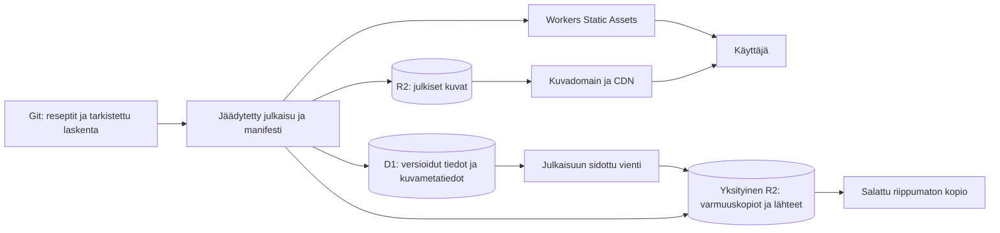

# Reseptit: yhteinen Cloudflare-siirtosuunnitelma

Päivä: 2.11.2026. Tila: suunnitelma, ei käyttöönottoa.
Kohde: `ozirix-dev/Reseptit`. Inventaarion jäädytetty main: `583fdb91aeb12114f909412b9165fc3b02a6515d`.
Työhaara: `codex/cloudflare-images-plan-20261102`.

Päivitetty 2.11.2026: Cloudflare-tilin lukevat havainnot, laaja toteutus- ja
varmennusjärjestys sekä käyttäjän vahvistamat valinnat on yhdistetty tähän
suunnitelmaan. GitHub Pagesin reseptisivut ohjataan onnistuneen käyttöönoton
kanssa samassa julkaisuikkunassa uuteen osoitteeseen. Cloudflare-lisäkulujen
kuukausitavoite on enintään 5 USD nykyisen Workers Paid -tilauksen päälle.
Tämä PR tallentaa vain suunnitelman. Siirto toteutetaan myöhemmin erikseen.

Luvut 2–3 ovat päivättyjä inventaariohavaintoja, eivät tulevan siirron
lopullinen aineistolista. Luvut 13–20 täsmentävät tarkistetun lähtötilanteen,
ensimmäisen toteutuksen sopimukset, vaiheet, tarkistukset ja palautuksen.

Tämä suunnitelma yhdistää ravintoarvot, lähteet, reseptikuvat, julkaisemisen ja
palautuksen yhdeksi julkaisuversioksi. Mainista ei löytynyt aiempaa D1/R2-suunnitelmaa;
nykyinen [julkaisuarkkitehtuuri](julkaisuarkkitehtuuri_github_pages.md) kuvaa GitHub Pagesia.
Tämä dokumentti on ehdotus sen Cloudflare-seuraajaksi. Nykyinen julkaisu jatkuu ennallaan.

## 1. Tavoite ja vastuunjako

| Osa | Tehtävä | Julkisuus |
| --- | --- | --- |
| Workers Static Assets | Esirenderöity reseptisivusto, JS/CSS, reittikohtainen julkaisu-JSON, favicon | Julkinen |
| Worker | Uuden domainin vanhojen polkujen yhteensopivuus ja rajatut ohjaukset | Ei julkista kirjoitus- tai SQL-rajapintaa |
| D1 | Versioidut ravintoarvot, lähdetietueet, määritelmät, laskentanäyttöviitteet, resepti–kuva-sidokset ja kuvametatiedot | Vienti buildia varten; ei selainyhteyttä eikä julkisen Workerin D1-bindingiä |
| R2 `reseptit-media` | Julkaisuun hyväksytyt alkuperäiset WebP:t ja niiden optimoidut versiot | Oma kuvadomain ja CDN |
| R2 `reseptit-private-archive` | Alkuperäismasterit, käyttämättömät kuvat, lähdeaineistot, D1-viennit ja palautusmanifestit | Yksityinen, ei kuvadomainia eikä `r2.dev`-julkisuutta |
| Riippumaton kopio | Salattu palautuspaketti ja lähdekuvat Proton-varmistukseen | Yksityinen; avaimet K:-holvissa |

Sivuston tavoitedomain on käyttäjän ilmoittama `recipavo.com`, ja kuvahosti on
`kuvat.recipavo.com`. Lopullinen julkinen sivusto sijoittuu domainin juureen
`https://recipavo.com/`. Resurssien suunnitellut nimet lukitaan luvussa 14.
Cloudflare-hallinnasta luetut havainnot on kirjattu lukuun 13. Asetuksia ei ole
muutettu eikä projektin resursseja luotu. Jaettujen kiintiöiden tulevaa vapaata
osuutta ei päätellä yksittäisestä käyttötilanteesta.



Ensimmäinen vaihe säilyttää Markdown-reseptit Gitissä toimituksellisena lähteenä.
D1 on hyväksyttyjen ravintoarvotietueiden ja lähdeketjujen tietokanta.
Sama tieto ei saa jäädä kahteen riippumattomasti muokattavaan masteriin:
importin ajaksi Git on määräävä, ja mahdollinen myöhempi D1-pohjainen toimitus
vaatii erillisen omistajuuspäätöksen. Kuvien master-tavut siirtyvät myöhemmin R2:een,
mutta paikalliset ja Gitin nykyiset kopiot säilytetään tässä vaiheessa.

## 2. Todennettu kuvainventaario

[Mainin tiedostokohtainen inventaario](cloudflare-migration/images-main-20261102.json)
sisältää jokaisen kuvan polun, tavumäärän, SHA-256:n, pikselimitat ja reseptiviittaukset.
Inventaario perustuu Gitin seuraamiin tiedostoihin ja mainin reseptien frontmatteriin;
se ei ole tuotantopalvelimen etäauditointi.

| Sijainti mainissa | Kuvia | Tavua |
| --- | ---: | ---: |
| `kuvat/aamupalat/` | 150 | 31 306 912 |
| `kuvat/alkuruoat/` | 1 | 175 516 |
| `kuvat/jalkiruoat/` | 16 | 3 004 126 |
| `kuvat/leivonnaiset/` | 5 | 1 145 686 |
| `kuvat/paaruoat/` | 154 | 31 672 380 |
| `kuvat/munakoiso-kesakurpitsalasagne.webp` | 1 | 374 076 |
| **Reseptikuvien lähdehakemisto yhteensä** | **327** | **67 678 696** |
| `reseptit/paaruoat/jauheliha-kaalikeitto-vhh.webp` | 1 | 171 902 |
| `site/public/favicon.svg` | 1 | 185 |
| **Kaikki Gitin seuraamat kuvat** | **329** | **67 850 783** |

327 lähdekuvaa on noin 64,54 MiB. Reseptihakemiston poikkeava WebP mukaan lukien
Gitissä on 328 reseptimediaan liittyvää rasterikuvaa. Kaikki ovat WebP:tä;
favicon on SVG. PNG-, JPEG- tai AVIF-mastereita ei ole tässä main-snapshotissa.
327 lähdekuvan mitat: 190 × 1536×1024, 94 × 1280×853, 40 × 1279×853,
yksi 2200×1053, yksi 1448×1086 ja yksi 1254×1254.

Mainissa on 326 julkaistua suomenkielistä reseptiä ja 119 julkaistua versiota
kullakin kielellä en/sv/th: yhteensä 683 julkaistua reseptiversiota.
Ne viittaavat 325 erilliseen kuvatiedostopolkuun. Puuttuvia `image.src`- tai
historiallisia `image.srcset`-tiedostoja ei löytynyt; jokaisella julkaistulla
reseptiversiolla on kuva. Ilmoitetut pääkuvien pikselimitat täsmäävät tiedostoihin.

### Paikalliset alkuperäiset ja generoidut kopiot

Pelkkä puhdas worktree ei paljasta Gitin ohittamia mastereita. Siksi seuraavat
hakemistot luettiin lisäksi muuttamatta olemassa olevaa checkoutia
`D:/Projects/Products/Reseptit`, jonka HEAD oli `b1c2bd3e036f0a17b3f61a560c39b5df56e1d8d5`.
Tätä eri haaran havaintoa ei sekoiteta mainin lukuihin.

| Paikallinen hakemisto | Kuvia | Tavua | Luonne |
| --- | ---: | ---: | --- |
| `kuvat/` | 327 | 69 838 925 | 326 WebP:tä ja yksi PNG |
| `site/public/kuvat/` | 1166 | 133 532 130 | Aiemmin generoitu julkaisutuloste |
| `site/dist/kuvat/` | 1166 | 133 532 130 | Aiemman buildin kopio |
| `output/` | 0 | 0 | Ei kuvia havaittu |
| `Reseptit-Backup/` | 0 | 0 | Vain varattu varmistuspaikka; ei todistettua varmuuskopiota |

Gitin ulkopuolinen `kuvat/paaruoat/italian-pata.png` on 1536×1024,
2 534 305 tavua, SHA-256
`3e17a936b782e13bced6aaad9f8b91e47f3624694a15beca0fc6f03ed641a66f`.
Se pitää säilyttää yksityisenä masterina ja selvittää sen reseptisidos.
PNG:tä ei korvata WebP:stä takaisin muunnetulla tiedostolla.

[Paikallinen manifesti](cloudflare-migration/images-local-20261102.json) kattaa
näiden kolmen kuvia sisältävän hakemiston 2659 tiedostoa ja 336 903 185 tavua.
Muiden aktiivisten worktreeiden, `tmp/`-suorituskykyaineistojen, selaincachejen,
liitteiden ja koneen muiden hakemistojen kuvat eivät kuulu tähän määrään.
Niiden mahdollisia korkearesoluutioisia mastereita ei ole osoitettu löydetyiksi.
Mainin kuva on tällä hetkellä pienin varmasti säilytettävä alkuperäinen.

## 3. Duplikaatit, käyttämättömät ja sidokset

Mainin 329 kuvatiedoston joukossa on **0 SHA-256-duplikaattiryhmää**.
Tästä ei seuraa, että kuvat olisivat visuaalisesti yksilöllisiä: pikseli- tai
havaintopohjaista samankaltaisuushakua ei tehty.

Paikallisissa lähde- ja tulostehakemistoissa on 1166 duplikaattiryhmää,
1168 erillistä SHA-256-sisältöä ja 200 626 012 tavua toistuvia fyysisiä kopioita.
Ne ovat pääosin odotettuja `public`/`dist`-kopioita ja alkuperäisten julkaisuversioita.
Tämä ei ole poistoehdotus. R2-tuonti käyttää sisältötiivistettä deduplikointiin,
mutta säilyttää kaikki vanhat URL-aliaset ja reseptisidokset.

Nykyisiin reseptimetatietoihin viittaamattomat lähteet:

- `kuvat/paaruoat/khao-soi-vhh-konjac.webp`: aiempi kuva; erillinen
  [muokkausmerkintä](review/khao-soi-image-v2.json) kertoo alkuperäisen säilyttämisestä.
- `kuvat/paaruoat/shoyu-kanakeitto-konjac.webp`: nykyisissä viittauksissa käyttämätön.
- `reseptit/paaruoat/jauheliha-kaalikeitto-vhh.webp`: ei pääkuvaviittausta;
  poikkeava tallennuspaikka. Säilytetään ja luokitellaan ennen mahdollista siirtoa.

"Käyttämätön" tarkoittaa tässä nykyisten reseptien frontmatter-viittausten puutetta.
Historialliset URL:t, aiemmat julkaisut ja toimituksellinen käyttö voivat silti tarvita
kuvaa. Yksikään näistä tiedostoista ei poistu automaattisesti.

`shoyu-kanakeitto-konjac` ja `vietnamilainen-pho-ga-aamuksi` jakavat mainissa polun
`kuvat/aamupalat/vietnamilainen-pho-ga-aamuksi.webp`. Tämä on kaksi reseptisidosta
samaan tiedostoon, ei kaksi SHA-duplikaattitiedostoa. Sisällöllinen sopivuus
molemmille resepteille on tarkistettava; tässä työssä sidosta ei muuteta.
Käännökset jakavat fyysisen kuvan, mutta niille säilytetään kielikohtainen alt-teksti.

Paikallinen varianttimanifesti sisältää 325 lähdettä ja 841 varianttia.
Kaikkien lähdetiivisteet vastaavat mainista löytyvää tiedostoa, mutta reseptien
käyttämä polkujoukko eroaa: vanha tuloste sisältää shoyu-kuvan ja siitä puuttuu
juuritason munakoiso-kesakurpitsalasagne. Tulostetta ei hyväksytä sellaisenaan
uudeksi julkaisuksi. Mainin 325 käytetystä lähteestä syntyisi nykyisillä
leveyssäännöillä myös 841 varianttia; tavumäärää ei ole mitattu uudella generoinnilla.

## 4. Alkuperäiset ja optimoidut kuvat R2:ssa

Säilytetään [nykyinen kuvaputki](responsive-images.md): Sharp 0.35.5,
WebP quality 78, effort 4, leveydet 480/960/1440 vain lähdettä pienempinä,
ei rajausta eikä suurennusta. Alkuperäinen kopioidaan tavutasolla muuttumattomana.
Työtä ei aloiteta uudella AVIF-/JPEG-rinnakkaisputkella; mahdollinen myöhempi
formaattivertailu on erillinen päätös.

| Objektiperhe, ehdotus | Sisältö |
| --- | --- |
| Julkinen `originals/<source-sha256>.webp` | Vain julkaisuun hyväksytty, nykyinen alkuperäinen WebP |
| Julkinen `_variants/<encoder-key>-<width>w.webp` | Nykyisen algoritmin nimellä ja todistetulla tuloste-SHA:lla tuotetut versiot |
| Julkinen `releases/<release-id>/images.json` | Vain julkinen polku-, mitta-, koko- ja URL-manifesti |
| Yksityinen `masters/<sha256>.<ext>` | PNG-masterit sekä säilytettävät käyttämättömät ja epäselvän oikeustilan lähteet |
| Yksityinen `source-evidence/<source-id>/<sha256>.<ext>` | Käyttöehtojen sallimat lähdeaineistot ja lisenssinäyttö |

Samasta lähteestä luodut variantit sidotaan lähde-SHA:han, encoder-asetuksiin sekä
Sharp/libvips/WebP-versioihin kuten nykyisessä putkessa. Tiedoston nimeen sisältyvä
lyhennetty encoder-avain ei korvaa täyttä tulosteen SHA-256:ta. Mahdollinen nimikollisio
pysäyttää tuonnin. Sama SHA saa yhden sisältöobjektin ja useita viittauksia.

Kaikkien 327 lähdekuvan ja poikkeavan WebP:n tavut säilytetään, myös silloin kun
vain 325 lähdettä kuuluu julkiseen julkaisuun. Korkearesoluutioinen master ja
julkaisuoriginaali ovat eri käsitteet. Julkiseen buckettiin ei sijoiteta
julkaisemattomia raakatiedostoja tai oikeuksiltaan selvittämättömiä mastereita.
Käyttöliittymän annoskertoimet eivät synnytä uusia kuvia tai kopioita.

## 5. D1: ravintoarvot ja kuvametatiedot samassa versiomallissa

Skeemaehdotus, ei ajettu SQL-migraatio:

| Taulu | Keskeiset tiedot ja eheys |
| --- | --- |
| `release` | `release_id`, Git-SHA, malliversio, input-/manifesti-SHA, `prepared/verified/published` |
| `recipe_version` | `recipe_id`, sisältöhash, annosmäärä, kieli, reseptipolku, julkaisuversio |
| `nutrition_source` | Virallinen lähde, julkaisuversio, tietuetunniste, hakuaika, lisenssi ja todistusaineiston hash/avain |
| `nutrient_observation` | Ravintotekijä, raaka-arvo tekstinä, yksikkö, painoperusta, valmistustila, määritelmä, lähde ja arvon tila |
| `calculation` / `calculation_ingredient` | Reseptin input-hash, ainesosat, massat, muunnosnäyttö, menetelmä ja hyväksytty tulos; muuttumaton jälki |
| `image_asset` | `asset_id`, alkuperäisen SHA-256 UNIQUE, MIME, leveys/korkeus/tavut, R2-avain, master-viite, alkuperä/oikeustila |
| `image_variant` | Lähdeasset, variantin SHA-256, leveys/korkeus/tavut, formaatti, encoder-versiot ja objektin avain |
| `recipe_image` | Reseptiversio + asset + rooli/järjestys, kielikohtainen alt-teksti; jakaminen sallitaan |
| `image_url_alias` | Vanha host/polku, julkaisuversio, kohdeasset/-variantti; ristiriitainen alias estää julkaisun |
| `backup_catalog` | Julkaisu, D1-bookmark/vienti-SHA, media-/lähdemanifesti ja palautuskokeen tila |

Reseptin tunniste ei riipu otsikosta, kategoriasta, URL-slugista tai kuvatiedoston
nimestä. `recipe_image` viittaa täsmälliseen reseptiversioon; kuvan vaihto ei muuta
vanhaa sidosta jälkikäteen. R2-avaimet eivät sisällä allekirjoitettuja URL:eja tai
salaisuuksia. FK:t ja indeksit vähintään julkaisuun, resepti-id:hen, lähdetietueeseen
sekä kuvien SHA:han ja aliaspolkuun.

Ravintoarvoissa säilytetään erikseen lähteen ilmoittama nolla, mittaamatta jäänyt
komponentti, tietokannasta puuttuva komponentti, jälkiarvo, raja-arvo ja laskettu
arvio. `NULL` ei muutu nollaksi. Hiilihydraatin, kuidun ja polyolien määritelmät
sekä muunnos säilyvät tietuetasolla. Valmiiksi hyväksytty laskentanäyttö sidotaan
reseptin ainesosa-/annoshashiin. SOURCE-01:n tutkimustietueita tai keskeneräisiä
GK80-ehdotuksia ei tuoda hyväksyttyinä tuotantoarvoina.

Mainin `docs/nutrition/` sisältää 383 JSON-tiedostoa, 71 755 421 tavua;
`calculations/` sisältää 207 tiedostoa. Nämä eivät ole D1:n mitattu koko eivätkä
383 aktiivista lähdetaulua. Historialliset raportit ja isot todistusaineistot
arkistoidaan yksityiseen R2:een. D1:een normalisoidaan vain rajattu, nimetty julkaisu.
D1:n riviraja on 2 MB, joten suuria laskentapaketteja ei tungeta yhteen BLOB-riviin.
[Viralliset D1-rajat](https://developers.cloudflare.com/d1/platform/limits/).

Julkinen staattinen sivusto rakennetaan hyväksytystä D1-snapshotista, ja tulos
sisältää ravintoarvot sekä kuvaosoitteet HTML:ssä ja reitti-JSONissa. Jokainen
sivun- tai kuvanlataus ei tee D1-kyselyä. Ensimmäisessä toteutuksessa ei tehdä
julkista ravintoarvo-API:a eikä D1-pohjaista editoria. Julkisella Workerilla ei
ole D1-bindingiä. Hallinta ei avaa julkista SQL- tai kirjoitusrajapintaa.

## 6. URL-yhteensopivuus, oma domain ja välimuisti

Ehdotettu kuvahost on `kuvat.recipavo.com`. Sivusto on `recipavo.com`;
`www.recipavo.com` ohjataan myöhemmin yhteen hyväksyttyyn pääosoitteeseen.
Kuvahost liitetään R2:n Custom Domains -toiminnolla omassa
Cloudflare-tilissä hallittuun zoneen. `r2.dev` ei ole tuotanto-CDN eikä sen eteen
tehdä omaa CNAME-kiertoa. Julkinen oma domain mahdollistaa CDN-välimuistin;
yksityisellä arkistobucketilla ei ole mitään julkista osoitetta.
[Cloudflaren R2-domain-ohje](https://developers.cloudflare.com/r2/buckets/public-buckets/).

| Osoiteperhe | Yhteensopivuusratkaisu |
| --- | --- |
| Nykyinen `https://ozirix-dev.github.io/Reseptit/kuvat/<polku>` | GitHubin nykyiset tiedostot säilyvät. Cloudflare ei hallitse `github.io`-hostia eikä voi tehdä siihen redirectiä. Myöhempi GitHub-puolen muutos olisi erillinen julkaisu. |
| Uuden sivuhostin `/Reseptit/kuvat/<polku>` ja tarvittaessa `/kuvat/<polku>` | Täsmällinen, versioitu alias -> julkinen R2-kuva. Ensin lyhytikäinen 302/307 pilotissa; pysyvä 301/308 vasta URL-sopimuksen hyväksymisen jälkeen. |
| Uuden sisällön `src`, `srcset`, preload, OG-kuva, JSON-LD | Suoraan samaan kuvadomainiin ja julkaisuun sidottuihin objektiavaimiin. |
| Historialliset `_variants/<key>-<width>w.webp` | Säilytetään todistetut vanhat tavut ja avaimet. Uudella encoderilla ei kirjoiteta eri tavuja vanhan avaimen alle. |

`image.src` voi säilyä reseptin suhteellisena lähdepolkuna: buildin resolveri käyttää
D1:n hyväksyttyä resepti–asset-sidosta. Vite-base `/Reseptit/` ja nykyinen
kovakoodattu `baseUrl` tiedostossa `site/scripts/build-content.ts` on myöhemmin
parametrisoitava sivuhostille ja kuvahostille. Pelkkä DNS-siirto ei korjaa HTML:n,
canonicalien, hreflangien, preloadien tai JSON-LD:n vanhoja absoluuttisia osoitteita.
Ensimmäinen julkaisematon pilotointi voi säilyttää sivupolut `/Reseptit/`-alkuisina.
Lopullisessa `recipavo.com`-julkaisussa Viten base ja canonical-pohja ovat `/`.
Vanhan ja uuden reittijoukon tarkka kartta laaditaan ennen kytkentää, esimerkiksi
`/Reseptit/pad-thai-vhh-konjac/` -> `https://recipavo.com/pad-thai-vhh-konjac/`.
Uuden hostin vanhat `/Reseptit/`-polut ohjataan tämän kartan mukaan;
kuvapolut käsitellään ennen yleistä sivupolkuohjausta.

Cache-sopimus: hash-nimetyille kuville `Cache-Control: public, max-age=31536000,
immutable`; muuttuville alias- ja manifestiosoittimille lyhyt TTL, esimerkiksi
300 s. Manifestin versioitu sisältö voi olla immutable. Asetetaan oikea MIME,
`Content-Length`, `ETag`/ehdollinen GET sekä `Last-Modified`; ETag ei ole
SHA-256-todiste, erityisesti multipart-tuonneissa. Sallitaan julkiseen jakeluun
GET/HEAD, ei selaimesta anonyymejä kirjoituksia. CORS avataan vain tarvittaville
sivuhosteille ja käyttötavoille, esimerkiksi canvas-käsittelylle.

CDN-säännöt kohdistetaan kuvahostiin ja hyväksyttyihin polkuihin. Private-arkistoa,
virhevastauksia tai hallinta-API:a ei oteta yleiseen Cache Everything -sääntöön.
Sisältöosoitteinen uusi versio ei tarvitse vanhan avaimen korvausta tai laajaa
cache-purgea. Oikeuspoistoissa varaudutaan täsmälliseen CDN-purgeen ja aliaseston
julkaisuun; immutable-selaimessa jo olevaa kopiota ei voida vetää takaisin.

Static Assets palvelee sivut suoraan. Worker-first rajataan vanhojen `/Reseptit/*`- ja `/kuvat/*`-polkujen
yhteensopivuuskäsittelyyn; sitä ei kytketä kaikelle liikenteelle. Tuntematon
resepti-/kuvapolku palauttaa aidon 404:n, ei SPA:n 200-kuvavastausta.
[Reititysmalli](https://developers.cloudflare.com/workers/static-assets/routing/advanced/),
[staattisen jakelun laskutus](https://developers.cloudflare.com/workers/static-assets/billing-and-limitations/).

## 7. Alkuperä ja käyttöoikeudet

327 mainin lähdekuvassa ei löytynyt EXIF-tekijä-/lisenssimetaa. WebP:n mukana olevat
`background`/`loop`-tiedot eivät ole käyttöoikeusnäyttöä.
[15 korjauksen manifestissa](reports/2026-10-22-v1-4-image-corrections.json) on
kuvakohtaista alkuperä-/muokkausjälkeä, ja kaikkien 15:n nykyinen SHA vastaa
manifestia. Khao soi -muokkauksesta on erillinen prompti-/työkalumerkintä.
[Thai-kuvien raportti](reports/2026-10-21-thai-recipes.md) kertoo kymmenen kuvan
imagegen-tuotannosta, mutta yleinen raportti ei yksin todista jokaisen nykyisen
kuvan lupaketjua.

Näistä havainnoista ei tehdä yleistä väitettä "kaikki kuvat ovat omia" tai
"kaikki ovat kaupallisesti uudelleenkäytettäviä". Muokkausmanifesti osoittaa
provenienssia, ei itsessään muodollista lisenssiä. Myöskään tiedoston sijainti
Gitissä tai EXIF:n puuttuminen ei ratkaise oikeuksia.

Kuvarekisteriin tarvitaan `origin_kind` (oma valokuva / generoitu / ulkopuolinen /
tuntematon), tekijä/oikeudenhaltija, lähde-URL tai generation-id, tuotantoaika,
alkuperäisen hash, muokkausketju, lisenssin tunniste/versio ja näyttöviite,
kaupallisen käytön ja muokkaamisen sallinta, vaadittu attribuutio,
`rights_status`, tarkistaja ja tarkistuspäivä. Tuntematon tallennetaan
tuntemattomana. Alt-teksti on kieli- ja reseptikontekstin tietoa, ei masterin
tekijänoikeuskenttä.

Ennen uuden julkisen median julkaisua oikeustiedot selvitetään tai omistaja
kirjaa todennettavan oikeusvakuutuksen. Julkaisun kuvasisällön vastaavuus reseptiin
on erillinen tarkistus. Yksityisessä arkistossakin lähdeaineiston tallentamisen ja
säilyttämisen on oltava sen käyttöehtojen sallimaa. K:-holvin salaisuuksia ei
kopioida julkiseen mediaan, D1:n julkisiin vientiriveihin tai dokumentaatioon.

## 8. Toistettava siirto ja julkaisu ilman ristiriitaista välitilaa

| Vaihe | Toimenpide myöhemmin | Valmistumisen näyttö |
| --- | --- | --- |
| 0: jäädytys | Nimetään main-SHA ja uusi release-id; inventoidaan uudelleen hyväksytty main | Input-tiedostojen SHA:t, oikeustila, reseptit ja kuvat nimetty |
| 1: paikallinen valmistelu | Luodaan D1-tuonti ja media-/aliasmanifesti eristettyyn stagingiin | Ei puuttuvia sidoksia; ei nollaistettuja NULL-arvoja; versioidut encoder-asetukset |
| 2: yksityinen varmistus | Tallennetaan alkuperäiset ja lähdenäyttö, D1-tuontipaketti sekä manifesti yksityiseen arkistoon | SHA-tarkistetut objektit ja riippumaton palautuskopio |
| 3: media-pilotti | Siirretään pieni hyväksytty otos: tavallinen kuva, suuri kuva, jaettu kuva, vanha alias, PNG-master vain yksityiseksi | Täydet read-back-SHA:t, MIME/mitat, molempien bucketien julkisuus todettu |
| 4: koko media | Manifestin ohjaama tuonti vain puuttuviin sisältöavaimiin, rajattu rinnakkaisuus ja retry | Jokainen objekti ladattu takaisin ja verrattu odotettuun SHA:han; loki ja erä-id |
| 5: D1 ja static staging | Tuodaan immutable release-rivit; rakennetaan sivusto samasta hyväksytystä snapshotista | Tulosarvot ja evidenssi ennallaan, kaikki HTML/JSON/kuva-URL:t saman release-id:n mukaisia |
| 6: julkaisu | Hyväksytään preview ja muutetaan vasta sitten Worker-versio sekä domain-/liikennekytkentä | Julkaisumanifesti lukittu; vanha julkaisu palautettavissa |
| 7: seuranta | Tarkistetaan 404:t, CDN-hitit, R2-operaatiot, D1-rivit ja kustannukset | Sovittu seuranta-aika ja palautuskriteerit |

Siirtoskripti lukee vain eksplisiittisen manifestin. Ei `sync --delete`-ajoa,
ei hakemistosta pääteltyä tuontia eikä olemassa olevan eri-SHA-objektin korvausta.
Sama erä voidaan ajaa uudelleen: HEAD/list kertoo ehdokkaat, mutta hyväksyntä
edellyttää checksum-todistetta. Pienille kuville riittää yksittäinen PUT;
suurissa arkistopaketeissa käytetään tarvittaessa hallittua multipart-jatkamista.
[Cloudflaren upload-ohje](https://developers.cloudflare.com/r2/objects/upload-objects/).

R2:n ja D1:n välillä ei ole yhtä yhteistä transaktiota. Siksi objektit ja
`prepared`-julkaisu rakennetaan ensin, media tarkistetaan, ja julkaisumanifesti
sinetöidään vasta kun kaikki riippuvuudet ovat olemassa. Worker-julkaisu sisältää
release-id:n: D1:n erillisen "uusin"-osoittimen muutos ei saa vaihtaa vanhan HTML:n
ravintoarvoja tai kuvasidoksia. R2-avaimia ja vanhoja release-rivejä ei poisteta
rollback-ikkunan aikana. D1-skeema muuttuu tarvittaessa lisäävästi niin, että myös
edellinen Worker-versio pystyy lukemaan omaa julkaisuaan.

SOURCE-01- ja GK80-työpuut eivät ole tuontilähteitä. Tämä suunnitelma ei muuta
niiden reseptejä, lähderekistereitä, laskentamoottoria tai PR-haaroja. Käyttöönotto
odottaa erikseen hyväksyttyä yhteistä main-snapshotia; tässä dokumentissa esitetyt
kuvamäärät lasketaan silloin uudelleen. Tuotantokytkentää tai siirtoa ei ole
valtuutettu tällä suunnittelupyynnöllä.

## 9. Varmuuskopiot ja palautus

Yksityiseen R2-buckettiin tallennetaan D1:n looginen vienti, julkaisumanifesti,
kaikki sen viittaamat kuvat/masterit ja sallitut lähdeaineistot. Sisältöosoitteiset
kuvat säilytetään kerran kutakin SHA:ta kohti; päivittäinen manifesti ei kopioi
koko kuvakirjastoa uudelleen. Ehdotettu säilytys: päiväviennit 30 vrk,
viikkoviennit 8 viikkoa ja kuukausiviennit 12 kuukautta. Vähintään yksi
ennen-siirtoa-paketti säilytetään erikseen pysyvänä.

Objekteja ei vanhenneta ennen kuin kaikki niitä käyttävät säilytettävät
manifestit ovat poistokelpoisia. Lifecycle ei saa poistaa mastereita pelkän
objektin iän perusteella. Tarvittaessa käytetään prefix-kohtaisia R2 Bucket Lock
-sääntöjä; lukituksen pysyvyys ja lifecycle-yhteensopivuus tarkistetaan ennen
käyttöönottoa. Suunnitelma ei perusta palautusta oletettuun S3-versionointiin.
[Bucket Lock](https://developers.cloudflare.com/r2/buckets/bucket-locks/).

D1 Time Travel antaa lisäksi Free-tilauksessa 7 vrk ja Paid-tilauksessa 30 vrk
palautusikkunan. Se ei korvaa yksityistä vientiä tai R2-kuvavarmistusta.
Palautettava kokonaisuus valitaan release-id:llä, ja D1:n bookmark sekä
kuvamanifestin SHA kirjataan samaan palautusluetteloon.
[Time Travel](https://developers.cloudflare.com/d1/reference/time-travel/).

Ehdotettu palvelutavoite: normaali varmistus RPO enintään 24 h ja erillinen vienti
ennen jokaista siirtomigraatiota; RTO enintään 4 h ensimmäisen onnistuneen
palautusharjoituksen jälkeen. Nämä ovat tavoitteita, eivät mitattuja lupauksia.
Palautusharjoitus tehdään erilliseen testiympäristöön: tuodaan D1-vienti,
palautetaan manifestin tarvitsemat SHA-objektit, lasketaan hashit uudelleen ja
avataan pieni sovittu reseptiotos. Vasta todistettu palautus merkitään onnistuneeksi.

Erillisen bucketin käyttö saman Cloudflare-tilin sisällä ei suojaa tilin
menetykseltä. Siksi salattu riippumaton Proton-kopio ja testattu purkuavain
kuuluvat samaan suunnitelmaan. Julkisen sivuston Workerilla ei ole kirjoitus-
tai arkistobindingiä; varmistus- ja siirtotunnukset rajataan eri tehtäviin.
Nykyinen tyhjä `Reseptit-Backup`-paikka ei ole todiste toimivasta varmistuksesta.

## 10. Käyttömäärä ja kustannusarvio

Hinnat tarkistettu Cloudflaren virallisista lähteistä 2.11.2026, USD ennen veroja.
Tilin muiden projektien kulutus pienentää yhteistä vapaata kiintiötä. Tilin
käyttönäkymien havaintoja on luvussa 13; ne eivät ole projektin lopullinen
kustannus tai koko tilin laskutusauditointi. Alla ovat skenaariot, eivät
liikenne-ennuste. Käyttäjän vahvistama lisäkulutavoite on luvussa 19.

R2 Standard: 10 GB-month, 1 M Class A- ja 10 M Class B -operaatiota/kk sisältyy
vapaaseen osuuteen. Ylittävä tallennus $0,015/GB-month, A $4,50/M,
B $0,36/M; Internet-egress $0. Laskutusyksiköt pyöristyvät ylöspäin.
Infrequent Accessiin ei sovelleta samaa vapaata osuutta ja siitä tulee
hakukustannus, joten näin pieni kirjasto aloittaa Standardissa.
[R2-hinnasto](https://developers.cloudflare.com/r2/pricing/).

Mainin lähteet 0,0677 GB; paikallisen vanhan varianttiaineiston 0,0664 GB perusteella
julkisen kuvajulkaisun alustava budjetti on **alle 0,2 GB**. Varianttien tarkka
koko mitataan staging-generoinnissa. Yhden tuonnin noin 1166 julkaisuobjektia
ja masterit jäävät kauas miljoonasta kirjoitusoperaatiosta; varmennusluvut ja
listauspyynnöt lasketaan silti mukaan. Yksityisen arkiston budjettiin varataan
aluksi esimerkiksi 1 GB lähde- ja masteraineistolle sekä erikseen vientien säilytys.

| Sivulatauksia/kk | Oletus: 5 kuvapyyntöä/sivu | CDN-hit | R2-lukuja/kk | R2 B -lisämaksu, jos koko vapaa osuus käytettävissä |
| ---: | ---: | ---: | ---: | ---: |
| 100 000 | 500 000 | 95 % | 25 000 | $0 |
| 1 000 000 | 5 000 000 | 95 % | 250 000 | $0 |
| 10 000 000 | 50 000 000 | 90 % | 5 000 000 | $0 |
| 10 000 000 | 50 000 000 | 70 % | 15 000 000 | $1,80 |

Kuvaindeksin todellinen pyyntömäärä ja cache-hit mitataan pilotissa.
Kuvapyyntöjen määrä ei ole sama kuin R2-operaatioiden määrä. Suora R2-kuvadomain
välttää Worker-invokaation per kuva; vanhan URL:n Worker-alias voi lisätä niitä.

Workers Static Assetsin suorat asset-pyynnöt ja tallennus ovat maksuttomia.
Workers Paidin lähtöhinta on $5/kk; siihen sisältyy 10 M Worker-pyyntöä ja
30 M CPU-ms/kk, ylitys $0,30/M pyyntöä ja $0,02/M CPU-ms. Free antaa
100 000 Worker-pyyntöä/vrk; sitä ei tulkita samaksi kuin kuukausikiintiö.
Workers Paid on tilillä jo aktiivinen. Tässä työssä tilausta ei muuteta.
[Workers-hinnat](https://developers.cloudflare.com/workers/platform/pricing/),
[Static Assets](https://developers.cloudflare.com/workers/static-assets/billing-and-limitations/).

D1 Free: 5 M luettua riviä/vrk, 100 000 kirjoitettua riviä/vrk,
5 GB yhteensä mutta enintään 500 MB/tietokanta. Paid: ensimmäiset 25 mrd
lukua ja 50 M kirjoitusta/kk sekä 5 GB sisältyvät; ylitys $0,001/M lukua,
$1/M kirjoitusta ja $0,75/GB-month. Staattinen julkaisu välttää kyselyn
jokaisella sivulatauksella. Indeksittömän SELECT:n lukemat rivit voivat ylittää
palautettujen rivien määrän.
[D1-hinnasto](https://developers.cloudflare.com/d1/platform/pricing/).

Jos esimerkiksi yhden pakatun D1-viennin koko olisi 0,1 GB, 30 päivä-,
8 viikko- ja 12 kuukausiversiota veisivät noin 5 GB ennen deduplikointia.
Tämä on kapasiteettivaraus, ei mitattu vientikoko. Kuvaversioiden säilyttäminen
kertaalleen välttää kymmenien kuvakirjastokopioiden kasvun. Jos koko R2-kulutus
nousisi 20 GB-monthiin ja vapaat 10 GB olisivat käytettävissä, tallennuksen
lisäosa olisi noin $0,15/kk ennen muita operaatioita.

Pieni staattinen toteutus voi mahtua tilin jäljellä oleviin sisältyviin kiintiöihin.
Workers Paidin noin $5/kk perusmaksu on jo olemassa olevan tilauksen kustannus,
eikä sitä lasketa tämän projektin uudeksi lisäkuluksi. Domainin
rekisteröinti, riippumaton varmistustila, lokitus ja mahdolliset maksulliset
CDN-ominaisuudet budjetoidaan erikseen. Cloudflare Imagesin maksullista
muunnospalvelua ei tarvita valmiiksi tuotettujen R2-varianttien jakeluun.
Jos se myöhemmin valitaan, sille tehdään erillinen laskelma.
[Imagesin erillinen hinnasto](https://developers.cloudflare.com/images/pricing/).

## 11. Ensimmäisen toteutuksen rajaus ja avoimet päätökset

Ensimmäinen toteutuserä on julkaisematon pilotti: pieni kuvaotos,
muutama jo hyväksytty ravintoarvolaskelma, molempien bucketien käyttöoikeudet,
yksi D1-vienti ja palautus. Vasta sen jälkeen valmistellaan koko mainin tuonti.
Kuvien oikeudet, jaetun pho/shoyu-kuvan vastaavuus, PNG-masterin yhteys,
recipavo.com- ja kuvadomainin tekninen kytkentä ratkaistaan ennen julkista
kytkentää. Kustannusraja ja GitHub Pagesin siirtymäkäytäntö on nyt valittu;
niiden toteutus kuvataan luvuissa 16–19.
Historialliset lisenssiltään rajoitetut ravintolähteet pysyvät erillään
julkisesta manifestista ja API:sta.

Toteutusvaiheen rajatut hyväksyntäehdot: ei puuttuvia kuva-/resepti-/lähdeviitteitä,
SHA- ja mittatäsmäys, alkuperäisten tavujen säilyminen, aito 404,
vanhojen osoitteiden kohtuullinen otos, julkisen/yksityisen pääsyn ero,
saman release-id:n laskentatulokset ja onnistunut palautus. Laajaa
sivustotestiä ei ajeta jokaiselle dataerälle; mahdolliset reititys- tai skeemamuutosten
tarkistukset kohdistetaan muutoksen todelliseen vaikutukseen.

Tässä suunnittelutyössä tehtiin vain tiedostoinventaario, SHA-256-vertailu,
metatietojen ja viittausten tarkistus, dokumentaation tarkistus sekä
Cloudflare-hallinnan lukevat tarkistukset. Ei kuvien siirtoa tai poistamista, ei varianttien generointia, sivustobuildia,
Cloudflare-resurssia, GitHub Actions -ajoa, mergeä tai deployta.

## 12. Nykyisen GitHub-version tehtävä ja GSC:n lähtötilanne

Käyttäjän täydennys 2.11.2026: **GSC:ssä ei ole dataa**. Tämä on käyttäjän
ilmoittama lähtötieto; GSC-tiliä ei auditoitu tässä työssä. Siirron ehtona ei ole
28 päivän GSC-vertailujakso eikä raportin odottaminen. Datan puuttuminen ei
yksin todista, ettei vanhoja osoitteita olisi indeksoitu tai jaettu.

GitHubista luetut tiedot 2.11.2026: repo on julkinen, oletushaara on `main`,
Pages käyttää workflow-julkaisua ja sen ilmoitettu osoite on
`https://ozirix-dev.github.io/Reseptit/`. Pagesin custom domain on asettamatta.
Aiemmassa lukevassa tarkistuksessa viimeisin Pages-deployment-tietue
(`7479319566`, 1.11.2026 klo 23.24 Suomen aikaa)
viittaa SHA:han `583fdb91aeb12114f909412b9165fc3b02a6515d`. Pelkkä deployment-tietue
ei ole kaikkien tuotantosivujen tai -kuvien toimivuustodiste.

| Kohde | Nyt, muiden ajojen jatkuessa | Hallitun Cloudflare-siirron jälkeen |
| --- | --- | --- |
| GitHub-repo ja historia | Säilyvät nykyisen kehityksen lähteenä; ei arkistointia tai siivousta | Säilyvät koodin, Markdown-reseptien, katselmointien ja julkaisuversioiden lähteenä |
| GitHubin nykyiset kuvat | Säilyvät kokonaisina; ei Git-poistoja tai historian uudelleenkirjoitusta | Säilyvät ainakin siirtymän ja todistetun palautuksen ajan; Git-kuvakopioiden mahdollinen myöhempi vähentäminen on oma päätös |
| GitHub Pages -sivusto | Jatkaa nykyisellä julkaisulla; tämän PR:n yhteydessä ei muuteta Pages-asetuksia tai deploy-workflowta | Viimeinen toimiva julkaisu säilytetään palautuspakettina; reseptisivut ohjataan recipavo.comiin heti onnistuneen käyttöönoton yhteydessä, vanhat kuvat säilyttäen |
| `recipavo.com` | Aktiivinen coming-soon Pages -sivusto; tässä työssä ei resurssi-, DNS- tai liikennemuutoksia | Ainoa jatkuvasti ylläpidettävä julkinen reseptisivusto |
| Actions | Tämän dokumentaatio-PR:n commitit sisältävät `[skip ci]`; ei manuaalisia workflow-ajoja | Erillisen hyväksytyn käyttöönoton yhteydessä yksi julkaisuputki; vanha Pages-autodeploy poistuu käytöstä vasta sovitussa siirtymäjulkaisussa |

Suositus on säilyttää GitHub-repo ja erottaa se GitHub Pages -hostingista.
Repositorion poistaminen tai arkistoiminen katkaisisi käynnissä olevan resepti- ja
laskentatyön työnkulun. Kokonaisen toisen sisältösivuston jatkuva ylläpito
Cloudflaren rinnalla toisi kaksi julkaistavaa versiota ilman osoitettua hyötyä.

Ennen mitään Pages-muutosta otetaan talteen täsmällinen julkaisu-SHA, staattinen
julkaisupaketti, vanhojen HTML/JSON/kuva-URL:ien manifesti ja palautusohje.
Palautuspaketti ja aiemmat julkaisut säilytetään vähintään 30 päivää
käyttöönotosta. Tämä ei tarkoita 30 päivän rinnakkaista sisältöjulkaisua:
käyttäjä valitsi vanhojen reseptisivujen ohjauksen heti käyttöönotossa.
Varmistusten muu säilytys noudattaa luvun 9 politiikkaa. GitHubin workflow-artifactin
vaihtuvaan säilytysaikaan ei perusteta ainoaa palautuskopiota.

GitHub Pages ei tarjoa tämän sovelluksen hallittavaa HTTP-palvelinta, jolla
vanhalle `github.io`-hostille voisi asentaa Cloudflare Worker -redirectin.
Siirtymäjulkaisu toteuttaa sivukohtaisen HTML-ohjauksen, näkyvän linkin ja
canonicalin uuteen vastaavaan reseptiin heti onnistuneen Cloudflare-kytkennän
jälkeen samassa julkaisuikkunassa. Tätä ei kuvata aitona HTTP 301:nä. Vanhojen kuvatavujen säilytys pitää aiemmat
kuvaosoitteet käyttökelpoisina. Pelkkä README-linkin lisääminen ei ohjaa
reseptisivuille saapuvaa käyttäjää.

`recipavo.com`-domainia ei aseteta tämän suunnitelman sivuvaikutuksena GitHub
Pagesin custom domainiksi: tarkoitus on palvella sitä Cloudflare Workersista.
GitHub Pagesin domain-asetus on oma hosting-valintansa, johon liittyy myös DNS.
[GitHubin domain-ohje](https://docs.github.com/en/pages/configuring-a-custom-domain-for-your-github-pages-site/managing-a-custom-domain-for-your-github-pages-site).

GSC:n käyttöönotto kohdistetaan myöhemmin uuteen domainiin: omistajuusvahvistus,
uusi sitemap ja pieni URL-tarkistusotos. Seuranta alkaa uudesta lähtötilanteesta;
yksittäinen vahvistus ei tarkoita indeksoinnin onnistumista. Vanhojen kuvien
pitkän aikavälin säilytystä arvioidaan myöhemmin oikean käytön ja linkkien perusteella,
eikä niitä poisteta automaattisesti GSC:n tyhjyyden vuoksi.

Draft-PR ei ole käyttöönoton aloituslupa. Käynnissä olevien muiden sessioiden
työn valmistuminen ja hyväksytty main-snapshot tarkistetaan ennen tulevaa
siirtoa. CI:n ohitus koskee vain näitä dokumentaatiocommitteja: GitHubin mukaan
`[skip ci]` estää `push`/`pull_request`-käynnistimet, mutta ei esimerkiksi
`pull_request_target`-käynnistintä. Nykyisessä mainissa on vain `pages.yml`,
jonka käynnistimet ovat `push`, `pull_request` ja `workflow_dispatch`.
[GitHubin CI-ohitusohje](https://docs.github.com/en/actions/how-tos/manage-workflow-runs/skip-workflow-runs).

### Inventaarion toistaminen

Skriptit ovat lukevia apuvälineitä, eivät siirto- tai julkaisukomentoja.
Python tarvitsee PyYAML- ja Pillow-paketit. Tulostus ohjataan ensin scratchiin;
repoon tallentaminen tehdään repo_guardin `write`-operaatiolla.

```powershell
python -X utf8 docs/cloudflare-migration/inventory-images.py <verified-main-worktree> > D:/Temp/images-main.json
python -X utf8 docs/cloudflare-migration/inventory-local-images.py D:/Projects/Products/Reseptit > D:/Temp/images-local.json
```

Suunnitelman työpuu on erillinen
`D:/Projects/tmp/reseptit-cloudflare-images-plan-20261102`. Kaikki tähän suunnitelmaan
kuuluvat muutokset rajoittuvat tähän dokumenttiin ja `docs/cloudflare-migration/`-hakemistoon.


## 13. Cloudflare-valmiuden lukevat havainnot 2.11.2026

Lähde on käyttäjän kirjautunut [Cloudflare-hallinta](https://dash.cloudflare.com/2dda5d88f53563ddabfc97531c313ca1/recipavo.com).
Havainnot ovat tämän päivän tilannekuva. Tunnusten arvoja ei luettu tai tallennettu
suunnitelmaan. Uusia muutoksia edeltää aina uusi tilanne- ja kohdetarkistus.

| Kohde | Todennettu havainto | Siirtovalmistelu myöhemmin |
| --- | --- | --- |
| Domain | `recipavo.com` Active, voimassa 24.10.2027 asti; zone Free, DNS Full setup | Domain on käytettävissä |
| Apex ja www | Molemmat proxied CNAME -> `recipavo-coming-soon.pages.dev`, TTL Auto | Nykyinen Pages-kytkentä vaihdetaan luvun 18 mukaan |
| Pages | `recipavo-coming-soon`, molemmat custom domainit Active ja SSL enabled; ei Git-yhteyttä | Nykyinen julkaisu ja kytkennät säilytetään palautusta varten |
| Workers | Workers Paid aktiivinen; zoneen ei yhdistettyä Workeria eikä Worker-reittejä | Projektin Worker valmistellaan myöhemmin |
| SSL | Universal `recipavo.com` ja `*.recipavo.com` Active, voimassa 22.1.2027 asti; varavarmenne myönnetty | TLS varmennetaan uudelleen kytkennässä |
| HTTPS-asetukset | Full, automaattitila; Always Use HTTPS pois; TLS-minimi 1.0; TLS 1.3 ja Automatic HTTPS Rewrites päällä | HTTPS-pakotus ja TLS-minimi 1.2 ennen julkaisua |
| D1 | Tilin ainoa tietokanta `marjavuori-db`, ei Reseptit/Recipavo-kantaa | Erillinen projektin tuotanto- ja stage-kanta |
| R2 | Viisi muun käytön bucketia, yhteensä noin 3,35 GB; ei projektin media- tai arkistobucketia | Omat bucketit, ei muiden resurssien uudelleenkäyttöä |
| Kuvadomain | `kuvat.recipavo.com` ei määritetty | Liitetään julkiseen R2:een Custom Domains -toiminnolla |
| API-oikeudet | Tarkastettu Cloudflare Agent Token 2026-04-21 Active, D1/R2/Workers/Pages/DNS/SSL vain Read | Varsinaisten siirto- ja julkaisutunnusten oikeudet vielä todentamatta |
| Varmistukset | Projektin resursseja ja palautusprosessia ei vielä olemassa | Varmistus ja palautusharjoitus ovat julkaisun ehtoja |

Käyttönäkymässä D1:n tallennus oli 77,82 kB, lukurivejä 46 ja kirjoituksia 0.
R2:ssa näkyi 228 Class A- ja noin 5,26 tuhatta Class B -operaatiota.
Näiden palveluiden näkymissä laskutettava käyttö oli $0 kyseisellä jaksolla.
Tästä ei päätellä koko Cloudflare-laskua tai projektin tulevaa hintaa.
Muiden API-tokenien kirjoitusoikeuksia ei auditoitu: vain tarkastetun Agent-tokenin
lukuoikeus on todistettu. Ei väitettä, ettei tilillä voisi olla sopivaa tunnusta.

## 14. Ensimmäisen toteutuksen tekniset sopimukset

### Resurssit ja eristys

| Osa | Suunniteltu nimi / toteutus |
| --- | --- |
| Julkinen Worker ja Static Assets | `recipavo-web`, pääosoite `https://recipavo.com/` |
| D1 | `reseptit-prod`; testikanta `reseptit-prod-stage` |
| Julkinen media | `reseptit-media`; pilotin yksityinen testibucket `reseptit-media-stage` |
| Yksityinen arkisto | `reseptit-private-archive`, ei custom domainia eikä r2.dev-julkisuutta |
| Stage-Worker | `recipavo-web-stage`, erilliset stage-bindingit |
| Varmistus | Julkisesta Workerista erotettu päivittäinen vientiprosessi |

Resurssien ID:t todennetaan luomisen tai käyttöön ottamisen yhteydessä.
Nimiristiriita pysäyttää luonnin; olemassa olevaa resurssia ei oteta käyttöön
pelkän nimen perusteella. Julkisella Workerilla ei ole D1-, arkisto- eikä
kirjoitustunnuksia. Stage-mediaa tarvittaessa lukeva binding kuuluu vain
suojatulle stage-Workerille, ei tuotannon julkiselle Workerille.

Nykyinen Vite/React/React Router -toteutus säilytetään. Osoitekonfiguraatio kattaa
Viten basen, build-contentin, prerenderin, selaimen reitityksen ja sisällön latauksen.
Tuotannon base on `/`, sivustohosti `https://recipavo.com` ja mediahosti
`https://kuvat.recipavo.com`. Sitemap, robots, canonical, hreflang, OG, JSON-LD,
preload ja srcset käyttävät samaa konfiguraatiota; erillisiä kovakoodattuja
GitHub Pages -oletuksia ei jätetä tuotantopolulle.

### Datan omistajuus ja yhteinen julkaisu

Git säilyy toimituksellisena lähteenä. D1:een tuodaan hyväksytty, muuttumaton
julkaisu. Build lukee täsmällisen julkaisun D1-viennin sekä saman Git-commitin
reseptisisällön. Erillistä editoria tai julkista ravintoarvo-API:a ei tehdä.
Julkisen sisältömallin nykyiset neljä ravintoarvokenttää ja niiden null-semanttiikka
säilyvät. Siirto ei täydennä puuttuvia arvoja eikä muuta laskentamoottoria.

Reseptiversion avain sisältää release-id:n, recipe_id:n ja kielen. Laskentamuistion
sidos perustuu nykyiseen ainesosa-/annoshashiin. Tuonnissa säilytetään alkuperäiset
arvot, yksiköt, tilat ja lähdemääritelmät; uusi tuontitila ei itsessään vahvista
laskelman laatua. Lähtötilanteen puute erotetaan siirron aiheuttamasta virheestä.
Suuret ja historialliset evidenssipaketit jäävät yksityiseen arkistoon.

Release-id sitoo Git-SHA:n, skeemaversion, lukitut riippuvuudet, kaikki input- ja
kuvamanifestit, D1-viennin, sivustopaketin, Worker-version ja varmennusraportin.
Julkinen `/release.json` sisältää vain release-id:n, Git-SHA:n ja julkisen
manifestin SHA-256:n. Ei sisäisiä resurssi-ID:itä, tunnuksia tai yksityisiä lähteitä.

### Turvallinen ja toistettava tuonti

Tuonti toimii vain eksplisiittisestä manifestista. Mediaerän rinnakkaisuus on
aluksi neljä objektia ja enintään viisi uudelleenyritystä tilapäistä virhettä
kohti viiveellä. Oikeusvirhe, SHA-ristiriita tai nimikollisio pysäyttää erän.
Onnistumiset kirjataan erä- ja julkaisutunnisteella, jotta keskeytyksestä jatketaan
ilman kaksoisobjekteja. Tunnuksia ja allekirjoitettuja URL:eja ei kirjata lokiin.

Sama D1-julkaisu ei saa tuottaa kaksoisrivejä. Tunnisteeltaan sama mutta sisällöltään
eri tietue pysäyttää tuonnin. Osittainen julkaisu pysyy prepared-tilassa.
verified-tila edellyttää kaikkien riippuvuuksien onnistunutta vertailua.
Vain täsmällisesti valittu verified-julkaisu kelpaa tuotantobuildiin.

## 15. Myöhemmän toteutuksen vaiheistus

| Vaihe | Työ | Valmistumisen näyttö |
| --- | --- | --- |
| 0: suunnitelman tallennus | Päivitetään vain tämä dokumentti samaan Draft-PR:ään | Dokumentaatiodiffi, ei Actions-ajoja tai Cloudflare-muutoksia |
| 1: lähtötilanteen lukitus | Todetaan muiden töiden tilanne ja nimetään hyväksytty main-SHA | Tarkka input-joukko, ei keskeneräisten worktreeiden aineistoa |
| 2: paikallinen valmistelu | Uusitaan inventaario; muodostetaan D1-, media-, oikeus-, URL- ja palautusmanifestit | Täydet SHA:t ja sidokset; muuttuneet tiedostot tutkittu |
| 3: paikallinen sovitus | Parametrisoidaan osoitteet ja tehdään D1-tuonti sekä kuvaresolveri | Kohdennetut paikalliset tarkistukset läpi |
| 4: eristetty pilotti | Käytetään stage-resursseja, pientä hyväksyttyä otosta ja suojattua previewta | Tuonti, uusinta-ajo, käyttöoikeudet ja palautus todistettu |
| 5: koko julkaisu | Manifestiohjattu siirto, jokaisen objektin read-back, D1 ja lopullinen build | verified-julkaisu ja riippumattomat varmistukset valmiit |
| 6: tuotantokytkentä | Kuvadomain ja Worker; perustarkistukset; GitHub Pages -ohjaukset samassa julkaisuikkunassa | Luvun 17 hyväksyntäehdot täyttyvät |
| 7: seuranta | Heti, tunnin kuluttua sekä 1, 7 ja 30 päivän kohdalla | Toimivuus, varmistukset ja lisäkulut kirjattu |

Pilottiin valitaan tavallinen kuva, suurin lähdekuva, jaettu reseptikuva,
historiallinen alias sekä PNG-master vain yksityiseen arkistoon. Ravintoarvoista
mukaan otetaan hyväksytty laskelma, puuttuvia arvoja sisältävä resepti ja kieliversiot.
Paikallinen vertailu todistaa, että puutteet säilyvät puutteina.

Esikatselu suojataan Cloudflare Accessilla ennen aineiston avaamista. Stage käyttää
omia resurssejaan. Worker-version preview-URL ei yksin eristä resursseja:
[Version URLs ja Access](https://developers.cloudflare.com/workers/versions-and-deployments/version-urls/).
Pilotin jälkeen tuotantoartefaktin osoitteet ja kaikki manifestiviittaukset
varmennetaan vielä lopullisella tuotantokonfiguraatiolla.

Tuontia ei tehdä muutoksessa olevaan tiedostoon: jos paikallinen lähde muuttuu
inventaarioluvun aikana, se jää pois hyväksytystä snapshotista, kunnes omistava
istunto on saanut sen valmiiksi ja lähde on nimetty uudelleen.

## 16. HTTPS, välimuisti ja GitHub Pagesin välitön ohjaus

Tuotannossa Always Use HTTPS otetaan käyttöön ja TLS-minimiksi asetetaan 1.2.
TLS 1.3 säilytetään päällä. HSTS-preloadia ei lisätä ensimmäisessä siirrossa.
Vyöhykkeen nykyinen DNS ja asetukset luetaan uudelleen juuri ennen muutosta,
jotta myöhemmin lisätyt muut palvelut eivät jää tarkistamatta.

| Sisältö | Välimuistisopimus |
| --- | --- |
| Hash-nimetyt kuvat, JS ja CSS | Vuosi, immutable |
| HTML, reitti-JSON ja muuttuvat julkaisuosoittimet | Uudelleenvalidointi tai enintään 300 sekunnin vanheneminen |
| Vanhojen polkujen ohjaukset | Aluksi lyhyt välimuisti; pysyvä status vasta kartan varmennuttua |
| Yksityinen arkisto ja virhevastaukset | Ei julkista pitkäaikaista välimuistia |

Suora Static Assets -palvelu on ensisijainen. Worker-first kohdistetaan vain
vanhojen polkujen yhteensopivuuskäsittelyyn, ei kaikkeen sivustoliikenteeseen.
[Selective run_worker_first](https://developers.cloudflare.com/workers/static-assets/binding/).

Käyttäjä valitsi **ohjauksen heti onnistuneen käyttöönoton yhteydessä**.
GitHub Pagesille valmistellaan etukäteen sivukohtainen siirtymäjulkaisu, jossa
on HTML-ohjaus, näkyvä linkki ja canonical vastaavaan Recipavo-reseptiin.
Kielipolut ja query-/fragmenttitiedot säilytetään siltä osin kuin kyseinen
osoitesopimus niitä käyttää; ulkoisia ohjauskohteita ei hyväksytä URL-parametreista.
Vanhoja kuvia ja tunnettuja variantteja ei poisteta eikä korvata eri tavuilla.

GitHub Pagesin nykyinen julkaisumalli tarvitsee Actions-ajon. Välttämätön
siirtymäjulkaisu ja mahdollinen Pages-palautus tarvitsevat myöhemmän erillisen
valtuutuksen; nykyinen ajokielto on edelleen voimassa. Jos kielto jatkuu,
tuotantosiirtoa ei aloiteta tämän heti-ohjauksen sisältävällä suunnitelmalla.
Cloudflare-julkaisuun ei liitetä automaattista Git-buildia tässä dokumentaatio-PR:ssä.

## 17. Tarkistusmatriisi ja hyväksymiskriteerit

| Tarkistus | Hyväksymiskriteeri |
| --- | --- |
| Kohteen identiteetti | Repo-guard PASS oikeassa erillisessä worktreessä; oikea repo, haara ja main-SHA |
| Syötteet | Main-, lähde-, laskenta-, oikeus- ja kuvamanifesti saman julkaisun mukaiset |
| Ravintoarvot | Ei siirron aiheuttamia muutoksia neljään julkaistuun arvoon tai puuttuvuuksiin |
| Lähdeketju | Hyväksyttyjen laskelmien lähteet ja input-hashit täsmäävät |
| Alkuperäiset | Jokainen säilytettävä tiedosto löytyy; takaisinluettu SHA-256 täsmää |
| Variantit | SHA, mitat, MIME, tavumäärä ja encoder-asetukset vastaavat manifestia |
| Resepti–kuva-sidokset | Ei uusia puuttuvia sidoksia; kielikohtaiset alt-tekstit säilyvät |
| Toistettavuus | Uusinta-ajo ei monista rivejä tai ylikirjoita eri sisältöä |
| Katkennut tuonti | Jatkaminen onnistuu; keskeneräinen julkaisu ei tule näkyviin |
| URL-yhteensopivuus | Kaikilla tunnetuilla vanhoilla sivu- ja kuvapoluilla määritelty lopputulos |
| 404 ja ohjaukset | Aito 404, ei silmukoita, ei tuntemattoman reitin etusivu-200-vastausta |
| SEO | Canonical, hreflang, sitemap, OG, JSON-LD ja robots käyttävät oikeita hosteja |
| Julkinen/yksityinen | Arkistoon ei anonyymiä pääsyä; salaisuuksia tai yksityistä lähdeaineistoa ei buildissa |
| Julkaisuversio | HTML, reitti-JSON, media ja release.json vastaavat samaa julkaisua |
| Varmistus ja palautus | SQL-vienti ja media palautuvat testikohteeseen; riippumaton salattu paketti aukeaa |
| Budjetti | Lopullisesta koosta ja tilin jäljellä olevista kiintiöistä laskettu lisäkulutavoite täyttyy |

Toteutusvaiheessa ajetaan yksi lopullinen build sekä muuttuneeseen malliin,
ravintoarvon vientiin, kuviin, reititykseen ja SEO-tulosteeseen kohdistuvat tarkistukset.
Koko julkaistun reittijoukon tiedosto- ja metatietovertailu tehdään koneellisesti.
Selainotos kattaa neljä kieltä, mobiilin ja työpöydän, haun, annosmuutoksen,
kielenvaihdon ja kuvan latauksen. Tuotannossa käytetään rajattua HTTP- ja
selainotosta. Koko sivustoa ei kuormiteta toistuvilla selaintesteillä eikä
laajoja testisarjoja ajeta jokaiselle kuva- tai dataerälle.

Tämän dokumentin tallennuksessa ei ajeta näitä tulevan toteutuksen tarkistuksia,
vaan vain dokumentin rakenne-, linkki- ja diff-tarkistus.

## 18. Tuotantokytkentä ja palautusohje

Ennen kytkentää säilytetään nykyiset DNS-tietueet, Pages-custom-domainit,
HTTPS-asetukset, tuotantojulkaisut ja palautuskomennot. Domainmuutoksia ei
kuvata atomiseksi vaihdoksi. Käyttöönotto tehdään valvotussa julkaisuikkunassa.

1. Todetaan lopullinen verified-julkaisu, media ja molemmat varmistuskopiot.
2. Liitetään hyväksytty julkinen media R2:n kuvadomainiin. Tarkistetaan TLS,
   MIME, SHA-täsmäys, GET/HEAD ja välimuistin toiminta.
3. Irrotetaan apexin nykyinen Pages-domainkytkentä ja sen CNAME vasta tässä
   vaiheessa; liitetään `recipavo.com` Workerin Custom Domainiksi.
4. `www` irrotetaan Pagesista ja toteutetaan proxied DNS-tietueella sekä
   vyöhykkeen ohjaussäännöllä apexiin, polku ja kysely säilyttäen.
5. Tarkistetaan pääsivu, neljä kieliversiota, ravintoarvot, kuvat, 404 ja release-id.
6. Vasta onnistuneen tarkistuksen jälkeen julkaistaan valmistellut GitHub Pagesin
   siirtymäohjaukset samassa julkaisuikkunassa. Vanhat kuvaosoitteet testataan.

Cloudflare ei salli Custom Domainin lisäämistä olemassa olevan CNAME-tietueen päälle.
`www`-ohjaus tarvitsee proxied-tietueen; toteutetaan Cloudflaren dokumentoimalla
originless-tietueella ja ohjaussäännöllä, ei jäljelle jäävällä Pages-kytkennällä.
[Custom Domains, CNAME-rajoite ja www-ohjaus](https://developers.cloudflare.com/workers/configuration/routing/custom-domains/).

Kytkentä keskeytetään heti, jos havaitaan väärät ravintoarvot, yksityisen aineiston
vuoto, puuttuvia julkaisukuvia, TLS-virhe tai keskeisten reittien toimimattomuus.
Jos uusi domain ei läpäise perustarkistuksia viidessä minuutissa, domainkytkentä
palautetaan lähtötilanteeseen. Pages-ohjauksia ei julkaista epäonnistuneen
Cloudflare-tarkistuksen jälkeen.

| Häiriö | Palautus |
| --- | --- |
| Worker-/asset-virhe | Edellinen varmennettu Worker- ja asset-versio |
| Julkaisun datavirhe | Edellinen release-id; vanhoja rivejä ei muuteta uusiksi |
| Ensimmäisen siirron epäonnistuminen | Coming-soon-domainkytkentä ja GitHub Pagesin aiempi täysi julkaisu |
| Tietokantavaurio | SQL-vienti erilliseen palautuskantaan; varmennus ennen käyttöönottoa |
| Cloudflare-tilin menetys | Riippumattomasta paketista koodi, tietokanta, media ja julkaisutiedot |

Palautus ei poista uuden julkaisun aineistoa tutkinnan alta. Edelliset objektit,
release-rivit ja paketit säilytetään vähintään ensimmäisen 30 päivän ajan.
Git-kuvien tai historian vähentäminen ei kuulu tähän toteutukseen.

## 19. Varmistusajot, kustannusraja ja seuranta

D1:n looginen vienti tehdään erillisellä varmistusprosessilla päivittäin klo 00.00
UTC sekä ennen jokaista julkaisu- tai skeemamuutosta. Vientiprosessi voidaan
rakentaa Cloudflaren Workflows-mallilla; se ei ole julkisen sivuston rajapinta.
Sen oikeudet rajataan tarvittavaan D1-vientiin ja yksityisen arkiston kirjoitukseen.
[Cloudflaren D1-varmistusohje](https://developers.cloudflare.com/d1/reference/time-travel/).
Ajon onnistuminen kirjataan vasta SQL-paketin ja manifestin varmistuttua.
Epäonnistunut varmistus estää seuraavan julkaisun, ei nykyisen sivuston palvelua.

Jokaisesta julkaistavasta versiosta tehdään lisäksi salattu Proton-kopio ennen
liikennekytkentää. Paikallinen tiedosto tai synkronointikuvake ei yksin riitä:
paketti ladataan riippumattomasta palvelusta takaisin, puretaan ja tarkistetaan.
Julkaisun mukana säilyvät tarvittavat salauksen palautusohjeet, mutta yksityinen
purkuavain pysyy K:-holvissa ja sen erillisessä palautusjärjestelyssä.
Tavoitteet RPO 24 h ja RTO 4 h ovat voimassa vasta onnistuneen harjoituksen jälkeen;
riippumattoman kopion ajantasaisuus varmistetaan jokaiselle julkaistulle versiolle.

Käyttäjän vahvistama lisäkulujen tavoite on **enintään 5 USD/kk nykyisen Workers
Paid -tilauksen päälle**, ennen veroja ja erillisiä domain-/Proton-maksuja.
Tilin nykyinen noin 3,35 GB:n R2-käyttö ei ole Recipavon lähtökustannus eikä
10 GB-month -vapaan kiintiön täsmällinen käyttöaste. Tallennusluokat,
laskutusjakson kertymä ja muiden projektien kulutus tarkistetaan ennen siirtoa.

Budjettiin kuuluvat media, D1, arkistot, varmistusten operaatiot/Workflows ja
mahdollinen lokitus. Lopullinen koko mitataan; vientien esimerkkikoko ei ole
todennettu tietokannan koko. Cloudflare Images -tilausta tai maksullista
kuvamuunnospalvelua ei oteta tämän toteutuksen edellytykseksi.

Kun kuukausiennuste lisäkuluille saavuttaa 2,50 USD, kasvun syy tutkitaan.
Viiden dollarin ennusteessa keskeytetään uudet vapaaehtoiset maksulliset
laajennukset ja korjataan kustannuksen aiheuttaja. Tämä ei ole automaattinen
laskutuskatto eikä syy pysäyttää varmuuskopiointia tai nykyistä sivustoa.
Kulut erotellaan resurssimittareista ja verrataan ennen siirtoa kirjattuun
lähtötasoon; koko tilin laskua ei esitetä Recipavon kuluna.

Seuranta tehdään heti, tunnin kuluttua sekä 1, 7 ja 30 päivän kohdalla:
release-id, avainsivut, kuvat, uudet 404/5xx-virheet, ohjaukset, CDN-osumat,
R2-operaatiot, D1-käyttö, viimeisin varmistus ja arvioidut lisäkulut.
GSC:lle vahvistetaan omistajuus, toimitetaan uusi sitemap ja tehdään pieni
URL-tarkistusotos. Historiadataa ei odoteta eikä sen puutteesta päätellä,
ettei vanhoja linkkejä tarvittaisi.

## 20. Tallennuksen ja myöhemmän aloituksen rajat

Tämä dokumentti on yksi yhteinen suunnitelma; inventaariot säilyvät omina,
päivättyinä todistusaineistoinaan. Dokumentaatio tallennetaan olemassa olevaan
Draft-PR:ään #172 repo-guardin kirjoitus-, commit- ja push-operaatioilla.
PR säilyy Draftina. Commitissa käytetään `[skip ci]` ja ennen pushia luetaan
nykyiset workflow-käynnistimet. Pushin jälkeen varmennetaan head-SHA ja
siihen liittyvien Actions-ajojen puuttuminen. PR:n otsikon tai kuvauksen
muokkausta ei tehdä suoralla GitHub-mutaatioilla ohi repo-guardin.

Suunnitelman tallennuksessa ei muuteta kuvia, reseptejä, lähderekisteriä,
GK80-/SOURCE-01-aineistoa, sivustokoodia, workflowta tai Cloudflare-asetuksia.
Ei buildia, varianttien generointia, pilottiresursseja tai tuotantokytkentää.

Myöhempi toteutus alkaa vasta erikseen valtuutettuna. Ennen sitä tarkistetaan
hyväksytty main-snapshot, rinnakkaisten töiden tilanne, kuvien oikeudet,
käyttöoikeudet ja välttämättömän Pages-julkaisun ajolupa. Tuntematonta tietoa
selvitetään havaintona; sitä ei hyväksytä oletusarvolla tai massalatauksella.
