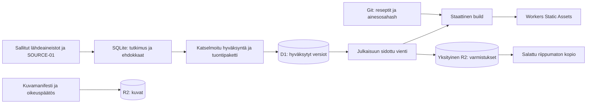

# Reseptit: yhteinen Cloudflare-siirtosuunnitelma

Päivitetty 2.11.2026. Tila: dokumentaatio, **ei toteutus- tai julkaisulupaa**.
Repository: `ozirix-dev/Reseptit`. [Draft-PR #172](https://github.com/ozirix-dev/Reseptit/pull/172).
Työhaara: `codex/cloudflare-images-plan-20261102`.
Inventaarion main-SHA: `583fdb91aeb12114f909412b9165fc3b02a6515d`.

Tämä suunnitelma korvaa aiemman päällekkäisen vaiheistuksen yhdellä kuuden vaiheen
mallilla. Liitteiden luvut ovat päivättyjä havaintoja. Tulevan siirron aineisto
nimetään erikseen hyväksytystä mainista, ei muiden istuntojen työpuista.

## 1. Tavoite, vastuut ja työn rajat

Yksi järjestelmä: paikallinen SQLite tutkimukseen ja tuontien valmisteluun,
D1 hyväksytyille ravintoarvoille ja lähteille, R2 kuville ja aineistoille sekä
Workers Static Assets julkiselle sivustolle. Sivusto on `https://recipavo.com/`,
kuvahosti `https://kuvat.recipavo.com/` ja www ohjataan apexiin.

| Osa | Määräävä tehtävä | Julkisuus |
| --- | --- | --- |
| GitHub | Markdown-reseptit, ainesosat, annokset, koodi, katselmoidut hyväksyntämanifestit ja historia | Nykyisen repon mukainen; ei salaisuuksia tai rajoitettua raakadataa |
| SQLite | Paikallinen tutkimus, ehdokkaat ja tuontien valmistelu | Ei itsenäinen tuotantomaster |
| D1 | Hyväksytyt ravintoarvot, lähdetietueversiot, laskentasidokset ja kuvametatiedot | Ei suoraa selainyhteyttä |
| Media-R2 | Hyväksytyt julkaisuoriginaalit ja optimoidut versiot | Kuvadomain avataan vasta vaiheessa 5 |
| Erillinen yksityinen R2 | Masterit, sallitut lähdeaineistot, SQL-viennit ja palautuspaketit | Ei custom domainia eikä r2.dev-julkisuutta |
| Workers Static Assets | HTML, reitti-JSON, JS/CSS ja julkiset metatiedot | Julkinen vaiheessa 5 |
| Riippumaton kopio | Salatut hyväksytyn datan ja julkaisun palautuspaketit Protoniin | Cloudflaren ulkopuolella |

Projektin omistaja hyväksyy tietomallin, datan omistajuuden siirtymän ja jokaisen
vaiheen aloituksen. Toteuttaja kirjaa näytön Gitissä katselmoitavaan manifestiin
tai PR:ään. Uutta projektinhallintajärjestelmää ei rakenneta.
Yhden vaiheen hyväksyntä ei aloita seuraavaa vaihetta.

Tämä korjausajo muuttaa vain dokumentaatiota. Ei aktiivisia reseptejä, makroja,
GK-arvoja, laskentamoottoria, julkaisurekistereitä, kuvia tai workflowta.
Ei buildia, testisarjaa, massagenerointia, D1/R2-tuontia, Cloudflare-resursseja,
DNS-/tuotantomuutoksia, Actions-ajoja, mergeä tai deployta.
SOURCE-01:n ja GK80:n työpuita ei muuteta.

## 2. SOURCE-01:n tila ja pakollinen riippuvuus

SOURCE-01 tarkoittaa tässä kansainvälisten ravintokoostumustietokantojen tutkimusta
(NEVO, Thai FCD, MEXT, CoFID ja muut), ei erillistä GI-SOURCE-01-tutkimusta.

Lukevassa tarkistuksessa 2.11.2026 tunnetun SOURCE-01-worktreen HEAD oli
inventaarion main-SHA, seurattujen tiedostojen diffi tyhjä eikä työpuusta löytynyt
SOURCE-01-loppuraporttia. Scratchissa `D:/Temp/source-01-20261102` oli baseline-,
lähdehaku- ja pilotointiaineistoa. Pilotissa oli hyväksymättömiksi merkittyjä
tutkimusehdokkaita. Tarkistetuista PR-hauista ei löytynyt erillistä hyväksyttyä
ravintotietokantojen SOURCE-01-loppuraporttia. Tämä havainto ei ole kaikkien
istuntojen tai hakemistojen täydellinen auditointi.

**SOURCE-01:n valmistuminen ja tulosten hyväksyntä on vaiheen 1 poistumisehto.**
Lopullista SQLite/D1-skeemaa tai lähdekenttien normalisointia ei lukita ennen sitä.
Tämä dokumentti määrittelee yhteiset invarianssit ja katselmoitavan käsitemallin,
ei valmista SQL-migraatiota. Tutkimustiedostojen olemassaolo ei ole hyväksyntä
tuotantolaskentaan. Keskeneräisiä ehdokkaita ei kopioida hyväksyttyyn D1-dataan.

Vaiheessa 1 tarvitaan hyväksytty raporttiversio, lähdekohtaiset ravintotekijä-
ja hiilihydraattimääritelmät, polyolien puuttuvuuden käsittely, käyttö-/säilytys-/
julkaisuehdot sekä pilotin hyväksytyt ja hylätyt ainesosavastaavuudet.
Hyötyarvio ei yksin osoita tuotekohtaista vastaavuutta tai käyttöoikeutta.

## 3. Datan omistajuus ja yksisuuntainen siirtymäsopimus

Omistajuutta ei vaihdeta tällä dokumentaatiomuutoksella.

| Tila | Ravintoarvojen määräävä lähde | SQLite/D1 |
| --- | --- | --- |
| Nykytila ja vaiheet 1–3 | Nykyinen Git-pohjainen laskenta ja hyväksyntä | SQLite valmistelee, stage-D1 todistaa yhteensopivuuden |
| Vaihe 4 ennen omistajuusporttia | Gitin nimetty lähtöjulkaisu | Tuotanto-D1:een valmistellaan lukittu ehdokas |
| Omistajan hyväksymän portin jälkeen | D1:n hyväksytyt tietue- ja laskentaversiot | SQLite on valmistelija; Gitin numerokopiot ovat vain vientiprojektioita |

Omistajuusportti on vaiheen 4 lopussa: hyväksytään lähtösnapshot, D1-vientivertailu
ja cutover-commit. Sen jälkeen Gitin mahdolliset ravintoarvonumerot tuotetaan
D1:stä ja merkitään projektioiksi; niiden käsinmuokkaus estetään tulevassa
julkaisutarkistuksessa. Git säilyy reseptitekstin, ainesosien, annosten ja koodin
masterina. Tuotanto-D1:tä muutetaan vain hyväksytyillä, versioiduilla tuontipaketeilla.
SQLiteen ja D1:een ei synny kahta vapaasti muokattavaa tuotantomasteria.

Ainesosien tai annosmäärän muutos Gitissä vanhentaa laskentasidoksen.
Uusi arvo vaatii uuden laskennan ja hyväksynnän; vanhaa versiota ei ylikirjoiteta.
Puuttuvaa tulosta ei korvata nollalla. GK-menetelmää tai arvoja ei muuteta siirrossa.

Jo julkaistu mutta riittämättömästi perusteltu arvo ei saa hyväksyntää siirron
perusteella. Se säilytetään tarvittaessa erillisenä versionoituna
`legacy_publication_snapshot`-käsitteenä alkuperäisine näyttötiloineen:
nykyinen esitys voidaan säilyttää, mutta tietoa ei hyväksytä uuden laskennan
lähdetietueeksi. Tarkka esitys ja rajaus hyväksytään vaiheen 1 kartoituksessa.
Siirron tekninen onnistuminen ei paranna lähteen laatuluokitusta.

## 4. Yhteensopiva SQLite/D1-tietomalli ja hyväksyntä

### 4.1 Yhteinen skeemaperhe

SQLite ja D1 käyttävät samaa versioitua ydinskeemaa ja migraatiojärjestystä.
SQLite voi sisältää ehdokkaita ja hylättyjä rivejä; tuotanto-D1:een viedään
vain hyväksytty paketti ja erikseen luokiteltu lähtöjulkaisu. Ei kaksisuuntaista
synkronointia. D1 tukee SQLite-SQL:ää, mutta ei kaikkia laajennuksia tai PRAGMA-
asetuksia; yhteensopivuus todistetaan pilotissa.
[D1 SQL](https://developers.cloudflare.com/d1/sql-api/sql-statements/).

Seuraava on SOURCE-01:n tulosten jälkeen katselmoitava käsitemalli.
Taulunimet ja DDL ovat vielä ehdotuksia; tunnistus-, puuttuvuus- ja versiointisäännöt
ovat vaatimuksia.

| Käsite | Vähimmäissisältö |
| --- | --- |
| `source` / `source_version` | Namespace, virallinen versio, noutoaika, aineisto-SHA, ehdot ja näyttöviite |
| `source_record` | Lähde, lähdeversio, alkuperäinen tunniste, tuote/valmistustila ja tietuehash |
| `nutrient_observation` | Lähteen ravintotekijäkoodi, raaka-arvo ja tilakoodi, yksikkö, painoperusta, määritelmä ja muunnosviite |
| `record_review` / `ingredient_match` | Tarkistaja, hyväksyntä/ehto, täsmällinen tietueversio ja reseptin ainesosavastaavuus |
| `calculation` / `calculation_ingredient` | Resepti-input-hash, annokset, massat, lähdetietueversiot, menetelmä ja tulos-/hyväksyntätila |
| `recipe_version` / `legacy_publication_snapshot` | release-id, recipe_id, kieli, Git-/sisältöhash ja alkuperäinen julkaisutila |
| `image_asset` / `image_variant` / `recipe_image` | SHA:t, mitat, R2-avaimet, reseptiversio, rooli ja kielikohtainen alt |
| `image_url_alias` / `provenance_group` | Vanha host/polku ja kohde; kuvaryhmän näyttö ja SHA-jäsenet |
| `import_batch` / `release` | Skeema-/importer-/manifestiversio, input-hashit ja prepared/verified/published-tila |

### 4.2 Tunnistus, uusintatuonti ja puuttuvuus

- Tietueen yksilöinti on `(source_id, source_version_id, original_record_id)`.
  Alkuperäinen tunniste säilytetään merkkijonona etunollineen ja kirjainkokoineen.
  Eri maiden samannimisiä elintarvikkeita ei yhdistetä automaattisesti.
- Ilman virallista versiota muodostetaan dokumentoitu snapshot-tunniste noutopäivästä
  ja aineistohashista. Virallinen versionumero jää tuntemattomaksi.
- Sama tunniste ja sisältö on uusinta-ajossa no-op. Sama tunniste eri sisällöllä
  pysäyttää tuonnin. Korjaus tarvitsee uuden snapshot-/revisioversion ja katselmoinnin.
- Reseptin laskenta sitoutuu tietueversioon ja sisältöhashiin, ei `latest`-osoittimeen.
- Ravintotekijän lähdemääritelmä, yksikkö, painoperusta ja raaka/kypsä/valutettu-tila
  säilyvät. Hiilihydraattikenttiä ei yhdistetä määritelmiä ohittamalla.
- Ilmoitettu nolla, mittaamatta jäänyt, puuttuva komponentti, jälki-/raja-arvo ja
  laskettu arvio erotetaan. Puuttuva polyoli pysyy puuttuvana. Kuitua ei vähennetä
  kahteen kertaan. Muunnos tallentuu versionoituna raakahavainnon rinnalle.
- Raaka-arvon tarkkuus säilyy; pyöristys noudattaa nykyistä laskentamenetelmää.
  SQL-tyyppimuunnos ei päätä puuttuvuutta tai hyväksyntää.

### 4.3 Tutkimusehdokkaasta hyväksyttyyn laskentaan

1. **Tutkimus:** sallittu raakatietue ja näyttö SQLiteen tutkimustilaisina.
2. **Lähdearvio:** käyttöehdot, lähdeversio, määritelmät, yksiköt ja puuttuvuus
   tarkistetaan; este jää HOLD-/hylkäyspäätökseksi.
3. **Ainesosavastaavuus:** tuotetyyppi, valmistus, massa ja muunnokset tarkistetaan.
   Lähdetietueen hyväksyntä ei hyväksy sitä kaikkiin samannimisiin ainesosiin.
4. **Laskenta:** nykyinen menetelmä käyttää hyväksyttyjä vastaavuuksia.
   Automaattinen tulos ei ole ihmisen hyväksyntä.
5. **Päätös:** tarkistaja, päivä, ehdot, päätös ja input-hashit kirjataan Gitissä
   katselmoitavaan hyväksyntämanifestiin täsmälliselle versiolle.
6. **Tuonti:** sama valittu rivijoukko SQLite-viennistä D1:een; manifesti, rivimäärät,
   FK:t, yksilöllisyys ja hashit verrataan. Keskeneräinen erä pysyy prepared-tilassa.
7. **Julkaisu:** verified-erän D1-vienti ja Git-reseptisisältö sidotaan release-id:hen
   ennen omistajan julkaisupäätöstä.

Erä sisältää skeema-/importer-version, lähdeversiot, hyväksyntämanifestin SHA:n,
Git-inputin ja odotetut rivimäärät/tiivisteet. Suuret sallitut evidenssit sijoitetaan
yksityiseen R2:een; D1:een niiden viitteet, ei suuria todistusaineisto-BLOBeja.
## 5. Kuvakirjasto: oikeudet, duplikaatit ja versiot

Liite A säilyttää alkuperäisen tiedostoinventaarion rajauksineen: 327 lähdekuvaa,
67 678 696 tavua (noin 64,54 MiB), ei SHA-256-duplikaattiryhmiä. Lisäksi havaittiin
poikkeava reseptihakemiston WebP, favicon, Gitin ulkopuolinen PNG-master ja
build-kopioita. SHA-yhtäläisyys kertoo samoista tavuista, ei kuvan samankaltaisuudesta.

### 5.1 A/B/C-luokat ja ryhmäkohtainen alkuperäselvitys

| Luokka | Näyttö | Käsittely |
| --- | --- | --- |
| A: dokumentoidusti itse luotu tai generoitu | Oma tuotanto tai dokumentoitu generointityönkulku, soveltuvat käyttöehdot ja tiedostojen jäsenyys | Julkaistavissa tarkistetun ryhmä-/tiedostopäätöksen mukaisesti |
| B: dokumentoidusti käyttöoikeudellinen | Tekijä/oikeudenhaltija, lähde, lupa/lisenssi ja attribuutioehdot | Julkaistavissa ehtoja noudattaen |
| C: alkuperältään epäselvä | Näyttö puuttuu, on ristiriitainen tai ei yksilöi ryhmää/tiedostoa | Ei hyväksyntää uuteen julkiseen mediaan ennen selvitystä |

Yhteinen selvitys saman dokumentoidun generointierän kuville sallitaan, kun polku-
ja SHA-256-jäsenluettelo sitoo jokaisen tiedoston tuotantolokiin, export-manifestiin
tai muuhun näyttöön. Ryhmässä kirjataan työkalu/palvelu, tuotantoaika tai aikaväli,
käyttöehdot, näyttö, tarkistaja ja päätös. Encoder-ketju osoittaa variantit ryhmän
alkuperäisiin. Poikkeukset tarkistetaan erikseen. Sama hakemisto tai tyyli ei
osoita jäsenyyttä. 327 erillistä käsintarkistusta ei edellytetä ilman syytä:
jäsenyys voidaan tarkistaa koneellisesti ja ryhmänäyttö ihmisen katselmoinnilla.

Aiemmat 15 kuvakorjausmerkintää ja Thai-kuvien raportti ovat näyttöehdokkaita,
eivät koko kirjaston oikeusvakuutus. EXIF:n puuttuminen tai GitHub-sijainti ei
osoita oikeutta. Yksityinenkin lähdeaineisto säilytetään käyttöehtojensa mukaisesti.

### 5.2 Säilytys, optimointi ja sidokset

Kaikkien havaittujen alkuperäisten tavut säilytetään. PNG-masteria ei rekonstruoida
WebP:stä. Julkinen media ja yksityiset masterit erotetaan; käyttämättömiä,
historiallisia tai epäselviä kuvia ei poisteta. Julkisen median alkuperäiset
kuuluvat myös yksityisen ja riippumattoman palautuspaketin kattavuuteen.

Säilytetään Sharp 0.35.5, WebP quality 78, effort 4 ja leveydet 480/960/1440 vain
lähdettä pienempinä. Ei rajausta tai suurennusta. Variantti sidotaan lähde-SHA:han,
mittoihin, Sharp/libvips/WebP-versioihin ja täyteen tuloste-SHA:han.
[Nykyinen kuvaputki](responsive-images.md).

| Objektiperhe | Sisältö |
| --- | --- |
| Media `originals/<sha256>.webp` | Hyväksytty julkaisuoriginaali |
| Media `_variants/<encoder-key>-<width>w.webp` | Nykyisen nimisopimuksen varianttitavut |
| Media `releases/<release-id>/images.json` | Vain julkiset kuvaviitteet ja mitat |
| Arkisto `masters/<sha256>.<ext>` | Masterit ja säilytettävät julkaisemattomat alkuperäiset |
| Arkisto `source-evidence/<source-id>/<sha256>.<ext>` | Käyttöehtojen sallima lähdenäyttö |

Sama SHA saa yhden sisältöobjektin mutta useita resepti- ja URL-sidoksia.
Lyhennetty encoder-avain ei korvaa hash-todistetta. Eri sisältö saman avaimen alla
pysäyttää tuonnin. Reseptiversion sidosta ei muuteta jälkikäteen, ja alt-teksti on
resepti- ja kielikohtainen.

Ennen vaihetta 4 ratkaistaan käyttämättömien khao-soi- ja shoyu-kuvien,
reseptihakemiston WebP:n ja PNG-masterin luokittelu sekä pho/shoyu-reseptien yhteisen
kuvan tarkoituksellisuus. Mikään näistä ei ole poistoehdotus. Jos julkaistavan
reseptin C-kuva jää selvittämättä eikä korvausta ole erikseen hyväksytty, vaihe 4
ei valmistu: reseptiä tai kuvaa ei pudoteta julkaisusta hiljaisesti.

## 6. Sivusto, URL-siirtymä ja julkaisuvaihdoksen eheys

Vite/React/React Router säilytetään. Origin, base ja mediaorigin parametrisoidaan
paikallisesti; tuotannossa base on `/`. Build lukee julkaisuun sidotun D1-viennin
ja saman Git-inputin reseptit. Julkinen sivulataus ei tee D1-kyselyä.
Ensimmäiseen versioon ei lisätä julkista ravintoarvo-API:a tai editoria.

### 6.1 Täsmällinen osoitekartta

| Osoiteperhe | Toteutus vaiheessa 5 |
| --- | --- |
| GitHub Pagesin vanha resepti-/kielisivu | Sivukohtainen HTML-ohjaus, näkyvä linkki ja canonical vastaavaan uuteen sivuun |
| GitHub Pagesin vanha kuva tai srcset-variantti | Vanhat tavut ja polut säilyvät Pages-paketissa |
| `recipavo.com/Reseptit/<tunnettu sivupolku>` | Täsmällinen alias oikeaan juuripolkuiseen osoitteeseen |
| Uuden hostin `/Reseptit/kuvat/*` ja `/kuvat/*` | Tunnettu alias kuvadomainiin ennen yleistä sivuohjausta |
| `www.recipavo.com` | Vyöhykkeen ohjaussääntö apexiin, polku ja kysely säilyttäen |
| Tuntematon sivu-/kuvapolku | Aito 404, ei etusivun tai SPA-fallbackin 200-vastausta |

Cloudflare ei hallitse github.io-hostin HTTP-vastauksia. GitHub Pagesin HTML-ohjaus
ei ole HTTP 301. Siirtymäjulkaisu tehdään heti onnistuneen Recipavo-kytkennän
jälkeen samassa julkaisuikkunassa käyttäjän valinnan mukaisesti.
Kieliversiot yhdistetään recipe_id:n ja kielen perusteella. Kysely/fragmentti
säilytetään kiinteään karttakohteeseen; URL-parametri ei määrää ulkoista kohdetta.
Myös hakemistot ja menetelmäsivut luetteloidaan. Puuttuvaa vastinetta ei piiloteta
etusivuohjaukseen.

Nykyisen GitHub Pagesin canonical-, hreflang-, sitemap-, robots-, OG- ja JSON-LD-
tiedot muutetaan vasta vaiheen 5 siirtymäjulkaisussa. Vaiheissa 2–4 valmistellaan
ja tarkistetaan vain julkaisematon uusi konfiguraatio. Preview suojataan Accessilla.

### 6.2 Pagesin autodeploy ja jo avoin selain

Nykyinen Pages-workflow voi julkaista main-pushista uudelleen. Vaiheessa 2
valmistellaan muutos, jolla automaattinen täysi Pages-sisältöjulkaisu loppuu
siirtymäjulkaisussa. Vaiheessa 5 sallittu erillinen julkaisu tuottaa ohjaussivut ja
vanhat kuvat; myöhemmät main-muutokset eivät saa korvata niitä. Palautus on erikseen
valittava julkaisutapa vanhasta täydestä paketista. Tässä PR:ssä workflow ei muutu.

Vanhat hash-nimetyt JS/CSS- ja reitti-JSON-tavut sisällytetään seuraavien julkaisujen
asset-joukkoon vähintään 30 päivän ajan ja vähintään edelliselle palautusversiolle.
Nykyinen build poistaa datahakemiston: toteutus kokoaa julkaisuassetit erilliseen
stagingiin aiempien manifestien tarvitsemista muuttumattomista objekteista.
Näin vanha HTML tai avoin välilehti saa tarvitsemansa JSONin ja koodin.
Objektimäärä ja Static Assets -rajat mitataan; ylitys vaatii omistajan hyväksymän
ratkaisun ennen vaihetta 5, ei tiedostojen hiljaista pudottamista.

Release-id sitoo Git-SHA:n, skeema-/importer-/laskenta-/encoder-versiot, D1-viennin,
kuvamanifestin ja sivustopaketin. Julkinen `/release.json` sisältää vain release-id:n,
Git-SHA:n ja julkisen manifestin SHA:n. Lyhyt TTL ei yksin korvaa versiosidosta.

| Sisältö | Välimuisti |
| --- | --- |
| Hash-nimetyt kuvat, JS, CSS ja reitti-JSON | Vuosi, immutable; vanhat tavut säilytetään |
| HTML, sitemap, robots ja muuttuva release-osoitin | Uudelleenvalidointi tai enintään 300 sekunnin vanheneminen |
| Muuttuvat aliaset | Lyhyt TTL ja aluksi väliaikainen ohjaus; pysyvä vasta kartan hyväksynnän jälkeen |
| Private-arkisto ja hallinta | Ei julkista välimuistia; virheisiin ei pitkää TTL:ää |

Worker-first rajataan vanhoihin `/Reseptit/*`- ja `/kuvat/*`-polkuihin.
Muut staattiset pyynnöt palvellaan suoraan. MIME, GET/HEAD ja ehdollinen GET
varmennetaan; ETag ei ole SHA-todiste. CORS avataan vain todettuun tarpeeseen.
[Static Assets -konfiguraatio](https://developers.cloudflare.com/workers/static-assets/binding/).

## 7. Yksi varmistusprosessi ja selkeä palautus

### 7.1 Viisi täydentävää suojaa

| Suoja | Tarkoitus | Säilytys |
| --- | --- | --- |
| D1 Time Travel | Nopea saman tilin pistepalautus | Paid 30 vrk, tarkistetaan käyttöönotossa |
| Päivittäinen D1-vienti yksityiseen R2:een klo 00.00 UTC | SQL-vienti ja manifesti | 30 vrk |
| Tuonti-/julkaisukohtainen paketti ennen merkittävää muutosta | SQL, inputit, media-/asset-manifestit, sivustopaketti ja asetukset | 365 vrk; aktiivinen ja edellinen palautusversio aina |
| Kuukausittainen palautuskokeilu erillisessä ympäristössä | Todistaa kuukauden paketin, avaimen, kuvat ja sivuston | Paketti/raportti 400 vrk eli vähintään 12 täyttä kuukautta |
| Salattu ulkopuolinen kopio Protoniin | Jokainen hyväksytty tuontierä ja julkaisu ennen vahvistusta sekä kuukausipaketti | 400 vrk; aktiivinen, edellinen ja ennen-siirtoa-paketti aina |

Ennen-siirtoa-paketti säilytetään pysyvänä. Ei erillistä viikkovarmistuskerrosta,
päivittäisiä koko kuvakirjaston kopioita tai uutta varmistusohjausjärjestelmää.
Time Travel ei varmenna R2-kuvia eikä suojaa tilin menetykseltä.
[D1 Time Travel](https://developers.cloudflare.com/d1/reference/time-travel/).

### 7.2 Ajastus, onnistuminen ja vanhentuminen

Valitaan yksi pieni Cloudflaren oman esimerkin mukainen ajastettu Workflows-vienti,
ei paikallisen tietokoneen yöajoa. Se käynnistää D1-viennin, odottaa tulosta,
tallettaa SQL:n ja manifestin sekä varmistaa SHA:n ennen onnistumismerkintää.
Sama prosessi tekee kuukauden ensimmäisestä onnistuneesta viennistä
kuukausipaketin; erillistä kuukausibackup-palvelua ei tehdä.
[Cloudflaren D1→R2-esimerkki](https://developers.cloudflare.com/workflows/examples/backup-d1/).

Paketti yksilöidään backup-id:llä, UTC-ajalla, release-id:llä, skeemaversiolla,
D1-bookmarkilla ja manifestiversiolla. SQL:n, median ja asset-paketin SHA:t,
tavumäärät, rivimäärät ja palautuskokeen viite kirjataan. Tiedoston olemassaolo
tai tyhjä backup-kansio ei riitä näytöksi.

Sama prosessi ja R2:n omat prefix-kohtaiset lifecycle-säännöt hallitsevat vanhentumisen:

- `backups/daily/`: SQL ja manifesti poistokelpoisiksi 30 vrk jälkeen.
- `backups/monthly/`: kuukausivienti ja manifesti poistokelpoisiksi 400 vrk jälkeen.
- `releases/`: 365 vrk vanhat paketit arvioidaan; aktiivinen, edellinen,
  ennen-siirtoa-paketti ja säilytettävien manifestien riippuvuudet suojataan.
  Poistolista kirjataan; epäselvä viite estää siivouksen.
- Mastereille, lähdenäytölle ja jaetuille sisältöosoitteisille media-/asset-objekteille
  ei aseteta ikään perustuvaa automaattipoistoa ensimmäisessä toteutuksessa.

Lifecycle-/siivoustoiminnon hyväksyntä kuuluu vaiheeseen 3. Tässä ajossa ei luoda
poistoja tai sääntöjä. Bucket Lockia tai oletettua S3-versionointia ei tehdä
ensimmäisen version edellytykseksi.
[R2 lifecycle](https://developers.cloudflare.com/r2/buckets/object-lifecycles/).

Viimeisin onnistuminen näkyy Workflowsin nykyisessä näkymässä ja manifestissa.
Nimetty ylläpitäjä tarkistaa sen julkaisuportilla ja ylläpitokatselmuksessa.
Yli 24 h vanha onnistuminen tai virheellinen manifesti kirjataan poikkeamaksi ja
estää uuden julkaisun; nykyinen staattinen sivusto jatkaa. Ulkoisen ilmoituskanavan
valinta ei sisälly automaattisesti tähän suunnitelmaan. RPO-tavoite ei tarkoita,
että hälytysjärjestelmä olisi jo olemassa.

### 7.3 Riippumaton kopio, avaimet ja palautus

Käytetään samaa palautuspakettia tar-muodossa ja age v1 / X25519 -salattuna.
Ennen vaihetta 3 nimetään Proton-kohde, vastaanottaja-avain ja ylläpitäjä.
Purkuavain säilytetään K:-holvissa ja omistajan erillisessä offline-palautuskopiossa.
Pelkkä samassa koneessa oleva K:-asema ei riitä. Avainta tai tilien palautuskoodeja
ei tallenneta Git-repoon tai R2-pakettiin.

Proton-siirto käyttää olemassa olevaa hallittua asiakasta tai tarkistettua
julkaisurutiinia; uutta Proton-API-/synkronointijärjestelmää ei rakenneta.
Kopio ladataan takaisin, puretaan ja tarkistetaan ennen tuontierän tai julkaisun
vahvistamista. Myös kuukausikokeilu käyttää ulkopuolista kopiota.
Sen siivous noudattaa samaa säilytysluetteloa nykyisen Proton-työnkulun kautta;
ilman turvallista automaatiota se kuuluu kuukausirutiiniin.

Jokainen hyväksytty D1-datamuutos kuuluu nimettyyn tuontierään ja sen ulkopuoliseen
pakettiin. Ad hoc -muokkausta ei sallita. Keskeneräinen prepared-erä rekonstruoidaan
Git-/SQLite-syötteistä. Näin viimeisin verified-data on tilin menetyksessä
palautettavissa ilman jatkuvaa Proton-yöajastusta.

| Häiriö | Palautus |
| --- | --- |
| Kone rikkoutuu | Puhdas kone, oikea Git-SHA ja lukitut työkalut; Proton-paketti ja erillinen avain; hash-varmennus; SQLite rekonstruoidaan inputeista |
| Cloudflare-tili menetetään | Protonista SQL, media, assetit ja asetukset uuteen hallittuun ympäristöön; tili- ja domainhallinta varmistetaan erikseen |
| D1 vaurioituu | SQL erilliseen palautuskantaan; eheys-/rivivertailu; Time Travel nopeana lisävaihtoehtona |
| Worker/julkaisu epäonnistuu | Edellinen varmennettu release ja assetit; ei vanhojen D1/R2-versioiden poistoa |

Kuukausikoe palauttaa SQL:n erilliseen stage-D1:een, varmentaa kuvat/assetit,
avaa pienen neljän kielen otoksen ja kirjaa keston. Ensimmäinen koe tehdään ennen
tuotantokytkentää. RPO 24 h ja RTO 4 h ovat tavoitteita ennen mitattua näyttöä.
Tilin menetyksen RTO riippuu myös uuden tilin ja domainhallinnan saannista.

## 8. Resurssit, käyttöoikeudet ja kustannukset

| Resurssi | Suunniteltu nimi |
| --- | --- |
| Julkinen Worker ja stage | `recipavo-web`, `recipavo-web-stage` |
| D1 | `reseptit-prod`, `reseptit-prod-stage` |
| Media | `reseptit-media`, `reseptit-media-stage` |
| Arkisto | `reseptit-private-archive`, `reseptit-private-archive-stage` |
| Varmistus | Yksi pieni ajastettu D1-vienti; ei julkista hallinta-API:a |

Nimi ei todista identiteettiä: resurssi-ID, tili ja ympäristö varmistetaan.
Nimiristiriita pysäyttää käyttöönoton. Vaiheen 4 media pysyy yksityisenä ilman
custom domainia tai r2.dev:tä vaiheeseen 5 asti. Stage-siivous ei koske tuotantoa.

Olemassa olevat tunnukset tarkistetaan ennen uusien pyytämistä; oikeutta ei päätellä
nimestä. Resurssien valmistelu, tuonti, media, julkaisu ja varmistus rajataan
tehtäviinsä. Julkisella Workerilla ei ole D1-, arkisto- tai kirjoitustunnuksia.
Stage käyttää vain stage-bindingejä ja Access-suojausta ennen aineiston avaamista.
Ei salaisuuksia lokeihin, manifesteihin tai julkisiin assetteihin.

Siirtotyökalu lukee vain hyväksyttyä manifestia. Ei sync --delete -ajoa,
hakemistosta pääteltyä tuontia tai eri-SHA-objektin korvaamista. Rinnakkaisuus
aluksi neljä objektia, tilapäiseen virheeseen enintään viisi retry-yritystä
viiveellä. Oikeus-/sisältövirhe pysäyttää erän; loki mahdollistaa jatkamisen.

Lisäkulutavoite on **enintään 5 USD/kk nykyisen Workers Paid -tilauksen päälle**,
ennen veroja ja domain-/Proton-maksuja. Kiintiöt jaetaan muiden projektien kanssa.
Nykyinen 3,35 GB:n R2-näkymä ei osoita koko jakson GB-month-kertymää tai vapaata
projektikiintiötä. Hinnoittelu ja kapasiteetti tarkistetaan ennen vaiheita 3–5.

Seurataan D1-tavuja ja luettuja/kirjoitettuja rivejä, R2:n mediaa/arkistoa ja
Class A/B -operaatioita, varmistusprosessia sekä Workerin kutsuja ja CPU:ta.
Stage, read-backit ja retentio lasketaan mukaan. Kuvapyynnöt eivät ole sama asia
kuin R2-operaatiot. Maksullinen Cloudflare Images ei ole edellytys.

2,50 USD:n lisäkulujen kuukausiennusteessa tutkitaan kasvu; 5 USD:ssa pysäytetään
uudet vapaaehtoiset maksulliset laajennukset ja ratkaistaan aiheuttaja.
Varmistuksia tai nykyistä sivustoa ei katkaista. Tavoite ei ole laskutuskatto.
Laskentaskenaariot ovat liitteessä C.
## 9. Kuusi erikseen hyväksyttävää toteutusvaihetta

Omistaja hyväksyy nimetyn vaiheen ja tarkan aineisto-/Git-version. Päätös ja näyttö
kirjataan tavalliseen PR:ään tai manifestiin. Seuraava vaihe ei käynnisty
automaattisesti; tämän dokumentaation hyväksyminen ei aloita vaihetta 1.

### 9.1 Vaihe 1 – SOURCE-01 ja tietomalli

- **Lähtöehdot:** oikean repon erillinen työpuu ja SOURCE-01:n tila tiedossa.
  Käsitemallia voidaan valmistella, mutta keskeneräinen tutkimus estää skeeman lukituksen.
- **Tehtävät:** katselmoidaan SOURCE-01, lähdemääritelmät, ehdot, SQLite/D1-kentät,
  versioavaimet, legacy-julkaisun käsittely ja hyväksyntäprosessi.
- **Hyväksymiskriteerit:** hyväksytty raporttiversio ja skeemaehdotus; nolla/puuttuva,
  eri maiden tietueet, muunnokset ja reseptin versiosidos ratkaistu.
- **Palautus:** ehdotus tarkennetaan tai hylätään, nykyinen Git-laskenta säilyy.
- **Kustannus:** ei Cloudflare-resursseja tai uusia palvelumaksuja.
- **Omistajan päätöspiste:** hyväksyy SOURCE-01:n tulokset ja yhteisen skeeman sekä
  vaiheen 2 paikallisen toteutuksen. Ei masterin vaihtoa vielä.

### 9.2 Vaihe 2 – Paikallinen toteutus

- **Lähtöehdot:** portti 1 hyväksytty ja lähdeaineistojen paikallinen käyttö sallittu.
- **Tehtävät:** SQLite-tuonnit, hyväksyntä-/vientimanifestit, kuvien A/B/C-ryhmät,
  kuva-/variantti-/URL-kartta, osoitekonfiguraatio sekä Pages-siirtymä ja palautus.
- **Hyväksymiskriteerit:** uusintatuonti no-op, ristiriita pysäyttää erän, puuttuvat ja
  julkaistut lähtöarvot säilyvät; legacy ei muutu approved-tiedoksi; vanhojen assetien
  säilytys ja kaikki reittikohteet määritelty. Ei massalatausta ilman hyötyä ja lupaa.
- **Palautus:** paikallinen ehdokas jätetään käyttämättä; nykyinen julkaisu ja masterit säilyvät.
- **Kustannus:** levytila ja työaika, ei Cloudflare-tuotantomuutoksia.
- **Omistajan päätöspiste:** hyväksyy pilotin erän, vaiheen 3 stage-resurssit,
  oikeudet, Proton-/avainjärjestelyn, ylläpitäjän ja varmistusten säilytyskäytännön.

### 9.3 Vaihe 3 – Cloudflare-pilotti

- **Lähtöehdot:** portti 2 hyväksytty, tili/tunnukset varmennettu, pieni hyväksytty
  otos ja erillinen stage-arkisto nimetty.
- **Tehtävät:** stage-D1, R2-testibucketit, Access-suojattu testijulkaisu,
  päiväviennin pilotti ja palautus. Otoksessa tavallinen, suurin ja jaettu kuva,
  vanha alias, yksityinen PNG-master, hyväksytty laskelma ja puuttuvia arvoja.
- **Hyväksymiskriteerit:** SQLite/D1-vastaavuus, read-back-SHA:t, arkiston yksityisyys,
  uusinta-ajo, keskeytyksestä jatkaminen ja ulkopuolisen paketin palautus testikantaan.
- **Palautus:** stage suljetaan testiliikenteeltä; aineisto säilytetään tutkintaan.
  Testiresurssien poisto on erillinen hyväksytty toimi.
- **Kustannus:** stage-tallennus, operaatiot, D1 ja vientiprosessi lasketaan yhteiseen
  5 USD:n lisäkulutavoitteeseen; ei julkisen domainin muutoksia.
- **Omistajan päätöspiste:** hyväksyy pilotin näytön ja vaiheen 4 aineistovalmistelun;
  kuvadomainin tai julkisen sivuston avaamista ei vielä hyväksytä.

### 9.4 Vaihe 4 – Koko aineiston valmistelu

- **Lähtöehdot:** portti 3 hyväksytty, main-SHA ja SOURCE-01/GK80:n mukaan tulevat
  versiot nimetty; inventaario uusitaan tästä snapshotista.
- **Tehtävät:** manifestituonti tuotanto-D1:een ja vielä yksityisiin tuotantobucketeihin,
  koko median read-back, D1-vienti, julkaisematon lopullinen build ja Proton-paketti.
- **Hyväksymiskriteerit:** julkiseen mediaan aiotut A/B-hyväksytty, C-poikkeukset ratkaistu,
  kaikki SHA:t, arvot, FK:t, reitit ja kielisidokset täsmäävät; nykyinen sivusto ei muutu.
- **Palautus:** prepared-ehdokas jää julkaisematta, Git määrää omistajuusporttiin asti;
  vanhoja objekteja tai reseptitietoja ei poisteta.
- **Kustannus:** mitattu media+arkisto+D1+asset-retentio sekä tuonnin operaatiot;
  varmistukset ja muu tilikäyttö huomioiden enintään 5 USD/kk lisää.
- **Omistajan päätöspiste:** hyväksyy erikseen luvun 3 masterin siirtymän D1:een ja
  verified-julkaisun. Vaiheen 5 erilliseen julkaisulupaan kuuluvat DNS, domainit,
  HTTPS sekä välttämätön Pages-Actions-siirtymäjulkaisu ja palautusajo.
  Ilman ajolupaa julkista liikennettä ei siirretä.

### 9.5 Vaihe 5 – Recipavo.com-julkaisu

- **Lähtöehdot:** omistajan nimenomainen julkaisulupa, testattu palautuspaketti/avain,
  nykyiset DNS-/Pages-asetukset ja julkaisu-SHA:t talteen.
- **Tehtävät:** luvun 10 kuvadomain-, Worker-, HTTPS- ja www-kytkentä; perustarkistukset;
  vasta sitten Pagesin sivukohtaiset HTML-ohjaukset ja täyden autodeployn pysäytys.
- **Hyväksymiskriteerit:** neljän kielen sivut, kuvat/srcset, arvot ja reitti-JSON,
  canonical/hreflang/sitemap/robots/OG/JSON-LD, 404 ja vanhat kuvat oikein;
  ei ohjaussilmukoita, ja avoin välilehti toimii julkaisuvaihdoksen yli.
- **Palautus:** edellinen Worker/release tai ensimmäisessä siirrossa vanha täysi Pages
  ja coming-soon-kytkentä luvun 10 järjestyksessä.
- **Kustannus:** julkiset pyynnöt, CDN, Worker ja varmennusoperaatiot lisätään lähtötasoon.
- **Omistajan päätöspiste:** vahvistaa julkaisun näytön ja vaiheen 6 ylläpitovastuun.
  Epäonnistumisessa sovittu palautus tehdään julkaisuluvan puitteissa.

### 9.6 Vaihe 6 – Julkaisun varmennus ja ylläpito

- **Lähtöehdot:** portti 5 hyväksytty tai palautuksen tulos kirjattu, ylläpitäjä nimetty.
- **Tehtävät:** tarkistukset heti, tunnin sekä 1, 7 ja 30 päivän kohdalla; päiväviennit,
  kuukausipalautus ja säilytyssiivous; GSC:n omistajuus, sitemap ja pieni URL-otos.
- **Hyväksymiskriteerit:** avainsivut/kuvat toimivat, ei uusia selittämättömiä 404/5xx-
  virheitä, sama release, onnistuneet varmistukset ja mitattu palautus; kulut
  tavoitteessa tai hyväksytty korjaus kirjattu.
- **Palautus:** edellinen varmennettu release; datakorjaus erillisenä uutena eränä.
- **Kustannus:** palvelukohtainen kuukausiseuranta, retentio ja muu tilikäyttö;
  luvun 8 ennusterajat 2,50/5 USD.
- **Omistajan päätöspiste:** hyväksyy 30 päivän jälkiarvion ja normaalin ylläpidon.
  Tämä ei hyväksy Git-kuvien, historian tai vanhojen kuva-URL:ien poistamista.

## 10. Julkaisun järjestys, tarkistukset ja palautus

Apex/www ovat nykyisin coming-soon Pagesin domaineja (liite B).
Custom Domain ei voi ottaa hostnamea, jolla on CNAME. Muutos ei ole atominen:
valvottuun julkaisuikkunaan kirjataan tarkat palautusarvot.
[Custom Domains](https://developers.cloudflare.com/workers/configuration/routing/custom-domains/).

Vaiheen 5 hyväksytyssä julkaisuikkunassa:

1. Tarkistetaan verified-release, resurssi-ID:t, vanha täysi Pages-paketti,
   SQL/media/asset-manifestit, Proton-read-back ja palautusajojen luvat.
2. Liitetään media R2:n kuvadomainiin; varmennetaan TLS, GET/HEAD, MIME, hash ja
   välimuisti. r2.dev jää pois.
3. Vaihdetaan apexin Pages-domain/CNAME Worker Custom Domainiksi; www irrotetaan
   Pagesista ja ohjataan apexiin proxied originless-tietueella ja ohjaussäännöllä.
4. Otetaan HTTPS-pakotus ja TLS-minimi 1.2 käyttöön, TLS 1.3 säilyttäen.
   Ei HSTS-preloadia ensimmäisessä siirrossa. Tarkistetaan avainsivut, neljä kieltä,
   release-id, ravintoarvot, kuvat, 404 ja uudet metatiedot.
5. Vasta onnistumisen jälkeen julkaistaan Pagesin HTML-ohjaukset ja vanhat kuvat,
   täysi autodeploy pysäyttäen. Koko reittikartta tarkistetaan koneellisesti ja
   julkisesta toimivuudesta pieni otos.

Väärät ravintoarvot, yksityisen aineiston vuoto, TLS-virhe, puuttuvat julkaisukuvat
tai keskeisten reittien toimimattomuus keskeyttävät kytkennän. Jos perustarkistukset
eivät onnistu viidessä minuutissa, aloitetaan palautus. Viisi minuuttia on
palautuspäätöksen raja, ei kaikkien DNS-/Pages-palautusten valmistumislupaus.

Jos Pages-ohjauksia ei vielä julkaistu, vanha Pages jatkaa ja coming-soon-kytkentä
palautetaan. Jos ohjaukset jo julkaistiin, palautetaan ensin vanha täysi Pages-
paketti ja varmennetaan sen reitit, sitten coming-soon-kytkentä. Näin vanhoille
resepteille ei jää pelkkää ohjausta coming-sooniin. Myöhemmin palautetaan ensisijaisesti
edellinen Worker+Static Assets+release. SQL-vaurio palautetaan erilliseen kantaan;
pelkkä release.json-osoittimen vaihto ei vaihda vanhan HTML:n tietoja.

| Toteutusvaiheen tarkistus | Hyväksytty näyttö |
| --- | --- |
| SQLite/D1 ja uusintatuonti | Sama skeema ja hyväksytty rivijoukko; ei duplikaatteja tai FK-virheitä |
| Lähteet ja laskenta | Tietueversiot, input-hash, puuttuvuudet ja makrot vastaavat hyväksyttyä lähtösopimusta |
| Media | Jokaisen objektin read-back-SHA, mitat, MIME ja koko; variantin sidos alkuperäiseen |
| Oikeudet | SHA-jäsenet kattava ryhmäpäätös tai poikkeustarkistus; C ei muutu hyväksytyksi automaattisesti |
| URL:t ja selain | Kaikki tunnetut reitit kartoitettu; vanhat kuvat/variantit ja avoimen välilehden navigointi toimivat |
| HTTP ja SEO | Ei silmukoita, aito 404, oikeat metadatahostit ja HTTPS |
| Julkinen/yksityinen | Stage suojattu, arkistoon ei anonyymiä pääsyä, yksityinen data pois buildista |
| Release ja palautus | Sama release-id, lopullinen build ja erillisen ympäristön palautus; ulkopuolinen paketti aukeaa |

Testit kohdistetaan vaikutukseen. Lopullinen build ja tarvittavat ravintoarvo-,
kuva-, reititys- ja staattisen tulosteen tarkistukset tehdään myöhemmin.
Neljän kielen pieni selainotos sisältää mobiilin, työpöydän, haun, annosmuutoksen ja
kielenvaihdon. Laajaa sarjaa ei toisteta joka dataerälle. R2:n ja D1:n välille ei
oleteta yhteistä transaktiota: prepared -> verified -> julkaisu etenee vasta
riippuvuuksien valmistuttua.

## 11. Avoimet päätökset ja aloitusportit

| Asia | Mihin mennessä | Ratkaisun näyttö |
| --- | --- | --- |
| SOURCE-01:n loppuraportti ja ehdot | Vaiheen 1 loppu | Hyväksytty versio, ravintotekijä- ja ainesosakartoitus |
| Lopullinen skeema ja legacy-käsittely | Vaiheen 1 loppu | Yhteinen malli ja nykyisten arvojen täsmällinen vertailuperusta |
| Kuvien A/B/C-jäsenet ja poikkeukset | Pilotti vaiheessa 2, koko aineisto vaiheessa 4 | Ryhmä-/poikkeuspäätös ja SHA-manifesti |
| Tunnukset, stage-identiteetit ja ylläpitäjä | Ennen vaihetta 3 | Todetut oikeudet ja eristys |
| Proton-kohde ja riippumaton avainpalautus | Ennen vaihetta 3 | Nimetty kohde, vastaanottaja ja toimiva salaus/read-back/purku |
| Main-input ja SOURCE-01/GK80:n julkaisuversiot | Ennen vaihetta 4 | Hyväksytty snapshot, ei keskeneräisiä työpuita |
| D1:n masteriksi siirtyminen | Vaiheen 4 loppu | Vientivertailu, legacy-rajat ja Git-projektioiden cutover hyväksytty |
| Julkaisun ja Pages-siirtymä-/palautusajon lupa | Ennen vaihetta 5 | Omistajan täsmällinen valtuutus |
| Lopullinen kustannus- ja asset-kapasiteetti | Ennen vaihetta 5 | Mitattu aineisto/retentio ja muu tilikäyttö; enintään 5 USD/kk lisää |

Päätettyjä valintoja ei avata uudelleen: recipavo.com, kuvat.recipavo.com, GitHub-repon
säilytys, vanhojen reseptisivujen ohjaus heti onnistuneessa julkaisuikkunassa ja
5 USD/kk lisäkulutavoite nykyisen Workers Paidin päälle. GSC:n datattomuus on käyttäjän
ilmoittama lähtötieto, ei odotusjakson vaatimus tai osoitus vanhojen URL:ien tarpeettomuudesta.

## 12. Dokumentaatioajon tallennus ja rajatut tarkistukset

Jatketaan PR #172:n omassa worktreessä
`D:/Projects/tmp/reseptit-cloudflare-images-plan-20261102`.
Repo-guard tarkistaa identiteetin ja tekee kirjoitukset, commitin ja pushin.
Ei uutta PR:ää, main-synkronointia, muiden työpuiden muutoksia, Readya tai mergeä.

Sallitut tarkistukset: Markdown-rakenne, paikalliset dokumenttilinkit, sisäinen
johdonmukaisuus ja `git diff --check`. Commitissa `[skip ci]`; nykyiset workflow-
käynnistimet luetaan ennen pushia, HEAD ja Actions-ajojen puuttuminen jälkeenpäin.
Ei buildia, testisarjaa, kuvagenerointia, tietokantatuontia tai Actions-ajoa.

PR-kuvauksessa on päivitettävä vanhentunut väite tarkistamattomista Cloudflare-
asetuksista. [Päivitetty kuvausteksti](cloudflare-migration/pr-172-description.md) tallennetaan
valmiina dokumentaationa. Jos repo-guard ei tue
olemassa olevan PR:n kuvauksen päivitystä, sitä ei ohiteta suoralla GitHub-
kirjoituksella ilman nimenomaista tähän päivitykseen rajattua käyttäjän poikkeusta.
Repo-guardia ei muuteta toisessa repossa tämän tehtävän sivuvaikutuksena.

## Liite A. Päivätty kuvainventaario ja rajaukset

[Mainin tiedostokohtainen inventaario](cloudflare-migration/images-main-20261102.json)
sisältää jokaisen kuvan polun, tavumäärän, SHA-256:n, pikselimitat ja reseptiviittaukset.
Inventaario perustuu Gitin seuraamiin tiedostoihin ja mainin reseptien frontmatteriin;
se ei ole tuotantopalvelimen etäauditointi.

| Sijainti mainissa | Kuvia | Tavua |
| --- | ---: | ---: |
| `kuvat/aamupalat/` | 150 | 31 306 912 |
| `kuvat/alkuruoat/` | 1 | 175 516 |
| `kuvat/jalkiruoat/` | 16 | 3 004 126 |
| `kuvat/leivonnaiset/` | 5 | 1 145 686 |
| `kuvat/paaruoat/` | 154 | 31 672 380 |
| `kuvat/munakoiso-kesakurpitsalasagne.webp` | 1 | 374 076 |
| **Reseptikuvien lähdehakemisto yhteensä** | **327** | **67 678 696** |
| `reseptit/paaruoat/jauheliha-kaalikeitto-vhh.webp` | 1 | 171 902 |
| `site/public/favicon.svg` | 1 | 185 |
| **Kaikki Gitin seuraamat kuvat** | **329** | **67 850 783** |

327 lähdekuvaa on noin 64,54 MiB. Reseptihakemiston poikkeava WebP mukaan lukien
Gitissä on 328 reseptimediaan liittyvää rasterikuvaa. Kaikki ovat WebP:tä;
favicon on SVG. PNG-, JPEG- tai AVIF-mastereita ei ole tässä main-snapshotissa.
327 lähdekuvan mitat: 190 × 1536×1024, 94 × 1280×853, 40 × 1279×853,
yksi 2200×1053, yksi 1448×1086 ja yksi 1254×1254.

Mainissa on 326 julkaistua suomenkielistä reseptiä ja 119 julkaistua versiota
kullakin kielellä en/sv/th: yhteensä 683 julkaistua reseptiversiota.
Ne viittaavat 325 erilliseen kuvatiedostopolkuun. Puuttuvia `image.src`- tai
historiallisia `image.srcset`-tiedostoja ei löytynyt; jokaisella julkaistulla
reseptiversiolla on kuva. Ilmoitetut pääkuvien pikselimitat täsmäävät tiedostoihin.

### A.1 Paikalliset alkuperäiset ja generoidut kopiot

Pelkkä puhdas worktree ei paljasta Gitin ohittamia mastereita. Siksi seuraavat
hakemistot luettiin lisäksi muuttamatta olemassa olevaa checkoutia
`D:/Projects/Products/Reseptit`, jonka HEAD oli `b1c2bd3e036f0a17b3f61a560c39b5df56e1d8d5`.
Tätä eri haaran havaintoa ei sekoiteta mainin lukuihin.

| Paikallinen hakemisto | Kuvia | Tavua | Luonne |
| --- | ---: | ---: | --- |
| `kuvat/` | 327 | 69 838 925 | 326 WebP:tä ja yksi PNG |
| `site/public/kuvat/` | 1166 | 133 532 130 | Aiemmin generoitu julkaisutuloste |
| `site/dist/kuvat/` | 1166 | 133 532 130 | Aiemman buildin kopio |
| `output/` | 0 | 0 | Ei kuvia havaittu |
| `Reseptit-Backup/` | 0 | 0 | Vain varattu varmistuspaikka; ei todistettua varmuuskopiota |

Gitin ulkopuolinen `kuvat/paaruoat/italian-pata.png` on 1536×1024,
2 534 305 tavua, SHA-256
`3e17a936b782e13bced6aaad9f8b91e47f3624694a15beca0fc6f03ed641a66f`.
Se pitää säilyttää yksityisenä masterina ja selvittää sen reseptisidos.
PNG:tä ei korvata WebP:stä takaisin muunnetulla tiedostolla.

[Paikallinen manifesti](cloudflare-migration/images-local-20261102.json) kattaa
näiden kolmen kuvia sisältävän hakemiston 2659 tiedostoa ja 336 903 185 tavua.
Muiden aktiivisten worktreeiden, `tmp/`-suorituskykyaineistojen, selaincachejen,
liitteiden ja koneen muiden hakemistojen kuvat eivät kuulu tähän määrään.
Niiden mahdollisia korkearesoluutioisia mastereita ei ole osoitettu löydetyiksi.
Mainin kuva on tällä hetkellä pienin varmasti säilytettävä alkuperäinen.

### A.2 Duplikaatit, käyttämättömät ja sidokset

Mainin 329 kuvatiedoston joukossa on **0 SHA-256-duplikaattiryhmää**.
Tästä ei seuraa, että kuvat olisivat visuaalisesti yksilöllisiä: pikseli- tai
havaintopohjaista samankaltaisuushakua ei tehty.

Paikallisissa lähde- ja tulostehakemistoissa on 1166 duplikaattiryhmää,
1168 erillistä SHA-256-sisältöä ja 200 626 012 tavua toistuvia fyysisiä kopioita.
Ne ovat pääosin odotettuja `public`/`dist`-kopioita ja alkuperäisten julkaisuversioita.
Tämä ei ole poistoehdotus. R2-tuonti käyttää sisältötiivistettä deduplikointiin,
mutta säilyttää kaikki vanhat URL-aliaset ja reseptisidokset.

Nykyisiin reseptimetatietoihin viittaamattomat lähteet:

- `kuvat/paaruoat/khao-soi-vhh-konjac.webp`: aiempi kuva; erillinen
  [muokkausmerkintä](review/khao-soi-image-v2.json) kertoo alkuperäisen säilyttämisestä.
- `kuvat/paaruoat/shoyu-kanakeitto-konjac.webp`: nykyisissä viittauksissa käyttämätön.
- `reseptit/paaruoat/jauheliha-kaalikeitto-vhh.webp`: ei pääkuvaviittausta;
  poikkeava tallennuspaikka. Säilytetään ja luokitellaan ennen mahdollista siirtoa.

"Käyttämätön" tarkoittaa tässä nykyisten reseptien frontmatter-viittausten puutetta.
Historialliset URL:t, aiemmat julkaisut ja toimituksellinen käyttö voivat silti tarvita
kuvaa. Yksikään näistä tiedostoista ei poistu automaattisesti.

`shoyu-kanakeitto-konjac` ja `vietnamilainen-pho-ga-aamuksi` jakavat mainissa polun
`kuvat/aamupalat/vietnamilainen-pho-ga-aamuksi.webp`. Tämä on kaksi reseptisidosta
samaan tiedostoon, ei kaksi SHA-duplikaattitiedostoa. Sisällöllinen sopivuus
molemmille resepteille on tarkistettava; tässä työssä sidosta ei muuteta.
Käännökset jakavat fyysisen kuvan, mutta niille säilytetään kielikohtainen alt-teksti.

Paikallinen varianttimanifesti sisältää 325 lähdettä ja 841 varianttia.
Kaikkien lähdetiivisteet vastaavat mainista löytyvää tiedostoa, mutta reseptien
käyttämä polkujoukko eroaa: vanha tuloste sisältää shoyu-kuvan ja siitä puuttuu
juuritason munakoiso-kesakurpitsalasagne. Tulostetta ei hyväksytä sellaisenaan
uudeksi julkaisuksi. Mainin 325 käytetystä lähteestä syntyisi nykyisillä
leveyssäännöillä myös 841 varianttia; tavumäärää ei ole mitattu uudella generoinnilla.

## Liite B. Cloudflare-auditin havainnot 2.11.2026

Lähde on käyttäjän kirjautunut [Cloudflare-hallinta](https://dash.cloudflare.com/2dda5d88f53563ddabfc97531c313ca1/recipavo.com).
Havainnot ovat auditointipäivän tilannekuva. Tunnusten arvoja ei luettu tai tallennettu
suunnitelmaan. Uusia muutoksia edeltää aina uusi tilanne- ja kohdetarkistus.

| Kohde | Todennettu havainto | Siirtovalmistelu myöhemmin |
| --- | --- | --- |
| Domain | `recipavo.com` Active, voimassa 24.10.2027 asti; zone Free, DNS Full setup | Domain on käytettävissä |
| Apex ja www | Molemmat proxied CNAME -> `recipavo-coming-soon.pages.dev`, TTL Auto | Nykyinen Pages-kytkentä vaihdetaan luvun 18 mukaan |
| Pages | `recipavo-coming-soon`, molemmat custom domainit Active ja SSL enabled; ei Git-yhteyttä | Nykyinen julkaisu ja kytkennät säilytetään palautusta varten |
| Workers | Workers Paid aktiivinen; zoneen ei yhdistettyä Workeria eikä Worker-reittejä | Projektin Worker valmistellaan myöhemmin |
| SSL | Universal `recipavo.com` ja `*.recipavo.com` Active, voimassa 22.1.2027 asti; varavarmenne myönnetty | TLS varmennetaan uudelleen kytkennässä |
| HTTPS-asetukset | Full, automaattitila; Always Use HTTPS pois; TLS-minimi 1.0; TLS 1.3 ja Automatic HTTPS Rewrites päällä | HTTPS-pakotus ja TLS-minimi 1.2 ennen julkaisua |
| D1 | Tilin ainoa tietokanta `marjavuori-db`, ei Reseptit/Recipavo-kantaa | Erillinen projektin tuotanto- ja stage-kanta |
| R2 | Viisi muun käytön bucketia, yhteensä noin 3,35 GB; ei projektin media- tai arkistobucketia | Omat bucketit, ei muiden resurssien uudelleenkäyttöä |
| Kuvadomain | `kuvat.recipavo.com` ei määritetty | Liitetään julkiseen R2:een Custom Domains -toiminnolla |
| API-oikeudet | Tarkastettu Cloudflare Agent Token 2026-04-21 Active, D1/R2/Workers/Pages/DNS/SSL vain Read | Varsinaisten siirto- ja julkaisutunnusten oikeudet vielä todentamatta |
| Varmistukset | Projektin resursseja ja palautusprosessia ei vielä olemassa | Varmistus ja palautusharjoitus ovat julkaisun ehtoja |

Käyttönäkymässä D1:n tallennus oli 77,82 kB, lukurivejä 46 ja kirjoituksia 0.
R2:ssa näkyi 228 Class A- ja noin 5,26 tuhatta Class B -operaatiota.
Näiden palveluiden näkymissä laskutettava käyttö oli $0 kyseisellä jaksolla.
Tästä ei päätellä koko Cloudflare-laskua tai projektin tulevaa hintaa.
Muiden API-tokenien kirjoitusoikeuksia ei auditoitu: vain tarkastetun Agent-tokenin
lukuoikeus on todistettu. Ei väitettä, ettei tilillä voisi olla sopivaa tunnusta.

## Liite C. Käyttömäärä- ja kustannusskenaariot

Hinnat tarkistettu Cloudflaren virallisista lähteistä 2.11.2026, USD ennen veroja.
Tilin muiden projektien kulutus pienentää yhteistä vapaata kiintiötä. Tilin
käyttönäkymien havaintoja on liitteessä B; ne eivät ole projektin lopullinen
kustannus tai koko tilin laskutusauditointi. Alla ovat skenaariot, eivät
liikenne-ennuste. Käyttäjän vahvistama lisäkulutavoite on luvussa 8.

R2 Standard: 10 GB-month, 1 M Class A- ja 10 M Class B -operaatiota/kk sisältyy
vapaaseen osuuteen. Ylittävä tallennus $0,015/GB-month, A $4,50/M,
B $0,36/M; Internet-egress $0. Laskutusyksiköt pyöristyvät ylöspäin.
Infrequent Accessiin ei sovelleta samaa vapaata osuutta ja siitä tulee
hakukustannus, joten näin pieni kirjasto aloittaa Standardissa.
[R2-hinnasto](https://developers.cloudflare.com/r2/pricing/).

Mainin lähteet 0,0677 GB; paikallisen vanhan varianttiaineiston 0,0664 GB perusteella
julkisen kuvajulkaisun alustava budjetti on **alle 0,2 GB**. Varianttien tarkka
koko mitataan staging-generoinnissa. Yhden tuonnin noin 1166 julkaisuobjektia
ja masterit jäävät kauas miljoonasta kirjoitusoperaatiosta; varmennusluvut ja
listauspyynnöt lasketaan silti mukaan. Yksityisen arkiston budjettiin varataan
aluksi esimerkiksi 1 GB lähde- ja masteraineistolle sekä erikseen vientien säilytys.

| Sivulatauksia/kk | Oletus: 5 kuvapyyntöä/sivu | CDN-hit | R2-lukuja/kk | R2 B -lisämaksu, jos koko vapaa osuus käytettävissä |
| ---: | ---: | ---: | ---: | ---: |
| 100 000 | 500 000 | 95 % | 25 000 | $0 |
| 1 000 000 | 5 000 000 | 95 % | 250 000 | $0 |
| 10 000 000 | 50 000 000 | 90 % | 5 000 000 | $0 |
| 10 000 000 | 50 000 000 | 70 % | 15 000 000 | $1,80 |

Kuvaindeksin todellinen pyyntömäärä ja cache-hit mitataan pilotissa.
Kuvapyyntöjen määrä ei ole sama kuin R2-operaatioiden määrä. Suora R2-kuvadomain
välttää Worker-invokaation per kuva; vanhan URL:n Worker-alias voi lisätä niitä.

Workers Static Assetsin suorat asset-pyynnöt ja tallennus ovat maksuttomia.
Workers Paidin lähtöhinta on $5/kk; siihen sisältyy 10 M Worker-pyyntöä ja
30 M CPU-ms/kk, ylitys $0,30/M pyyntöä ja $0,02/M CPU-ms. Free antaa
100 000 Worker-pyyntöä/vrk; sitä ei tulkita samaksi kuin kuukausikiintiö.
Workers Paid on tilillä jo aktiivinen. Tässä työssä tilausta ei muuteta.
[Workers-hinnat](https://developers.cloudflare.com/workers/platform/pricing/),
[Static Assets](https://developers.cloudflare.com/workers/static-assets/billing-and-limitations/).

D1 Free: 5 M luettua riviä/vrk, 100 000 kirjoitettua riviä/vrk,
5 GB yhteensä mutta enintään 500 MB/tietokanta. Paid: ensimmäiset 25 mrd
lukua ja 50 M kirjoitusta/kk sekä 5 GB sisältyvät; ylitys $0,001/M lukua,
$1/M kirjoitusta ja $0,75/GB-month. Staattinen julkaisu välttää kyselyn
jokaisella sivulatauksella. Indeksittömän SELECT:n lukemat rivit voivat ylittää
palautettujen rivien määrän.
[D1-hinnasto](https://developers.cloudflare.com/d1/platform/pricing/).

Jos esimerkiksi yhden pakatun D1-viennin koko olisi 0,1 GB, 30 päivä- ja noin 13 kuukausiversiota veisivät noin 4,3 GB ennen deduplikointia.
Julkaisupaketit budjetoidaan erikseen; viikkovarmistuskerrosta ei tehdä.
Tämä on kapasiteettivaraus, ei mitattu vientikoko. Kuvaversioiden säilyttäminen
kertaalleen välttää kymmenien kuvakirjastokopioiden kasvun. Jos koko R2-kulutus
nousisi 20 GB-monthiin ja vapaat 10 GB olisivat käytettävissä, tallennuksen
lisäosa olisi noin $0,15/kk ennen muita operaatioita.

Pieni staattinen toteutus voi mahtua tilin jäljellä oleviin sisältyviin kiintiöihin.
Workers Paidin noin $5/kk perusmaksu on jo olemassa olevan tilauksen kustannus,
eikä sitä lasketa tämän projektin uudeksi lisäkuluksi. Domainin
rekisteröinti, riippumaton varmistustila, lokitus ja mahdolliset maksulliset
CDN-ominaisuudet budjetoidaan erikseen. Cloudflare Imagesin maksullista
muunnospalvelua ei tarvita valmiiksi tuotettujen R2-varianttien jakeluun.
Jos se myöhemmin valitaan, sille tehdään erillinen laskelma.
[Imagesin erillinen hinnasto](https://developers.cloudflare.com/images/pricing/).

## Liite D. Inventaarion toistaminen myöhemmässä valmistelussa

Lukevat apuvälineet: [main-inventaario](cloudflare-migration/inventory-images.py) ja
[paikallinen inventaario](cloudflare-migration/inventory-local-images.py).
Ne tarvitsevat PyYAML-/Pillow-riippuvuudet. Tuloste scratchiin; mahdollinen
repoon tallennus repo-guardilla. Skriptit eivät siirrä tai julkaise mitään.

[Nykyinen julkaisuarkkitehtuuri](julkaisuarkkitehtuuri_github_pages.md) kuvaa
GitHub Pagesia. Aiemmassa lukevassa tarkistuksessa osoite oli
`https://ozirix-dev.github.io/Reseptit/`, custom domain asettamatta ja deployment
`7479319566` (1.11.2026 klo 23.24 Suomen aikaa) viittasi inventaarion main-SHA:han.
Tämä ei osoita siirron hetken viimeisintä julkaisua.

**Tämän suunnitelmapäivityksen jälkeen toteutusta ei aloiteta.**
