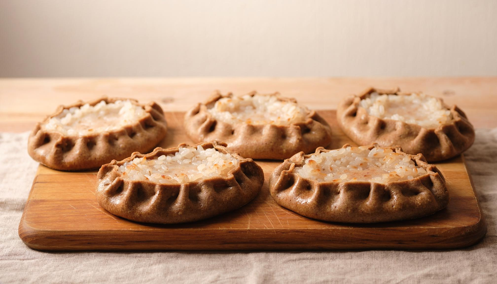
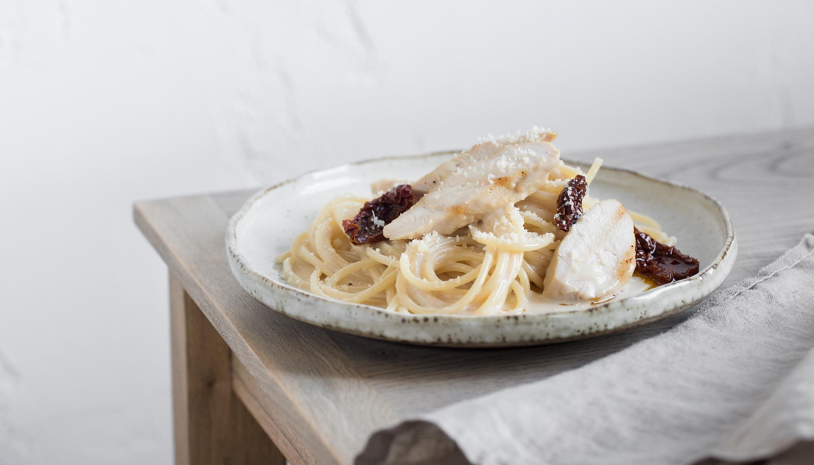
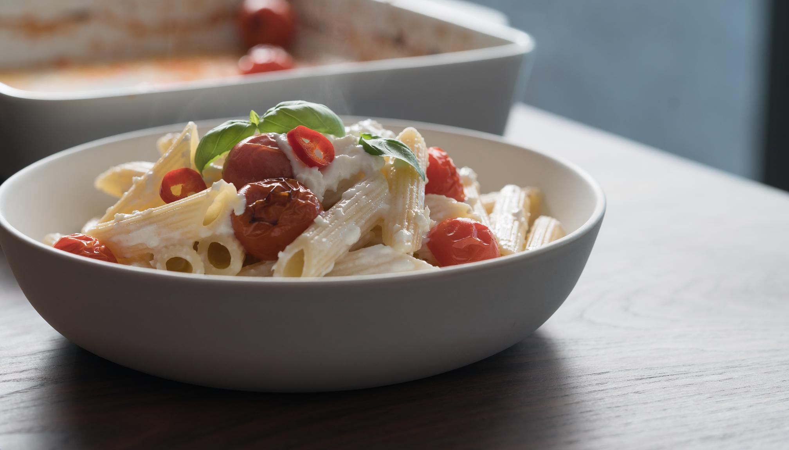
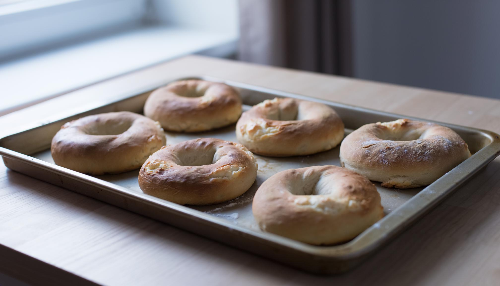
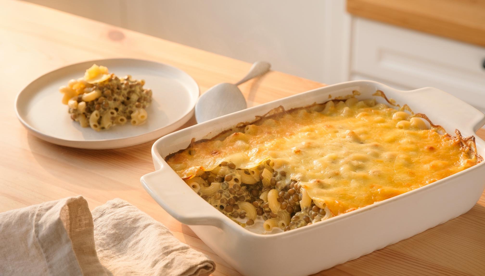

# Suomalaiset suosikit – viiden reseptikuvan katselmointigalleria

Päiväys 6.11.2026. PR #311, **DRAFT**. Kuvat ovat AI-generoituja ruokakuvia, eivät valokuvia tässä projektissa tehdystä koepaistosta. Tässä käytetään PR-haaraan talletettuja **JPEG-lähdekuvia** (2016 × 1152). Näistä lähteistä on nyt tehty viisi 1600 × 900 WebP-pääkuvaa, jotka sijaitsevat `kuvat/`-hakemistossa ja on kytketty vain Draft-resepteihin; yhtäkään ei ole julkaistu.

## 1. Karjalanpiirakat – punnittu perinneresepti

**Visuaalinen tarkistus:** viisi piirakkaa esittelykuvassa, vaalea riisitäyte ja rypytetty ruisreuna. Reseptin eräkoko on 24 kpl, mutta kuvan ei tarvitse näyttää koko erää. Ei perunaa eikä juustotäytettä. Perinne-/APT-nimi vaatii edelleen varsinaisen hyväksyntänsä.

## 2. Marry me -kanapasta – spagetti, ei penne

**Visuaalinen tarkistus:** pitkät spagettisäikeet, kypsää kanaa, tummaa aurinkokuivattua tomaattia ja vaalea kastike. Ei vaihdeta kuvaa penneen eikä tomaatteja kirsikkatomaatteihin.

## 3. Uunifetapasta – penne, feta ja kirsikkatomaatti

**Visuaalinen tarkistus:** lyhyet putkimaiset pennepastat, paahdettu kirsikkatomaatti, feta ja basilika. Kuvan yhteydessä alkuperäisen ruokailmiön kehittäjänä mainitaan Jenni Häyrinen; oma kuva ei tarkoita, että Recipavo olisi keksinyt uunifetapastan.

## 4. Raejuustobagelit – kuusi kappaletta

**Visuaalinen tarkistus:** korjatussa versiossa kuusi erillistä rengasta, kuten reseptissä. Alkuperäinen viiden renkaan AI-kuva hylättiin. Ei seesamia, muita siemeniä, täytteitä tai väitettä perinteisestä vedessä keitetystä bagelista.

## 5. Linssimakaronilaatikko – ei jauhelihaa

**Visuaalinen tarkistus:** makaronilaatikon rakenne ja lyhyet makaronit, linssit sekä sulanut emmental. Ei jauhelihaa tai tomaattikastiketta, joita resepti ei sisällä.

## Hyväksyntärajat ja WebP-jatko

- **Kuvat:** 5/5 JPEG lähdekuvaa GitHubissa. Vain alustava AI-avusteinen sisällöllinen tarkistus, ei vielä lopullinen omistajan kuvahyväksyntä.
- **WebP:** 5/5 pääkuvaa GitHubin `kuvat/leivonnaiset/` ja `kuvat/paaruoat/` -kansioissa, kooltaan 1600 × 900. Kaikki 20 Draft-kieliversiota osoittavat oikeaan WebP-kuvaan. Komento `node docs/review/convert-finnish-classics-webp.mjs` säilyy lähdekuvista tehtävän muunnoksen toistamiseen. Lopullinen kuvien omistajahyväksyntä ja julkaisu ovat avoimia.
- **SEO:** 1600 × 900 (16:9) sopii tulevaksi pääkuvaksi. Muut 4:3 ja 1:1 lähdekuvat ovat erillinen vasta suunniteltu vaihe; niitä ei ilmoiteta rakenteisessa datassa, ennen kuin oikeat tiedostot ja skeemat ovat käytössä.
- **Lähteet:** AI-generointi on ilmoitettava johdonmukaisesti sivuston kuvaperiaatteen mukaisesti. Kuvia ei saa esittää fyysisen valmistuskokeen dokumentaationa.
- **Julkaisu:** reseptit ja 15 käännöstä ovat `draft`, GK/makrot ratkaisematta. Tässä galleria ei avaa julkaisuporttia.

## Valmiit WebP-tiedostot PR-haarassa

- [Karjalanpiirakat](../../kuvat/leivonnaiset/karjalanpiirakat-riisipuurolla.webp)
- [Marry me -kanapasta](../../kuvat/paaruoat/marry-me-kanapasta.webp)
- [Uunifetapasta](../../kuvat/paaruoat/uunifetapasta-kirsikkatomaateilla.webp)
- [Raejuustobagelit](../../kuvat/leivonnaiset/raejuustobagelit-ilman-kohotusta.webp)
- [Linssimakaronilaatikko](../../kuvat/paaruoat/linssimakaronilaatikko.webp)

Jokainen kuva on AI-generoitu havainnekuva. Kuvat eivät korvaa reseptien fyysistä testausvelvoitetta eikä julkaisematon PR ole tuotantovarmistus.
